# Stage B1–B1.6 实验总结：Llama-3.1-8B Base 的空间关系表征、行为与跨 hop 迁移

整理日期：2026-09-01  
整理范围：**Stage B1、Stage B1.5、Stage B1.6**。

## 一、技术摘要

- 三个阶段均通过既定 Gate：**B1 PASS（38/38）**，**B1.5 PASS**，**B1.6 PASS（联合验证 15/15）**。
- B1 的核心结果是：显式一步关系 h1 的线性可解码性明显强于 h2–h5 派生关系。h1 在第 17 层达到 Macro-F1 0.3573；h2–h5 峰值仅为 0.1485–0.1702。
- h2–h5 没有呈现“hop 越大，表征越晚出现”的单调层深顺序；h3 的稳定阈值很早出现，h5 甚至在第 1 层达到峰值。因此不能把峰值层、L50 或 L90 解释为推理步骤发生的时间点。
- B1.5 的候选答案似然行为整体接近随机水平。主评分下，准确率由 h1 的 0.1517 单调下降至 h5 的 0.0915；只有 h1 的 95% 置信区间略高于 1/8 随机水平，h2 包含随机水平，h3–h5 未证明高于随机。
- B1.6 显示 h1 训练的线性解码器可以弱地迁移到 h2–h5，但派生任务本身的 within-hop 解码也很弱。结果最多支持“存在有限的共享线性可访问信号”，不支持“模型使用统一符号关系编码完成多步推理”。
- 结果对数据分布、未见模板以及候选词 token 长度敏感。尤其是 h1：平衡控制使峰值从 0.3573 降到 0.2163，未见模板测试使峰值降到 0.1794。

## 二、研究问题与三个阶段的分工

| 阶段 | 直接研究问题 | 主要输出 |
|---|---|---|
| B1 | 各层是否线性编码显式 h1 与派生 h2–h5 空间关系？编码强度和层深是否随 hop 有规律变化？ | 32 层 × 5 hop 的独立多项逻辑回归探针；平衡、Target-Absent、Composition-held-out、Template Test-only、随机标签和收敛控制 |
| B1.5 | 冻结 Base 模型在不生成自由文本时，能否用八个候选关系的条件似然选出正确答案？ | 候选 token 审计；sum/mean-token 两种评分；Primary 与 Balanced 行为结果；bootstrap 区间 |
| B1.6 | h1 学到的线性关系方向能否迁移到 h2–h5？派生关系编码能否反向迁移到 h1？ | h1→h2–h5、derived-pooled→h1、Balanced transfer、随机标签和收敛复核 |

## 三、方法与文献来源

### 3.1 直接文献基础

1. **线性探针方法**：Alain 与 Bengio（2016）提出在冻结网络的中间层上独立训练线性分类器，用于刻画各层特征的线性可分性。本文 B1/B1.6 的逐层独立探针遵循这一基本思想。来源：[Understanding intermediate layers using linear classifier probes](https://arxiv.org/abs/1610.01644)。
2. **空间表征逐层探测范式**：Gurnee 与 Tegmark（ICLR 2024）在冻结语言模型的逐层激活上训练独立线性探针，并强调可解码性与模型实际使用该表征不是同一命题。本项目先在 Stage A 复现该范式，再将连续坐标 Ridge 回归改为 StepGame 八分类逻辑回归。来源：[Language Models Represent Space and Time](https://proceedings.iclr.cc/paper_files/paper/2024/hash/0a6059857ae5c82ea9726ee9282a7145-Abstract-Conference.html)。
3. **多跳空间推理数据集**：Shi、Zhang 与 Lipani（AAAI 2022）提出 StepGame，用文本空间关系链测试多步空间推理。来源：[StepGame: A New Benchmark for Robust Multi-Hop Spatial Reasoning in Texts](https://ojs.aaai.org/index.php/AAAI/article/view/21383)，DOI: 10.1609/aaai.v36i10.21383。
4. **StepGame 模板错误与修订依据**：Li、Hogg 与 Cohn（2024）指出 StepGame 模板错误会影响评估，并给出修订与逻辑推理分析。本项目没有直接采用其全部实验，而是独立审计官方模板并排除不可辩护模板；该文为“为何必须审计模板语义”的外部依据。来源：[Advancing Spatial Reasoning in Large Language Models](https://arxiv.org/abs/2401.03991)。

### 3.2 本项目对文献方法的扩展

- 将连续经纬度 Ridge 回归改为八类空间关系的多项逻辑回归。
- 用独立计算的图最短路径 `computed_hop` 取代 StepGame 文件名中的 K；数据审计表明二者只有 17.47% 一致。
- 新增严格平衡、目标关系未显式出现、组合签名留出、模板测试留出、随机标签和求解器收敛控制。
- 新增 B1.5 候选答案条件似然行为评估，以及 B1.6 跨 hop 线性迁移。现有产物未声称这两项完全复现某篇论文，应表述为本项目的预注册式扩展。

## 四、数据集与冻结划分

### 4.1 StepGame 原始数据审计

- 官方仓库：`ShiZhengyan/StepGame`，冻结 commit `5e6aff1563a6d7f46ee1f1aeff98b94e68c29005`。
- 使用 `Dataset/CompleteVersion/clean`。实际文件为每个 K：10,000 train、1,000 valid、10,000 test；K=1–10 合计 **210,000** 条，而不是旧 README 文本可能暗示的 610,000 条。
- 在 210,000 条中，190,237 条为 `FULL_OK`，10,574 条为 `PATH_ONLY`，9,189 条为 `FAILED`。
- 仅 36,693/210,000（17.47%）满足文件 K 等于实际查询最短路径。实验因此把故事固定为 5 句话，用语义图 BFS 得到的 `computed_hop=1…5` 作为 hop。
- 主实验仅保留八个非 OVERLAP 类：ABOVE、BELOW、LEFT、RIGHT、UPPER_LEFT、UPPER_RIGHT、LOWER_LEFT、LOWER_RIGHT；OVERLAP 不作为 Primary 类别。
- 所有划分至少按 `story_group_id` 分组，避免同一故事、逆向问题或重复变体跨 train/validation/test 泄漏。

### 4.2 B1 使用的五类冻结数据

| 数据条件 | 目的 | 规模与划分 |
|---|---|---|
| Primary | 保留自然 hop/类别分布的主分析 | 13,758 条；train/val/test = 9,630/2,065/2,063；按 hop 的 test n = 712/505/422/282/142 |
| Balanced | 去除每个 hop×关系单元的样本量差异 | 每个关系×hop 共 56 条，train/val/test = 34/11/11；总计 2,240；每 hop test=88 |
| Target-Absent | 检查派生标签是否可由故事中直接出现的目标关系句泄漏 | h2–h5 共 4,023；train/val/test = 2,816/603/604 |
| Composition-held-out | 测试未见无序关系组合签名 | 932 个签名；train/val/test = 5,901/1,501/1,600；签名跨划分重叠为 0 |
| Template Test-only | 测试含至少一个未在开发集出现的保留中层模板组的路径 | train/val/test = 10,217/1,802/1,739；test 覆盖 40/40 hop×关系单元，最小单元 14；保留模板和故事泄漏均为 0 |

注意：Primary 的部分 validation/test 单元小于 20，Target-Absent test 最小单元仅 4。Balanced 每 hop test 只有 88 条，区间较宽。这些限制已纳入不确定性解释。

## 五、模型、提示与激活定义

### 5.1 模型与硬件

- 模型：Meta-Llama-3.1-8B Base；无 SFT、DPO、RLVR、Tulu、微调、steering、patching 或 ablation。
- 模型 commit：`24ce1d3ac24d46a14b16dcb666c4fdd9147b87ea`；tokenizer commit：`c52792af35fe806a76530f3028f037d1af4e3490`。
- 8,030,261,248 参数；32 个 decoder block；hidden size 4,096；权重以 BF16 加载。
- GPU：NVIDIA GeForce RTX 3090，23.68 GiB。
- 随机种子：B1 为 20260824；B1.5–B1.6 为 20260825；数据划分为 20260823。

### 5.2 冻结提示

```text
Story:
<每个原始故事句子独占一行>

Question:
<原始问题>
```

- 不添加答案、chat template、instruction wrapper、few-shot、CoT 或 demonstration。
- `add_special_tokens=False`；显式添加 BOS；EOS 作为 pad；右侧 padding。
- readout 位置是问题中最后一个非特殊 token。120 条审计样本全部落在终止问号 `?`。
- 联合集 13,758 条序列长度 49–115，无截断。

### 5.3 激活定义与完整性

- 每个 decoder block 保存 readout token 处、final RMSNorm 之前的原始 block 输出。
- 共 32 个矩阵，每个 `[13,758, 4,096]`，保存为 float16；另存精确对齐的 row IDs；合计约 3.36 GiB。
- NaN/Inf = 0/0；行顺序精确且唯一。
- 同批次 10 样本×5 层重前向与保存值比对：minimum cosine 1.0000006、mean MAE 0、maximum absolute error 0。
- batch-size-1 的非 Gate 诊断 minimum cosine 为 0.999355，归因于 BF16 随 batch shape 的数值敏感性。

## 六、完整实验步骤

### 6.1 Stage B1：逐层关系线性探针

1. 验证五类冻结 manifest 的 SHA-256、row IDs、故事分组和协议文件未改变。
2. 用冻结提示对 13,758 条联合样本分词；检查答案不在 prompt、readout 位于问题末尾且无截断。
3. 以 batch size 32 对冻结 Base 模型前向，hook 32 个 decoder block 的原始输出，取问题末 token 向量并保存为 float16。
4. 对激活执行形状、有限值、行对齐、hidden-state 索引和重前向一致性验证。
5. 对每个 layer×hop 独立训练八分类 multinomial logistic regression：
   - 只在 train 上拟合 `StandardScaler`；
   - `solver=lbfgs`，`max_iter=400`，`tol=1e-4`；
   - C 网格：1e-4、1e-3、1e-2、1e-1、1、10、100、1000、10000；
   - 只用 validation Macro-F1 选 C；精确并列时取更小 C；完成选择后才访问 test；
   - Primary、Composition、Template 使用 `class_weight=balanced`；已严格平衡的数据不再加权。
6. 在 Primary 上计算各 hop 的逐层 test Accuracy/Macro-F1、峰值层、L50/L90，并以 `story_group_id` 为单位做 1,000 次 bootstrap 得到峰值 95% CI。
7. 运行 Balanced、Target-Absent（复用 Primary probe，不重训）、Composition-held-out 和 Template Test-only 控制。
8. 运行多数类基线和随机标签控制；随机标签检查层为 0、7、15、23、31，hop 为 1、3、5。
9. 对 41 个出现收敛警告的正常标签拟合在冻结 C 下以 `max_iter=2000` 重拟合，检查数值敏感性。
10. 独立 validator 执行 38 项 fail-closed 检查并生成最终 Gate。

### 6.2 Stage B1.5：候选答案条件似然行为基线

1. 复用 B1 的模型、提示、Primary/Balanced test 和 row identity；重新验证输入 checksum。
2. 冻结八个候选 continuation，均以前导 ASCII 空格开始：` above`、` below`、` left`、` right`、` upper-left`、` upper-right`、` lower-left`、` lower-right`。
3. 做 5 hop×8 relation 共 40 条候选 token 审计，确认答案未泄漏、每样本 8 个候选、条件位置正确、EOS/pad 不进入候选、所有分数有限。
4. 对每个候选计算 `Σ_j log P(token_j | prompt, token_<j)`；选择总 log-probability 最大的候选作为主预测。
5. 由于 cardinal 候选为 1 token、diagonal 候选为 2 token，同时报告每 token 平均 log-probability 的固定敏感性结果；不得事后替换主指标。
6. 在 Primary 与 Balanced test 上计算 Accuracy、Macro-F1、多数类基线，并按 `story_group_id` 做 1,000 次 bootstrap 95% CI。
7. 将行为结果与 B1 各 hop 的峰值探针结果并列；五个 hop 的 Spearman 相关仅作描述，不作机制推断。

### 6.3 Stage B1.6：跨 hop 迁移探针

1. 复用 B1 的 32 层激活，不重新提取。
2. 对每层只用 Primary h1 train 拟合 scaler 和八分类 decoder；C 只用 h1 validation Macro-F1 选择。
3. 选定模型后，在 h1–h5 test 上评估，得到 h1→derived 的逐层迁移曲线。
4. 将迁移曲线与各 hop independently trained within-hop 曲线对齐，定义 gap=`within-hop F1 − h1-transfer F1`，计算峰值、within-peak 处迁移、retention、全层平均 gap 和 late layer 16–31 平均 gap。
5. 将 h2–h5 train 合并，训练 derived-pooled decoder 并评估到 h1–h5，检查迁移方向是否对称。
6. 在 Balanced 数据上重复 h1 transfer，作为样本量/类别分布控制。
7. 在层 0、7、15、17、23、31 上执行随机标签迁移控制。
8. 对 33 个达到 `max_iter=400` 的拟合，在冻结 C 下以 2,000 次迭代重拟合；仍告警的 6 个任务再升至 5,000 次，最终全部收敛。
9. 联合 validator 执行 15 项检查，并对六张图做视觉 QA。

## 七、实验结果

### 7.1 B1 Primary：显式 h1 明显更强，派生 hop 弱且无单调层深顺序

| Hop | 类型 | 峰值层 | 峰值 Macro-F1 | 95% story-group CI | 多数类 F1 | L50 | L90 |
|---:|---|---:|---:|---|---:|---:|---|
| 1 | Explicit | 17 | 0.3573 | [0.3234, 0.3904] | 0.0305 | 2 | 14 |
| 2 | Derived | 19 | 0.1670 | [0.1357, 0.1981] | 0.0297 | 0 | 15 |
| 3 | Derived | 31 | 0.1702 | [0.1311, 0.2055] | 0.0334 | 0 | 1 |
| 4 | Derived | 30 | 0.1563 | [0.1159, 0.1988] | 0.0344 | 0 | 未达到 |
| 5 | Derived | 1 | 0.1485 | [0.0847, 0.2118] | 0.0399 | 0 | 未达到 |

**图1解读。** h1 从 L0 的 Macro-F1 0.1625 上升，在中后层形成约 0.30–0.36 的宽平台，并于 L17 达到 0.3573。相比之下，h2–h5 的整条曲线大多交错在约 0.10–0.17，四个派生 hop 的峰值也仅为 0.1485–0.1702。图中最稳定的差异是“显式 h1 强于派生 h2–h5”，而不是派生 hop 之间存在清楚的层级顺序。尤其是 h5 在 L1 达到自身峰值、h3 在 L31 达峰，直接说明峰值层不会随 hop 单调向后移动。该图证明的是问题末隐藏状态的线性可解码性，不代表模型在相应层执行了可定位的推理步骤。

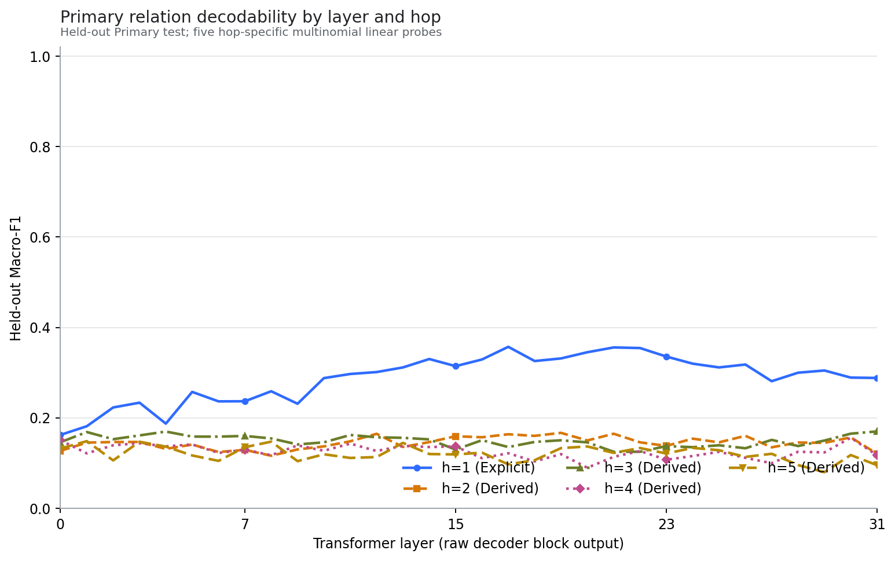

**图2解读。** 热力图把图1的同一组数值改为 layer×hop 矩阵。h1 行在中后层持续更深，形成明显的水平高值带；h2–h5 各行整体较浅，而且没有从左上向右下推进的对角高值带。如果“hop 越多、信息越晚出现”成立，应能看到高值区域随 h2→h5 系统性右移，但实际并未出现。需要注意，色标统一设为 0–1，因此 0.10–0.20 区间的细小差异在视觉上被压缩；热力图适合判断整体结构，精确峰值仍应以表格和曲线为准。

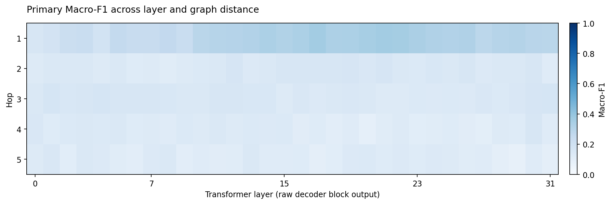

### 7.2 B1 控制实验

| 控制 | 关键结果 | 解释 |
|---|---|---|
| Balanced | h1 峰值 0.2163@L21，比 Primary 低 0.1409；h2–h5 峰值 0.1719–0.2139 | Primary h1 强度部分受样本量/类别分布影响；但平衡后仍没有派生 hop 的单调层深顺序 |
| Target-Absent | 在 Primary 峰值层，h2/h3/h4/h5 的 Target−All 分别为 +0.0235/−0.0342/−0.0318/+0.0372 | 差值方向不一致，不支持派生解码主要来自故事中直接出现目标关系句 |
| Composition-held-out | h2–h5 峰值为 0.1453/0.1818/0.1787/0.1565；相对 Primary 差异 −0.0216/+0.0116/+0.0224/+0.0079 | 没有一致的未见组合惩罚；但比较基于不同冻结测试集和各自峰值，只能描述，不能当作配对因果效应 |
| Template Test-only | h1 由 0.3573 降至 0.1794；h2–h5 差异小且正负混合 | 强 h1 读出对表面模板明显敏感；不能据此声称弱派生信号具有模板不变性 |
| Random label | 平均 Accuracy 0.1285，接近 chance 0.125；Macro-F1 0.1247；比匹配正常标签低 0.0543 | 支持探针结果不是完全由分类器容量或流程伪影造成 |
| 收敛复核 | 41 个正常标签重拟合全部收敛；平均绝对 F1 变化 0.000972，最大 0.011602 | 主要结论不由 `max_iter=400` 的告警驱动 |

**图3解读。** Balanced control 将每个 relation×hop 单元严格固定为 56 条，train/validation/test 分别为 34/11/11，并取消额外类别加权。平衡后，h1 峰值由 Primary 的 0.3573 降至 0.2163，下降 0.1409，原先中后层约 0.30–0.36 的宽平台基本消失；各 hop 曲线收拢到约 0.10–0.21。h2–h5 的峰值反而分别比 Primary 高 0.0318、0.0226、0.0156、0.0653，但峰值层分散，曲线仍无单调顺序。这说明 Primary 中 h1 的绝对优势部分来自样本量或类别分布，但“派生 hop 不呈单调层深规律”的结论对平衡处理保持稳定。由于 Balanced test 每 hop 只有 88 条，局部波动不宜过度解释。

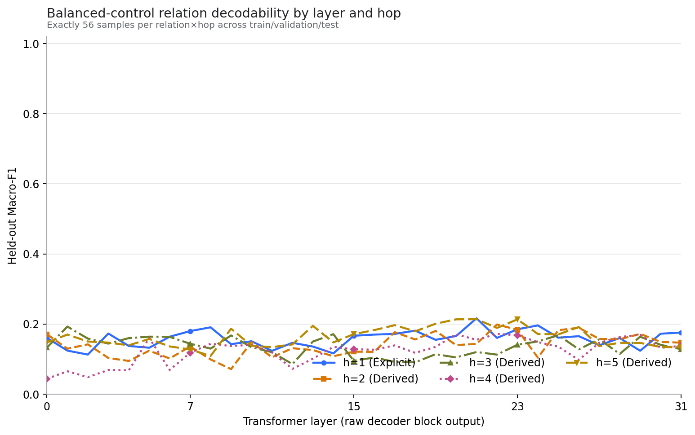

**图4解读。** Target-Absent 不重新训练探针，而是把 Primary 探针直接用于故事中没有显式目标关系句的 h2–h5 子集。以各 hop 的 Primary 峰值层比较，Target-Absent 相对 Derived-All 的差值依次为 h2 +0.0235、h3 −0.0342、h4 −0.0318、h5 +0.0372：两个上升、两个下降，方向不一致，幅度也均较小。若 Primary 派生解码主要依赖故事里直接出现目标标签对应的关系句，移除这类样本后应在所有 hop 上出现一致的大幅下降；图中没有这种模式。因此该控制削弱了“直接目标关系泄漏”解释，但 h4/h5 子集较小，尤其 Target-Absent test 的最小单元仅 4，不能把局部起伏视为稳健增益或损失。

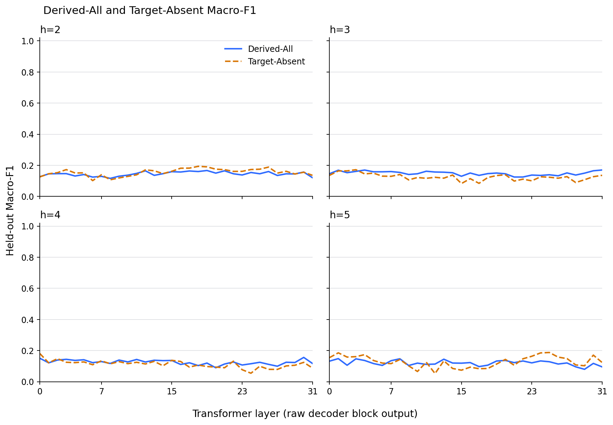

**图5解读。** Composition-held-out 按无序关系组合签名划分，使测试组合不在训练和验证中出现。h2–h5 的峰值分别为 0.1453、0.1818、0.1787、0.1565；相对 Primary 各自峰值的差异为 −0.0216、+0.0116、+0.0224、+0.0079。只有 h2 略降，h3–h5 略升，没有统一的组合泛化惩罚；同时各 hop 的峰值层分散在 L12、L3、L3、L28，也不构成共同层区间。由于 Composition-held-out 和 Primary 是不同冻结测试集，且这里比较的是各自从 32 层中选出的峰值，这些差异只能用于描述稳健性，不能解释为“未见组合导致”或“未见组合提升”的因果效应。

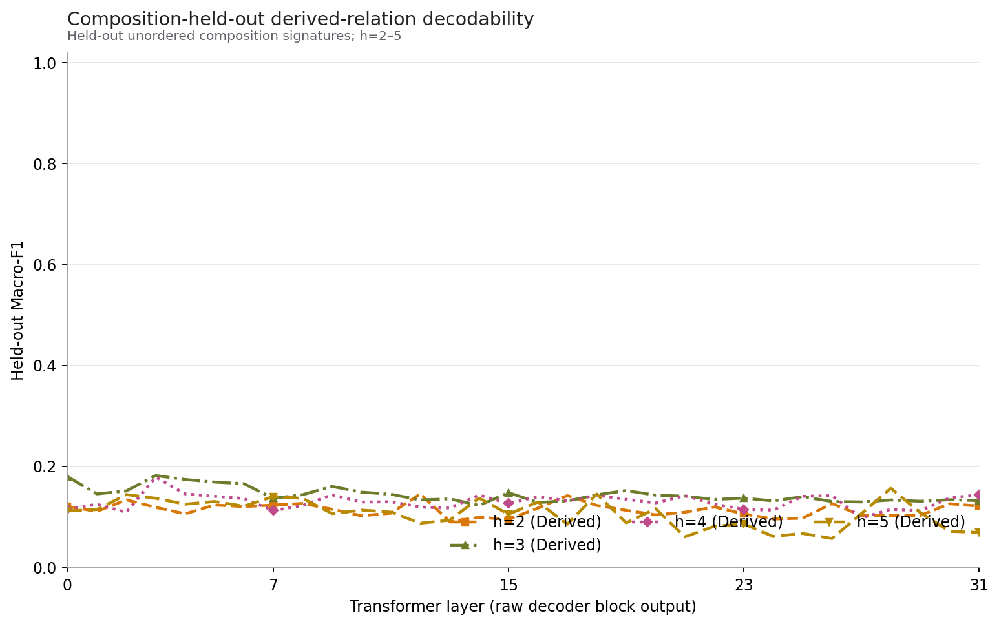

**图6解读。** Template Test-only 的测试故事包含至少一个训练/验证阶段未见的保留中层模板组。h1 仍在 L17 达峰，但峰值由 0.3573 降至 0.1794，绝对下降 0.1779，约相当于 Primary 峰值的一半；图中也不再出现 Primary 的中后层高平台。h2–h5 的峰值变化较小且正负混合，分别为 −0.0156、+0.0022、−0.0202、+0.0231。最清楚的结论是强 h1 线性读出显著依赖已见表面表达方式。不能据此说派生表示更具模板不变性，因为它们在 Primary 中本来就只有约 0.15–0.17 的弱信号，存在明显的地板效应。

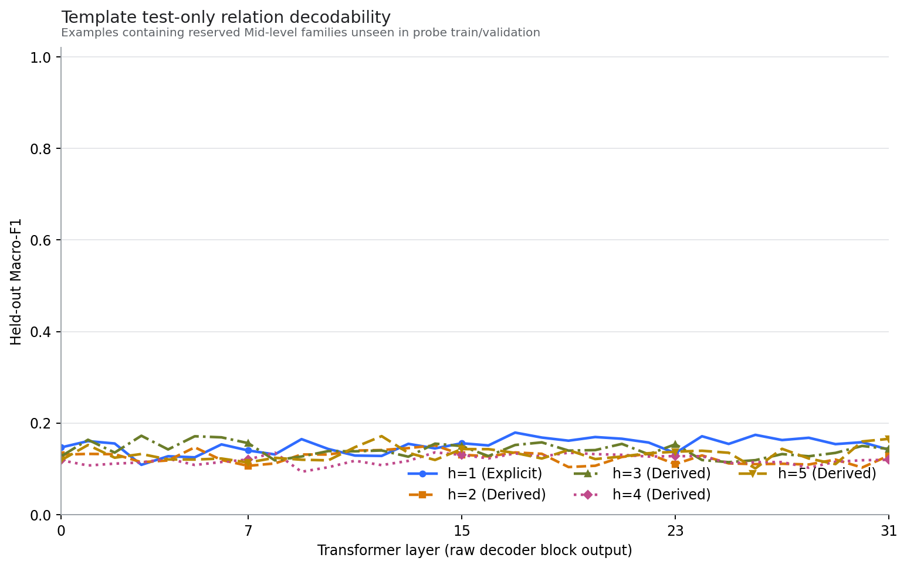

### 7.3 B1.5 行为基线

主指标为候选 token 条件 log-probability 之和。

| Hop | n | Accuracy（95% CI） | Macro-F1 | 多数类 Accuracy | 与 chance=0.125 的关系 |
|---:|---:|---:|---:|---:|---|
| h1 | 712 | 0.1517 [0.1292, 0.1784] | 0.0599 | 0.1390 | CI 略高于 chance |
| h2 | 505 | 0.1465 [0.1188, 0.1762] | 0.0637 | 0.1347 | CI 包含 chance |
| h3 | 422 | 0.1090 [0.0782, 0.1398] | 0.0452 | 0.1540 | 未证明高于 chance |
| h4 | 282 | 0.1064 [0.0709, 0.1454] | 0.0468 | 0.1596 | 未证明高于 chance |
| h5 | 142 | 0.0915 [0.0493, 0.1408] | 0.0410 | 0.1901 | 未证明高于 chance |

Balanced 结果为 h1–h5 Accuracy 0.1932、0.1477、0.1250、0.1023、0.1591；每 hop 仅 88 条，区间宽且不呈单调趋势。

候选长度敏感性很明显：使用每 token 平均 log-probability 后，h1–h5 Accuracy 变为 0.1728、0.1426、0.1635、0.1312、0.1620；h3 和 h5 的估计明显上升。这说明 summed score 对两 token 的对角关系候选有结构性不利，未来模型比较必须同时固定并报告 sum 与 mean-token 两种规则。

**图7解读。** 虚线是八分类随机水平 0.125。Primary 的候选似然准确率从 h1 的 0.1517 依次下降到 h2 0.1465、h3 0.1090、h4 0.1064 和 h5 0.0915，点估计呈单调非增；但置信区间显示只有 h1 的 95% CI [0.1292, 0.1784] 略高于随机线，h2 的区间包含随机线，h3–h5 也未建立高于随机的能力。Balanced 每 hop 只有 88 条，误差条明显更宽，且 h5 回升到 0.1591，因此不支持稳定的 hop 单调关系。综合来看，Base 在主 summed log-probability 评分下缺少稳健的派生多跳行为能力，Primary 的单调下降更适合作为描述性趋势，而非精确能力曲线。

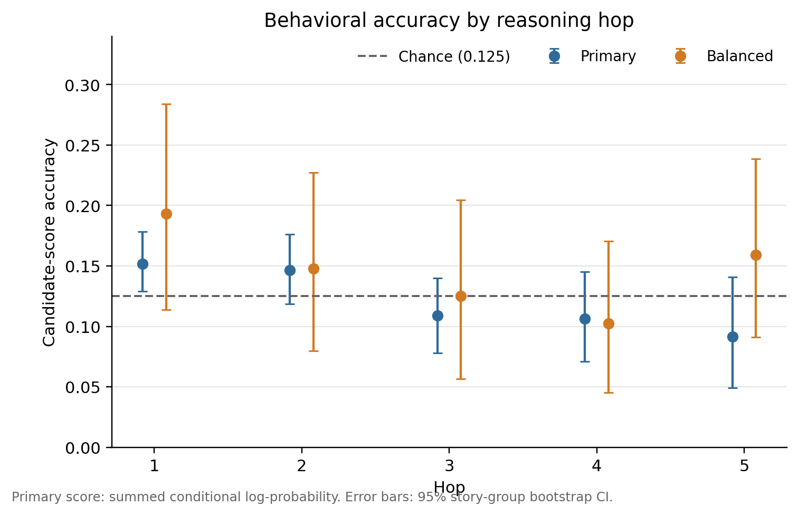

**图8解读。** 上面板是模型自身的候选答案行为，下面板是外部监督线性探针的峰值 Macro-F1，两者使用独立纵轴以避免量纲混淆。h1 的 probe F1 达 0.3573，但行为准确率仅 0.1517，刚高于随机；h2–h5 的 probe 峰值约 0.15–0.17，行为准确率则为 0.0915–0.1465。五个 hop 上，行为准确率与 probe 峰值的 Spearman ρ=0.90，但样本只有 5 个 hop，且行为 Macro-F1 与 probe 峰值的 ρ 仅 0.50，因此相关只能作描述。图的关键含义是“可被外部线性分类器读出”与“冻结模型能据此选对答案”并不等价：隐藏状态含有标签相关信息，不代表模型的输出头实际使用了它。

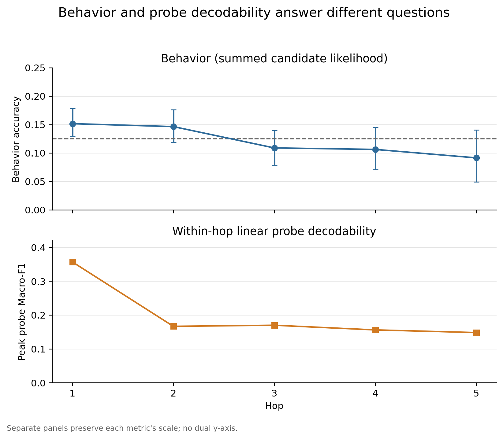

### 7.4 B1.6 h1→derived 跨 hop 迁移

| 目标 hop | h1-transfer 峰值 | within-hop 峰值 | within 峰值层上的 transfer | gap | retention | late L16–31 平均 gap |
|---:|---|---|---:|---:|---:|---:|
| h2 | 0.1676@L14 | 0.1670@L19 | 0.1359 | 0.0311 | 0.8140 | 0.0253 |
| h3 | 0.1795@L2 | 0.1702@L31 | 0.1370 | 0.0331 | 0.8053 | 0.0092 |
| h4 | 0.1887@L5 | 0.1563@L30 | 0.1354 | 0.0209 | 0.8661 | −0.0272 |
| h5 | 0.2187@L10 | 0.1485@L1 | 0.1656 | −0.0170 | 1.1147 | −0.0098 |

gap 定义为 within-hop F1 减 h1-transfer F1。h2/h3 在 within 峰值层有小幅正 gap，h4/h5 常出现零或负 gap。由于两种绝对 F1 都较弱，加上在 32 层中取峰值会产生乐观偏差，这些相近数值不能证明存在统一符号编码。

反向的 derived-pooled→h1 峰值只有 0.2047@L16，远低于 h1 within-hop 的 0.3573@L17，说明迁移方向并不对称；但训练样本量和源分布也不同，因此不是严格的数学对称性检验。

Balanced transfer 的 h1–h5 峰值为 0.2163、0.1823、0.2298、0.2146、0.2388，方差大且没有稳定 h1 优势，只能支持“迁移弱、噪声大、依赖层”的定性判断。

随机标签迁移平均 Accuracy 0.1240、Macro-F1 0.1215；匹配正常标签为 0.1704、0.1653。2,000/5,000 次迭代复核最终全部收敛，最大变化不足以改变总体解释。

**图9解读。** 每一层的 scaler 和 decoder 都只用 Primary h1 train 拟合，C 也只由 h1 validation 选择，然后统一测试 h1–h5。Test h1 曲线复现 B1 的中后层高平台并在 L17 达到约 0.357，说明迁移流程正确保留了源任务性能；h2–h5 曲线则主要在约 0.10–0.18 波动，各自最高点为 h2 0.1676@L14、h3 0.1795@L2、h4 0.1887@L5、h5 0.2187@L10。h5 的最高点看似高于其他派生 hop，但它来自 32 层取最大值、测试样本仅 142 条，并且没有形成宽而稳定的平台，不能解释为 h5 更容易迁移。更稳妥的结论是 h1 decoder 对派生样本存在弱但非零的迁移，而迁移强度高度依赖层和测试分布。

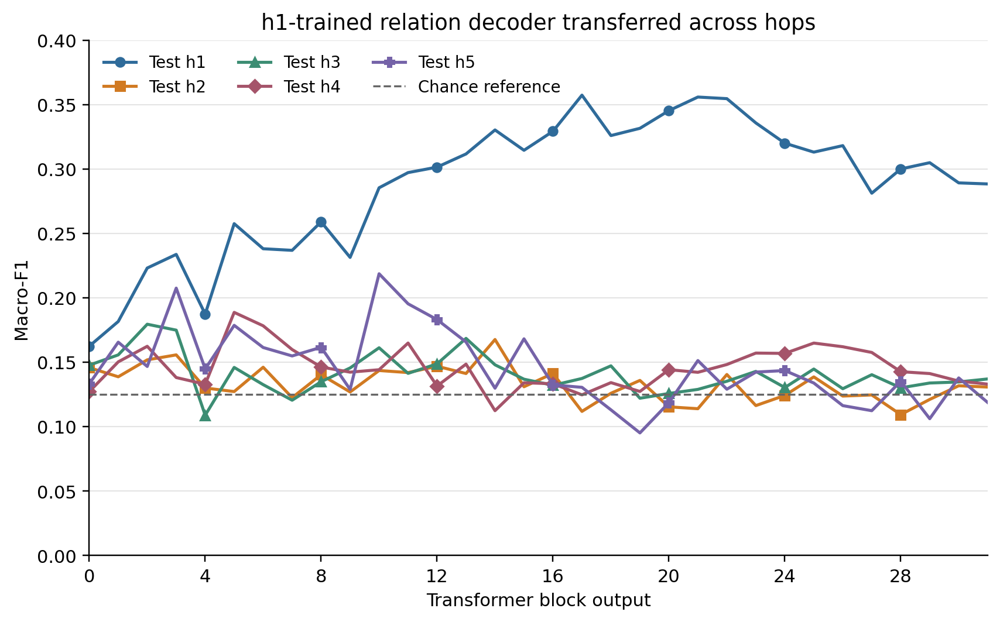

**图10解读。** 橙色实线是每个目标 hop 独立训练的 within-hop probe，蓝色虚线是只在 h1 上训练的 transfer probe，灰色点线为约 0.125 的参考水平。h2/h3 在若干中后层由 within-hop 略高，例如各自 within 峰值层的 gap 为 0.0311 和 0.0331；h4/h5 的蓝线在许多层反而高于橙线，h5 在 within 峰值层的 gap 为 −0.0170。若每个派生 hop 都形成了强而独特的线性编码，within-hop 曲线应稳定、大幅高于 h1-transfer；实际没有出现。另一方面，两条曲线多数只比参考线高出很小幅度，因此“接近”也可能来自共享表面统计或弱噪声信号，不能直接等同于共享语义或符号子空间。

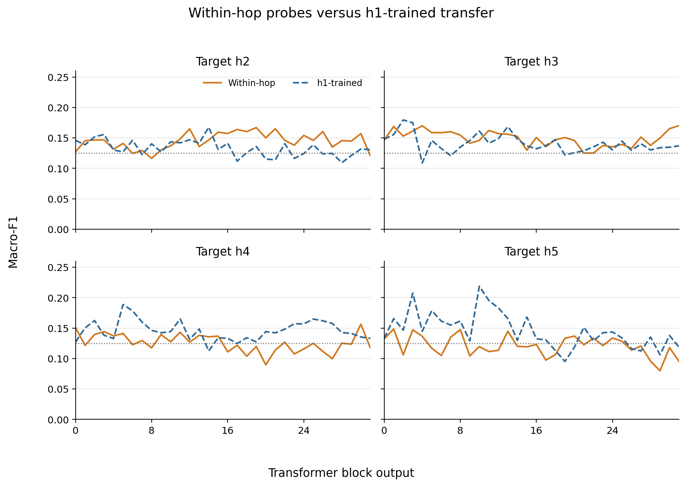

**图11解读。** 热力图定义 gap=`within-hop Macro-F1 − h1-transfer Macro-F1`：暖色表示独立训练更强，冷色表示 h1 迁移更强。h2/h3 在部分中后层呈浅暖色，但没有贯穿连续层区间；h4/h5 出现较多冷色，尤其 h5 在早中层有若干负 gap。若存在一个稳定的“先编码显式关系、再以同一码支持多跳推理”的层区间，四个目标 hop 应在相近层呈现方向一致、连续的 gap 结构；实际正负颜色随 hop 与层交错。该图因此支持“共享程度有限且层依赖”，不支持单一迁移窗口。色差表示的是两条弱 F1 曲线之差，不能脱离其约 0.10–0.20 的绝对水平单独解读。

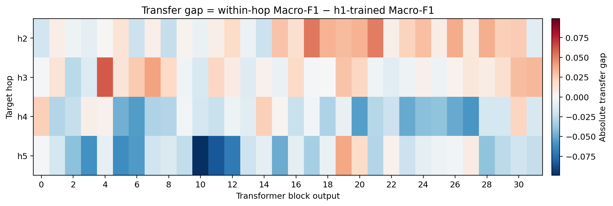

**图12解读。** Balanced transfer 在每个 relation×hop 采用相同样本量，减少 Primary 分布差异，但每 hop test 仅 88 条，因此逐层曲线波动明显增大。各目标 hop 的峰值为 h1 0.2163、h2 0.1823、h3 0.2298、h4 0.2146、h5 0.2388；h3 和 h5 的峰值甚至高于 h1，且高点分布在不同层。该结果没有复现 Primary 中 h1 明显占优的结构，说明跨 hop 峰值排序对样本规模和分布敏感。它不证明派生迁移优于显式任务，因为高峰可能来自小样本方差和 32 层峰值选择；合理用途是把 B1.6 的结论限定为“迁移弱、噪声大、层依赖”，而不是依据某个峰值建立表示层级。

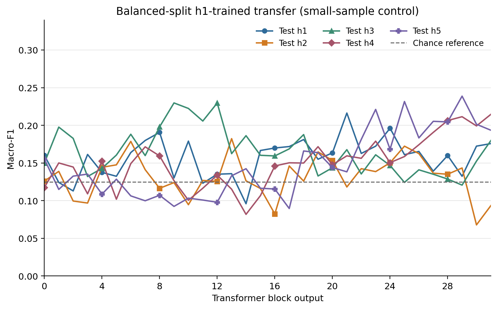

## 八、综合结果分析

### 8.1 最稳健的发现是“显式强、派生弱”

B1 的 h1 峰值约为派生 hop 峰值的 2.1–2.4 倍，且 h1 在中后层形成宽平台。该优势在平衡和未见模板条件下显著减弱，但没有完全消失。因此模型在问题末状态中确实含有更容易线性读取的显式关系信息，但这一读出部分依赖训练数据分布与语言模板。

### 8.2 数据不支持“hop 越多，关系信息越晚出现”

h3 在 L1 达到稳定 L90，h5 在 L1 达到峰值，而 h2、h3、h4 的峰值又分别落在 L19、L31、L30。这个顺序与 hop 大小不单调。最合理的结论是没有观察到简单的 hop-to-depth 时间线，而不是模型在某些层按步骤执行了可定位的符号推理。

### 8.3 可解码不等于可使用，行为结果对这一点构成关键约束

h1 probe 可达 0.3573，但模型候选行为 Accuracy 只有 0.1517；h2–h5 probe 虽高于多数类 Macro-F1，却没有对应的稳健行为能力。线性探针使用监督标签训练外部分类器，只证明隐藏状态含可被线性利用的统计信息，不能证明模型自身用该信息生成答案。

### 8.4 跨 hop 迁移更像有限共享统计结构，而非统一符号代码

h1 decoder 在派生 hop 上可以达到与弱 within-hop probe 相近的 Macro-F1；但当比较对象本身接近弱信号区时，“相近”并不能区分共享语义表示、表面分布线索或噪声相关性。反向迁移不对称、Balanced 曲线高方差、层间 gap 正负交错，都不支持稳定的统一代码叙事。

### 8.5 主要替代解释已被部分排除，但尚未全部排除

- 随机标签近 chance，排除了探针在当前规模下完全记忆标签的简单解释。
- Target-Absent 没有统一崩溃，削弱了“直接目标关系句泄漏”的解释。
- Composition-held-out 没有一致惩罚，但低绝对分数和不同测试集限制了结论强度。
- 未见模板使 h1 大幅下降，说明表面形式仍是重要混杂因素。
- 只在问题末 token 观察激活，无法排除关系信号在实体 token、中间 token 或非线性子空间更强。

## 九、可支持与不可支持的结论

### 可支持

1. 在冻结 Llama-3.1-8B Base 的问题末状态中，显式 h1 关系比 h2–h5 派生关系更容易被线性分类器读出。
2. h2–h5 没有单调的 hop-to-depth 层序。
3. h1 读出对样本分布和平面模板有明显敏感性。
4. Base 在主候选似然规则下没有表现出稳健的多跳 StepGame 行为能力。
5. 显式与派生样本之间可能存在有限共享的线性可访问信号，但证据较弱。

### 不可支持

1. 不能把某一层命名为“符号推理层”“grounding 层”或因果计算层。
2. 不能由线性可解码性推断模型实际使用该关系表征。
3. 不能把峰值层、L50、L90 当作推理操作发生的时刻。
4. 不能声称 h1 与 h2–h5 使用统一符号关系代码。
5. 不能把 Base 结果外推到 Tulu、SFT、DPO 或 RLVR；这些 checkpoint 在 B1–B1.6 中均未运行。

## 十、信息完整性、现有限制与需补充项

### 已有且足以复核主要结论

- 两份正式技术报告、12 张结果图、关键 CSV/JSON 汇总、分析/验证脚本和 Gate 文件。
- B1 主峰值、B1.5 行为结果和 B1.6 迁移结果均已从本地 CSV/JSON 与报告交叉核对。
- 模型与 tokenizer commit、数据 commit、随机种子、提示、readout、激活定义、C 网格、缩放/选参规则、bootstrap 和收敛复核均已记录。

### 当前工作区缺失或未明确

1. **服务器大文件**：3.36 GiB 的 32 层 activation tensors、完整 321 文件的 B1 服务器目录、原始模型权重/cache 没有复制到本地；现有报告只保留 shape、dtype、checksum、重前向和 row-order 审计。
2. **完整运行环境锁定信息**：当前本地主报告未给出 B1/B1.5/B1.6 的完整 Python、PyTorch、Transformers、scikit-learn、CUDA/cuDNN 版本组合。脚本会记录其中部分版本，但对应完整服务器 JSON 未在当前精简副本中。
3. **原始 StepGame 数据文件**：本地有数据审计和划分报告，但没有完整 210,000 条原始数据及 13,758 条 union manifest；若需逐行复算，需要从冻结官方 commit 或服务器产物恢复。
4. **实验耗时/能耗**：部分审计记录运行秒数和 GPU 峰值，但没有统一的总训练/提取耗时、GPU-hour 或能耗记录。

上述缺失不影响复述已验证的阶段结论，但会影响第三方从零完全复现。

## 十一、建议的后续实验

1. 在加载任何后训练模型前，先冻结 Base–Tulu 配对比较计划：同一 row IDs、提示、readout、候选字符串、sum/mean-token 两种评分、C 网格和 bootstrap 重采样单位。
2. 分开报告三类结局：行为准确率、within-hop 可解码性、cross-hop transfer；不把其中一个当作另一个的替代指标。
3. 在实体 token、路径中间 token 和问题末 token 多位置采样，以检验“问题末状态观察不到”这一替代解释。
4. 增加不依赖 32 层取最大值的汇总，如预注册代表层、层区间平均或校正后的多重比较。
5. 若要讨论统一关系子空间，应加入跨模板、跨组合、跨模型的方向相似度/子空间对齐和受控因果干预，而不仅是读出迁移。

