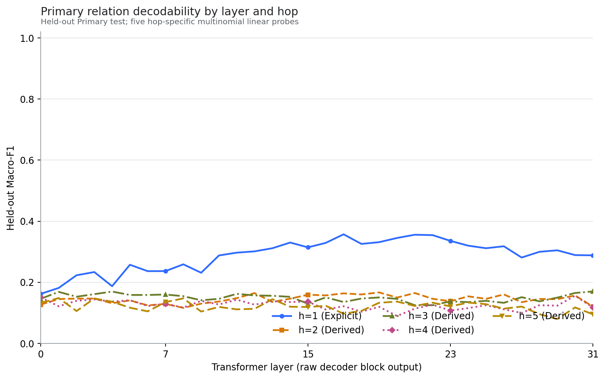
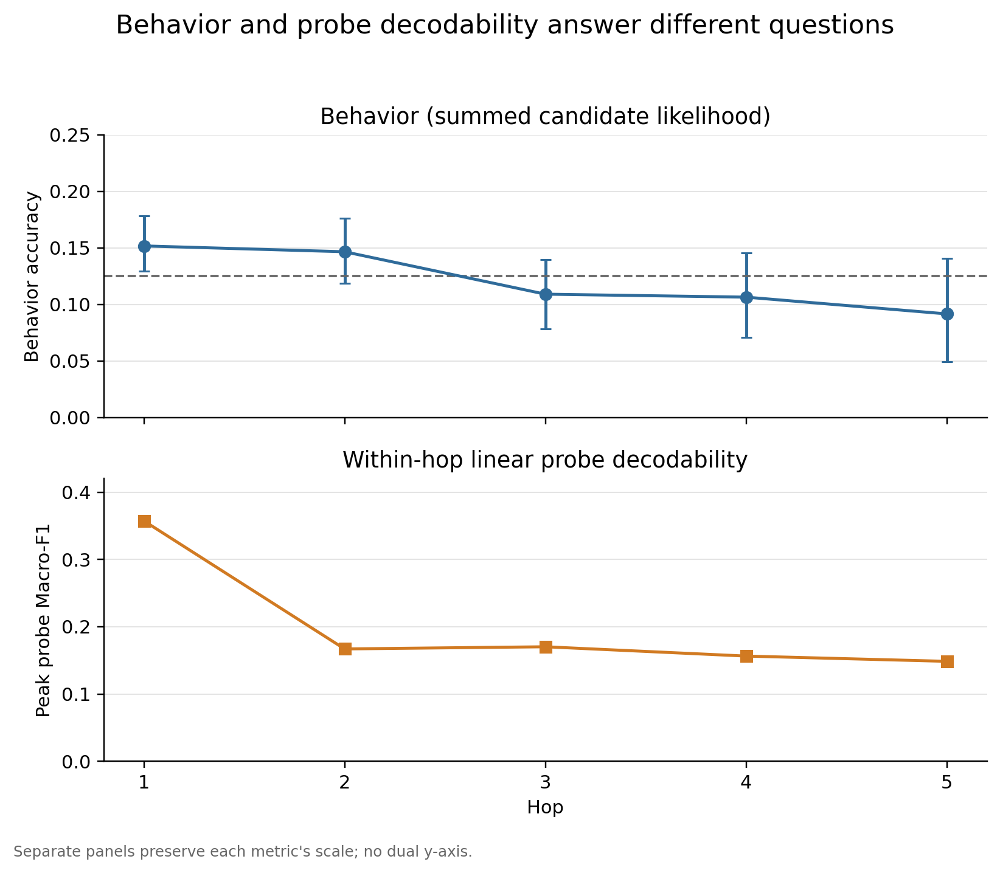
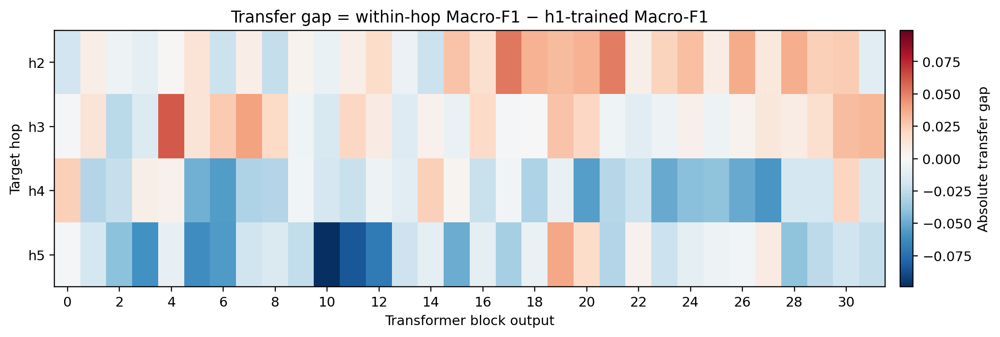
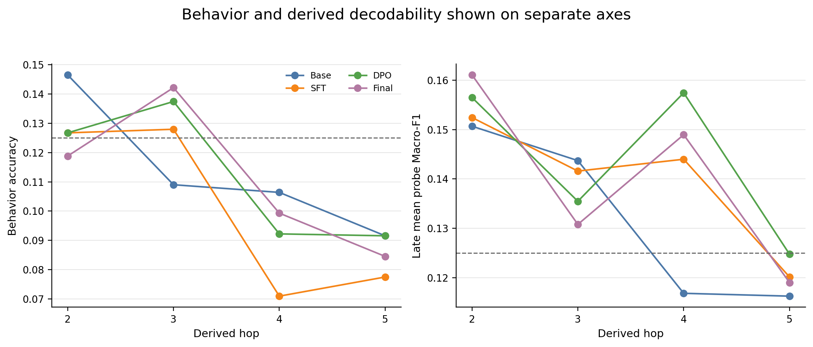

# Reasoning Geometry Pilot

一个用于研究大型语言模型内部空间表征、显式关系编码、多步推理和后训练影响的可复核实验仓库。

本仓库保存项目的公开研究层：实验方法、冻结协议、结果报告、图表、CSV/JSON 摘要、验证文件和复现脚本。模型权重、完整激活矩阵、缓存、虚拟环境、原始论文 PDF 和凭据不进入仓库。

> 更新于 2026-09-01：Stage A2–A3、B0–B2 和 MATH-500 pilot-20 的现有正式结果已经完成本地恢复与 Git 友好归档。

## 快速入口

| 内容 | 入口 |
|---|---|
| 全部阶段结果索引 | [RESULTS.md](RESULTS.md) |
| B1–B1.6 中文整合报告 | [EXPERIMENT_REPORT_ZH.md](EXPERIMENT_REPORT_ZH.md) |
| B2 Base/SFT/DPO/Final 正式报告 | [B2_BASE_TULU_STAGE_COMPARISON_REPORT.md](docs/stage-b/B2_BASE_TULU_STAGE_COMPARISON_REPORT.md) |
| Stage B 完整中文研究报告 | [STAGE_B_RESEARCH_REPORT_ZH.md](docs/stage-b/STAGE_B_RESEARCH_REPORT_ZH.md) |
| Stage B 正式 PDF 研究报告 | [STAGE_B_RESEARCH_REPORT_ZH.pdf](output/pdf/STAGE_B_RESEARCH_REPORT_ZH.pdf) |
| Stage B 离线交互式数据报告 | [reports/stage-b/index.html](reports/stage-b/index.html) |
| B2 十张图逐图解释 | [B2_FIGURE_GUIDE_ZH.md](docs/stage-b/B2_FIGURE_GUIDE_ZH.md) |
| MATH-500 pilot-20 | [preliminary/math500/README.md](preliminary/math500/README.md) |
| 完成范围与排除资产 | [STATUS.md](STATUS.md) |
| 云端恢复核验 | [SYNC_AUDIT.md](SYNC_AUDIT.md) |
| 文件大小与 SHA-256 | [FILE_INVENTORY.csv](FILE_INVENTORY.csv) |

## 研究问题

1. 语言模型的中间层是否形成可线性读取的空间表示？
2. 显式一步关系与多步派生关系在层间如何分布？
3. hop 增加是否对应更晚的可解码层？
4. 线性可解码信息是否与模型自身的答案行为一致？
5. 显式关系解码器能否跨 hop 迁移，以及后训练是否改变这种结构？

## 方法概览

1. **Stage A — 空间坐标复现**：在 World 数据上抽取冻结模型的 residual-stream 表征，使用线性 Ridge probe 预测经纬度，并通过随机标签、均值基线、量化往返、HF/TransformerLens 对齐和重前向检查约束解释。
2. **Stage B0 — StepGame 数据冻结**：独立重建 query path 与实际 hop，审计重复、解析失败、模板和 composition，随后冻结 Primary、Balanced、Target-Absent、Composition-heldout 与 Template Test-only 划分。
3. **Stage B1 — 逐层关系 probe**：在 Llama-3.1-8B Base 的 32 层 question-end hidden state 上训练八分类线性 probe；标准化只拟合训练集，正则参数只由验证集选择，测试集只用于最终评价。
4. **Stage B1.5–B1.6 — 行为与迁移**：用八个候选方向答案的条件对数似然衡量模型行为；再把 h1 probe 直接应用到 h2–h5，比较 within-hop 与 cross-hop Macro-F1。
5. **Stage B2 — 后训练比较**：在完全相同的冻结样本、token readout、probe 协议和控制实验下比较 Base、SFT、DPO、Final，并使用 story-group paired bootstrap 评价阶段差值。
6. **MATH-500 preliminary**：使用同一批 20 题、greedy decoding 和人工复核流程验证 Base→SFT→DPO→Final 行为评测链路；该小样本不作为正式 benchmark。

## 数据集与模型

| 实验 | 数据集 | 模型 |
|---|---|---|
| A2 | World spatial coordinates | Pythia-2.8B |
| A3 | World spatial coordinates | Llama-3.1-8B Base |
| B0–B1.6 | StepGame CompleteVersion/clean | Llama-3.1-8B Base |
| B2 | StepGame 冻结划分 | Llama-3.1-8B Base、Tülu-3 SFT、DPO、Final |
| Preliminary | MATH-500 pilot-20 | 同一 Base/SFT/DPO/Final 序列 |

## 当前阶段

| 阶段 | 模型与任务 | 范围 | 状态 |
|---|---|---|---|
| A2 | Pythia-2.8B × World coordinates | 32 层空间坐标线性探针复现 | 完成 |
| A3 | Llama-3.1-8B Base × World coordinates | 模型迁移审计、激活 sanity、5 层 mini probe | 完成（既定范围） |
| B0 | StepGame | 数据、模板、hop、泄漏与冻结划分审计 | 完成 |
| B1 | Llama-3.1-8B Base × StepGame | 32 层显式/派生关系探针与控制实验 | PASS，38/38 checks |
| B1.5 | Llama-3.1-8B Base × StepGame | 候选答案条件似然行为基线 | PASS |
| B1.6 | Llama-3.1-8B Base × StepGame | 跨 hop 线性迁移 | PASS |
| B2 | Base/SFT/DPO/Final × StepGame | 行为、within-hop、cross-hop 与冻结控制比较 | PASS |
| Preliminary | Base/SFT/DPO/Final × MATH-500 pilot-20 | 小样本行为层可行性验证 | 完成（非正式 benchmark） |

详细完成边界见 [STATUS.md](STATUS.md)，云端恢复核验见 [SYNC_AUDIT.md](SYNC_AUDIT.md)。

## 核心结果

- B1 中，显式 h1 的峰值 Macro-F1 为 **0.3573@L17**；h2–h5 峰值仅为 **0.1485–0.1702**。
- h2–h5 没有呈现“hop 越大、可解码层越晚”的单调顺序。
- 平衡控制使 h1 峰值降至 **0.2163**；未见模板测试使其降至 **0.1794**，说明强显式读出对数据分布和表面模板敏感。
- B1.5 主候选评分下，行为准确率从 h1 的 **0.1517** 下降到 h5 的 **0.0915**；派生 hop 未建立稳健的高于随机能力。
- B1.6 支持有限、较弱的跨 hop 线性迁移，但不支持统一符号关系代码或可定位的“推理层”。
- B2 中，后训练明显提高 h1 的晚层可解码性，但 h2–h5 的改善不稳定：derived late-layer mean 从 Base **0.1319** 到 SFT **0.1395**、DPO **0.1435**、Final **0.1400**。这不构成稳定的多步推理增强证据。
- B2 的 derived behavioral mean 分别为 Base **0.1134**、SFT **0.1008**、DPO **0.1120**、Final **0.1112**；行为层面没有随训练阶段单调提升。
- MATH-500 pilot-20 的人工复核准确率为 Base **25%**、SFT **20%**、DPO **20%**、Final/RLVR **35%**。样本仅 20 题，只用于证明完整评测流程可运行。

完整结果索引见 [RESULTS.md](RESULTS.md)。[EXPERIMENT_REPORT_ZH.md](EXPERIMENT_REPORT_ZH.md) 汇总 B1–B1.6；B2 使用独立的[正式报告](docs/stage-b/B2_BASE_TULU_STAGE_COMPARISON_REPORT.md)和[逐图解释](docs/stage-b/B2_FIGURE_GUIDE_ZH.md)。

## 代表性图表

### B1：逐层关系可解码性



### B1.5：行为与探针回答不同问题



### B1.6：跨 hop 迁移差值



图中每个单元格比较同一目标 hop 上的 within-hop probe 与 h1 训练 probe。接近零表示两种训练来源表现相近，不等于存在统一符号代码；负值也可能来自 within-hop probe 本身较弱。因此应结合绝对 Macro-F1、随机标签控制和置信区间解释。

### B2：行为正确率与线性可解码性



左右面板分别展示模型答案行为和隐藏状态线性可解码性，纵轴尺度与统计含义不同。后训练可提高部分关系的线性读出，并不自动带来行为正确率提升；两者分离是本实验最重要的解释边界之一。

## 仓库结构

```text
.
├── README.md
├── STATUS.md
├── RESULTS.md
├── EXPERIMENT_REPORT_ZH.md
├── CITATIONS.md
├── docs/
│   ├── stage-a/
│   └── stage-b/
├── figures/
│   ├── stage-a/
│   ├── stage-b1/
│   ├── stage-b1_5-b1_6/
│   └── stage-b2/
├── results/
│   ├── stage-a2/
│   ├── stage-a3/
│   ├── stage-b0/
│   ├── stage-b1/
│   ├── stage-b1_5-b1_6/
│   └── stage-b2/
├── preliminary/
│   └── math500/
├── scripts/
│   ├── stage-a/
│   ├── stage-b0/
│   ├── stage-b1/
│   ├── stage-b1_5-b1_6/
│   └── stage-b2/
└── environment/
```

## 复现边界

- Stage A2 的 Pythia revision、权重 SHA-256、运行环境和 Gate 记录位于 `docs/stage-a/`。
- Stage B 使用 StepGame 官方仓库冻结 commit `5e6aff1563a6d7f46ee1f1aeff98b94e68c29005`。
- Llama-3.1-8B Base 模型 revision 为 `24ce1d3ac24d46a14b16dcb666c4fdd9147b87ea`，tokenizer revision 为 `c52792af35fe806a76530f3028f037d1af4e3490`。
- B2 比较 Base、SFT、DPO 和 Final 四个 checkpoint；谱系、tokenization 一致性及冻结输入验证见 `results/stage-b2/`。
- 历史执行脚本保留了服务器项目布局，用于审计已执行流程；在新环境运行前应把项目根目录改为可配置路径。
- 大型二进制资产、activation tensors 和 `.npz` probe 参数不在 Git 中。报告及 `artifact_checksums.json` 通过 shape、dtype、row order 和 checksum 记录其完整性。

## 归档完整性

SSH 恢复后已核对服务器正式 artifact：B0.2c 为 8 个文件，B1 为 321 个文件，B2 为 1,500 个文件，Math500 远端报告为 18 个文件。完整恢复副本保留在本地暂存区，Git 仓库保存其中适合版本控制和公开审阅的研究层。

仓库当前不追求逐字节复制服务器运行目录。未纳入 Git 的主要是模型与 activation、大型 `.npz` probe 参数、冗余逐层 checkpoint/prediction、环境缓存和日志；正式结论所需的报告、协议、聚合结果、验证文件、图表与 checksum 均已纳入。详细记录见 [SYNC_AUDIT.md](SYNC_AUDIT.md)。

## 引用与数据来源

论文、数据集和方法来源见 [CITATIONS.md](CITATIONS.md)。仓库不重新分发论文 PDF。

## 许可

当前尚未选择开源许可证。在添加明确许可证前，仓库内容默认不授予再分发或衍生使用许可。准备公开发布前应根据项目归属选择合适许可证。
