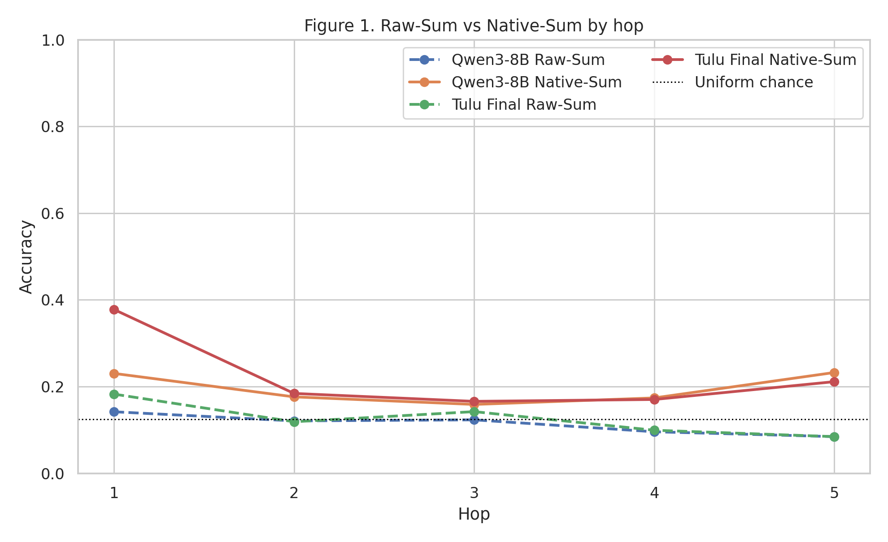
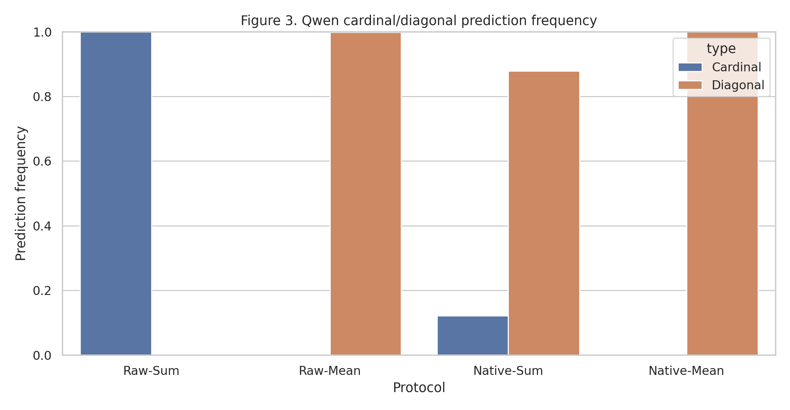
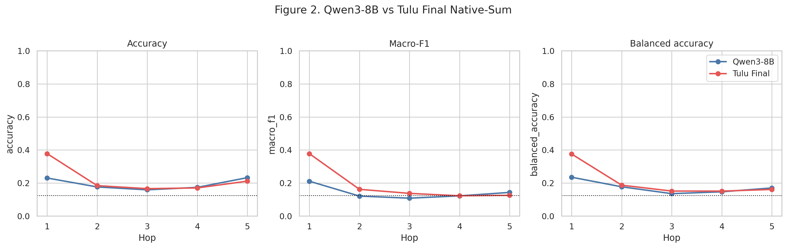
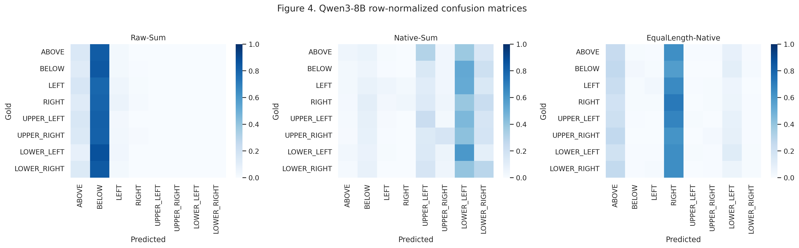
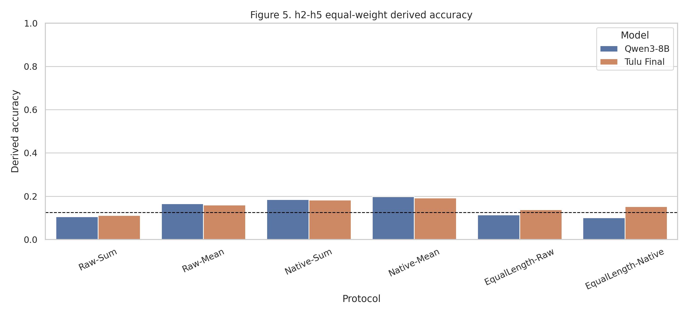

# Stage B2.2 Qwen3-8B Model Selection Gate

## 1. Research Question

Qwen3-8B 是否在冻结 StepGame task-fitness protocol 下表现出足够强且稳定的 multi-hop spatial reasoning behavior，从而适合作为后续 mechanistic comparison 的 strong-reasoning target？

## 2. Frozen Reference

- Primary frozen test: 2063 rows; h1–h5 = 712/505/422/282/142.
- Row-ID SHA-256: `dbc5bf84903b9d177c7f02f32e4e6226082c61be7498e466b7e3f8e0c84ee950`.
- Frozen source: `artifacts/stage_b1/union_manifest.csv`.
- Tülu Final Raw-Sum h2–h5 derived = 0.1112; Native-Sum = 0.1829.
- Frozen-data audit: **PASS**.

## 3. Qwen Model Audit

- Exact model: `Qwen/Qwen3-8B`; local path `/home/ai/chenchen/projects/reasoning-geometry-pilot/models/Qwen3-8B`; revision/snapshot `local_directory_no_revision_metadata`.
- Architecture: `['Qwen3ForCausalLM']`; layers=36; hidden size=4096; vocab=151936.
- Tokenizer BOS/EOS/PAD IDs: None/151645/151643; model-config/raw explicit BOS ID: 151643/151643.
- Config SHA-256: `f7c4eadfbbf522470667b797a3c89be2524832d2d599797248dc304fff447c30`; chat-template SHA-256: `a55ee1b1660128b7098723e0abcd92caa0788061051c62d51cbe87d9cf1974d8`.
- Main dtype: BF16; transformers=4.57.6; torch=2.4.0+cu124; CUDA=12.4.
- Native protocol uses the tokenizer's own template with `add_generation_prompt=True, enable_thinking=False`. If that exact template renders an empty `<think>

</think>` scaffold, it is retained; non-empty thinking content is a hard failure.

## 4. Tokenizer and Boundary Audit

Natural verbalizers are the frozen B2.1 strings `{"ABOVE": " above", "BELOW": " below", "LEFT": " left", "RIGHT": " right", "UPPER_LEFT": " upper-left", "UPPER_RIGHT": " upper-right", "LOWER_LEFT": " lower-left", "LOWER_RIGHT": " lower-right"}`. Raw and Native each received 120 deterministic contextual-boundary checks. Scoring uses the audited contextual continuation token IDs even when standalone tokenization differs. Equal-length mapping `{"ABOVE": "A", "BELOW": "B", "LEFT": "C", "RIGHT": "D", "UPPER_LEFT": "E", "UPPER_RIGHT": "F", "LOWER_LEFT": "G", "LOWER_RIGHT": "H"}` passed exactly-one-token continuation checks at Raw and Native boundaries; it remains a measurement-control/sensitivity diagnostic.

## 5. Experiment A — Raw-Sum

| hop | n_test | accuracy | macro_f1 | balanced_accuracy | majority_accuracy | uniform_chance |
|---|---|---|---|---|---|---|
| 1.0000 | 712.0000 | 0.1419 | 0.0590 | 0.1294 | 0.1390 | 0.1250 |
| 2.0000 | 505.0000 | 0.1208 | 0.0539 | 0.1268 | 0.1347 | 0.1250 |
| 3.0000 | 422.0000 | 0.1232 | 0.0678 | 0.1508 | 0.1540 | 0.1250 |
| 4.0000 | 282.0000 | 0.0957 | 0.0448 | 0.1295 | 0.1596 | 0.1250 |
| 5.0000 | 142.0000 | 0.0845 | 0.0286 | 0.1086 | 0.1901 | 0.1250 |

## 6. Experiment B — Native-Sum

| hop | n_test | accuracy | macro_f1 | balanced_accuracy | majority_accuracy | uniform_chance |
|---|---|---|---|---|---|---|
| 1.0000 | 712.0000 | 0.2303 | 0.2109 | 0.2350 | 0.1390 | 0.1250 |
| 2.0000 | 505.0000 | 0.1762 | 0.1208 | 0.1771 | 0.1347 | 0.1250 |
| 3.0000 | 422.0000 | 0.1588 | 0.1083 | 0.1356 | 0.1540 | 0.1250 |
| 4.0000 | 282.0000 | 0.1738 | 0.1223 | 0.1468 | 0.1596 | 0.1250 |
| 5.0000 | 142.0000 | 0.2324 | 0.1431 | 0.1701 | 0.1901 | 0.1250 |

Native is an own-native-interface task-fitness protocol. Qwen Native and Tülu Native do not have identical token sequences.

## 7. Experiment C — Scoring Sensitivity

| protocol | accuracy_h2_h5 | macro_f1_h2_h5 | balanced_accuracy_h2_h5 |
|---|---|---|---|
| Native-Mean | 0.1987 | 0.1157 | 0.1653 |
| Native-Sum | 0.1853 | 0.1236 | 0.1574 |
| Raw-Mean | 0.1660 | 0.0716 | 0.1363 |
| Raw-Sum | 0.1061 | 0.0488 | 0.1289 |

Mean-token is a sensitivity analysis, not an unbiased or mathematically privileged correction.

## 8. Experiment D — Equal-Length Control

| protocol | accuracy_h2_h5 | macro_f1_h2_h5 | balanced_accuracy_h2_h5 |
|---|---|---|---|
| EqualLength-Native | 0.1006 | 0.0558 | 0.1220 |
| EqualLength-Raw | 0.1144 | 0.0549 | 0.1314 |

Equal-length changes the output mapping and adds an explicit mapping instruction; it is not a gold-standard replacement for natural verbalizers.

## 9. Qwen vs Tülu Final

| model | hop | accuracy | macro_f1 | balanced_accuracy |
|---|---|---|---|---|
| qwen3_8b | 1.0000 | 0.2303 | 0.2109 | 0.2350 |
| qwen3_8b | 2.0000 | 0.1762 | 0.1208 | 0.1771 |
| qwen3_8b | 3.0000 | 0.1588 | 0.1083 | 0.1356 |
| qwen3_8b | 4.0000 | 0.1738 | 0.1223 | 0.1468 |
| qwen3_8b | 5.0000 | 0.2324 | 0.1431 | 0.1701 |
| tulu_final | 1.0000 | 0.3778 | 0.3776 | 0.3755 |
| tulu_final | 2.0000 | 0.1842 | 0.1618 | 0.1869 |
| tulu_final | 3.0000 | 0.1659 | 0.1374 | 0.1513 |
| tulu_final | 4.0000 | 0.1702 | 0.1226 | 0.1510 |
| tulu_final | 5.0000 | 0.2113 | 0.1255 | 0.1610 |

## 10. Statistical Comparisons

Paired bootstrap resamples `story_group_id` 2,000 times with seed 20260910. Derived differences first compute h2/h3/h4/h5 separately and then take an equal-weight mean.

| scope | metric | point_difference | ci95_low | ci95_high | ci_excludes_zero |
|---|---|---|---|---|---|
| h1 | accuracy | -0.1475 | -0.1896 | -0.1053 | True |
| h1 | macro_f1 | -0.1667 | -0.2067 | -0.1276 | True |
| h1 | balanced_accuracy | -0.1404 | -0.1793 | -0.1042 | True |
| h2 | accuracy | -0.0079 | -0.0455 | 0.0297 | False |
| h2 | macro_f1 | -0.0410 | -0.0728 | -0.0083 | True |
| h2 | balanced_accuracy | -0.0098 | -0.0471 | 0.0264 | False |
| h3 | accuracy | -0.0071 | -0.0521 | 0.0379 | False |
| h3 | macro_f1 | -0.0291 | -0.0679 | 0.0096 | False |
| h3 | balanced_accuracy | -0.0157 | -0.0560 | 0.0233 | False |
| h4 | accuracy | 0.0035 | -0.0426 | 0.0532 | False |
| h4 | macro_f1 | -0.0004 | -0.0371 | 0.0367 | False |
| h4 | balanced_accuracy | -0.0042 | -0.0448 | 0.0348 | False |
| h5 | accuracy | 0.0211 | -0.0563 | 0.0986 | False |
| h5 | macro_f1 | 0.0176 | -0.0337 | 0.0666 | False |
| h5 | balanced_accuracy | 0.0092 | -0.0529 | 0.0692 | False |
| h2_h5_derived | accuracy | 0.0024 | -0.0250 | 0.0296 | False |
| h2_h5_derived | macro_f1 | -0.0132 | -0.0336 | 0.0056 | False |
| h2_h5_derived | balanced_accuracy | -0.0052 | -0.0283 | 0.0162 | False |

## 11. Fitness Gate

- Data integrity: **PASS**
- Tokenizer boundary audit: **PASS**
- Native behavior stronger than Tülu: **UNCERTAIN**
- Above uniform chance at each h2–h5: **YES**
- Above hop-specific majority baseline at each h2–h5: **YES**
- Macro-F1 improved: **UNCERTAIN**
- Balanced accuracy improved: **UNCERTAIN**
- Prediction collapse: **NO**
- Protocol sensitivity: **HIGH**
- Strong-reasoning target: **UNCERTAIN**

## 12. Consequence for Stage B

C. Qwen remains weak or uncertain: do not start full activation extraction; examine free generation/thinking-mode evaluation or a stronger model in a future preregistered stage.

## 13. Interpretation Boundaries

- Behavior ≠ hidden mechanism.
- Chat improvement ≠ representation improvement.
- Equal-length ≠ pure length correction.
- Above chance ≠ successful reasoning.
- External literature accuracy ≠ accuracy under this frozen protocol.
- This stage does not establish graphs, symbolic reasoning, representational structure, or post-training causal mechanisms.
