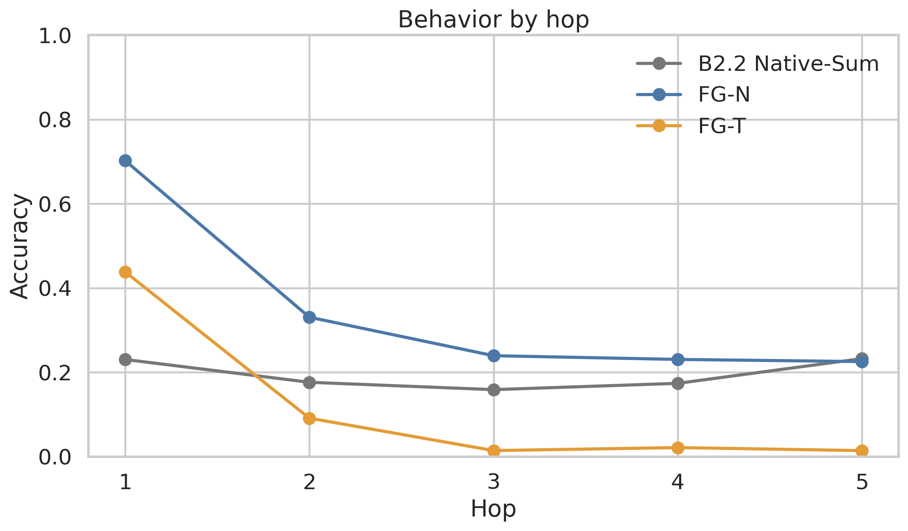
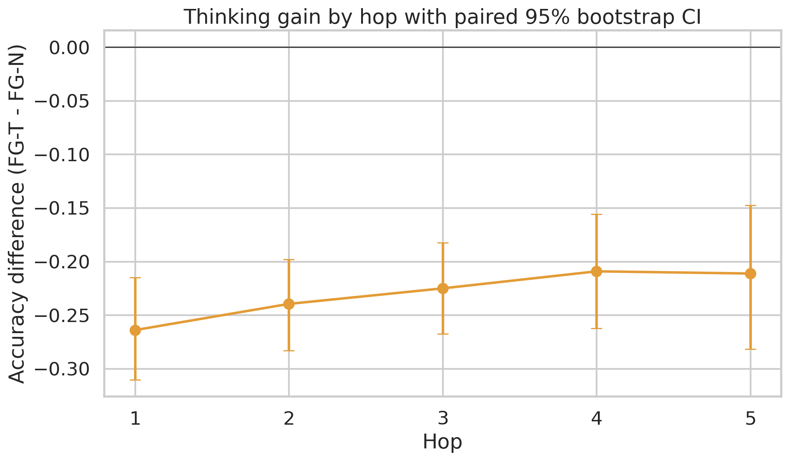
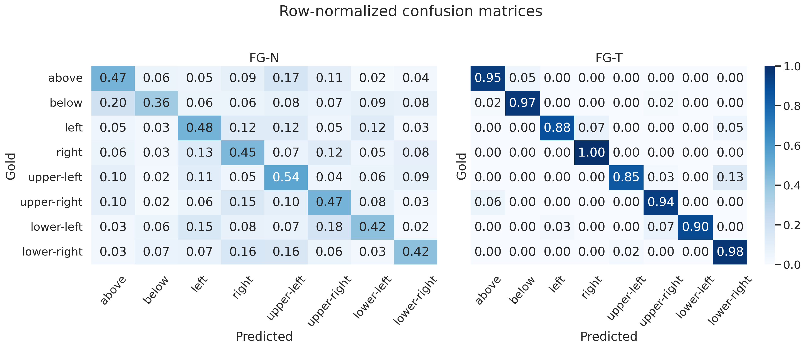
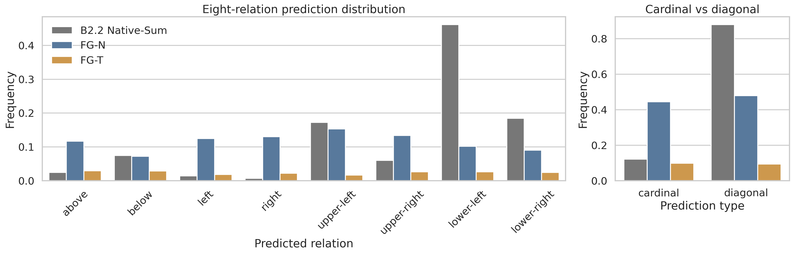
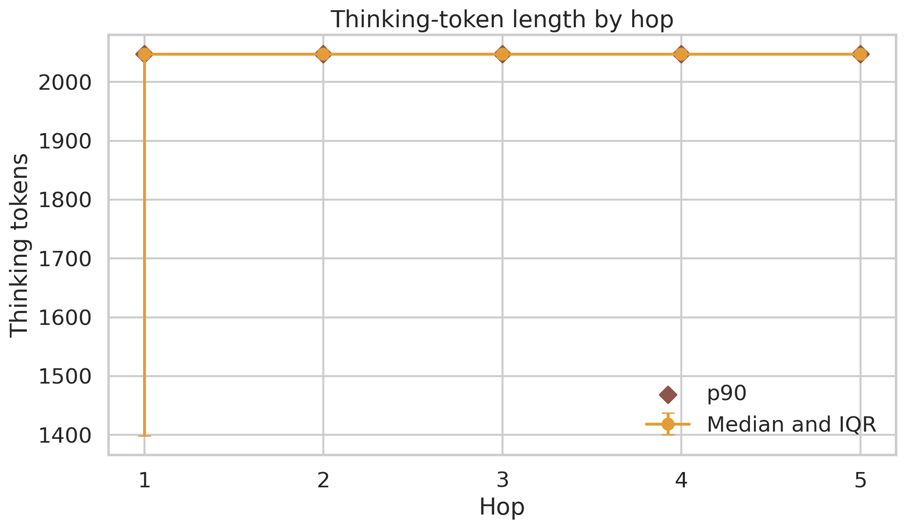
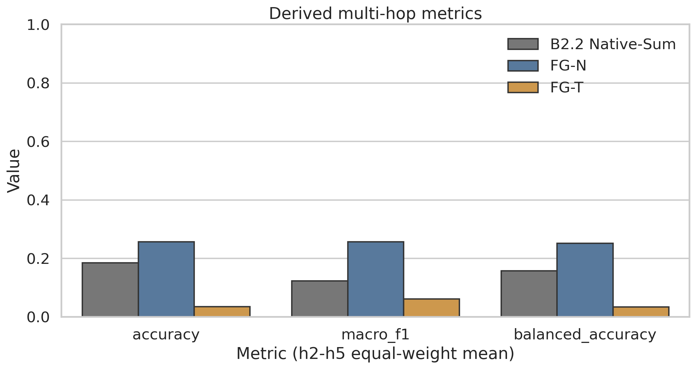

# Stage B2.3 Qwen3-8B Free-Generation / Thinking Gate

Validation: **<!-- VALIDATION_STATUS -->PASS_WITH_LIMITATION**

## 1. Research Question

Does candidate likelihood underestimate Qwen3-8B StepGame task fitness, and does official Qwen3 thinking mode further improve multi-hop free-generation behavior?

## 2. Frozen Reference

- Primary test: 2,063 frozen rows; h1–h5 = 712 / 505 / 422 / 282 / 142.
- Row-ID SHA-256: `dbc5bf84903b9d177c7f02f32e4e6226082c61be7498e466b7e3f8e0c84ee950`.
- B2.2 Qwen Native-Sum h2–h5 derived accuracy: `0.1853`.
- B2.2 strong-reasoning target: `UNCERTAIN`; B2.2 validation: `PASS`.

## 3. Model and Environment Audit

- Model: `Qwen/Qwen3-8B`, local BF16 weights, 36 layers, hidden size 4096.
- Config SHA-256: `f7c4eadfbbf522470667b797a3c89be2524832d2d599797248dc304fff447c30`.
- Chat-template SHA-256: `a55ee1b1660128b7098723e0abcd92caa0788061051c62d51cbe87d9cf1974d8`.
- Weight and tokenizer manifests match B2.2 exactly: **PASS**.
- Transformers `4.57.6`; PyTorch `2.4.0+cu124`; CUDA `12.4`; GPU `NVIDIA GeForce RTX 3090`.

## 4. Generation Protocols

- FG-N: Native chat template, free generation, `enable_thinking=False`, temperature 0.7, top-p 0.8, top-k 20, min-p 0.
- FG-T: Native chat template, free generation, `enable_thinking=True`, temperature 0.6, top-p 0.95, top-k 20, min-p 0.
- Matched sensitivity: both modes use temperature 0.6, top-p 0.95, top-k 20, min-p 0 on the frozen 250-row pilot subset.
- Resolved `max_new_tokens`: `2048` based only on the preregistered smoke truncation audit.
- Full run seed: `20260924`. Per-row child seeds are deterministic hashes of generation seed and row ID, which makes resume invariant to interruption.

## 5. Parser and Output Format Audit

The only prompt addition was the exact frozen output-format instruction. The deterministic parser selects the last valid `Final answer: <relation>` line, normalizing only case, whitespace, and `_`/space/`-` separators for diagonal labels. No semantic synonyms are accepted. `INVALID` counts as wrong. Parser and prompt hashes were frozen before generation.

## 6. Stability Pilot

| protocol | generation_seed | accuracy | macro_f1 | balanced_accuracy | parse_success_rate |
| --- | --- | --- | --- | --- | --- |
| FG-N | 20260924 | 0.3000 | 0.2789 | 0.2914 | 0.9050 |
| FG-N | 20260925 | 0.2850 | 0.2885 | 0.2896 | 0.9150 |
| FG-N | 20260926 | 0.2950 | 0.2693 | 0.2801 | 0.9250 |
| FG-T | 20260924 | 0.0350 | 0.0623 | 0.0378 | 0.0350 |
| FG-T | 20260925 | 0.0550 | 0.0844 | 0.0519 | 0.0550 |
| FG-T | 20260926 | 0.0650 | 0.1007 | 0.0657 | 0.0700 |

Stochasticity classification: **LOW**. Accuracy ranges were preregistered as LOW ≤ 0.03, MODERATE ≤ 0.07, and HIGH > 0.07.

| protocol | min | max | range |
| --- | --- | --- | --- |
| FG-N | 0.2850 | 0.3000 | 0.0150 |
| FG-T | 0.0350 | 0.0650 | 0.0300 |

## 7. FG-N Results

| hop | n | accuracy | macro_f1 | balanced_accuracy | parse_success_rate | prediction_collapse |
| --- | --- | --- | --- | --- | --- | --- |
| 1 | 712 | 0.7022 | 0.7248 | 0.7022 | 0.9270 | False |
| 2 | 505 | 0.3307 | 0.3264 | 0.3309 | 0.9366 | False |
| 3 | 422 | 0.2393 | 0.2424 | 0.2344 | 0.9005 | False |
| 4 | 282 | 0.2305 | 0.2307 | 0.2138 | 0.9113 | False |
| 5 | 142 | 0.2254 | 0.2265 | 0.2263 | 0.9507 | False |

h2–h5 equal-weight means: accuracy `0.2565`, Macro-F1 `0.2565`, balanced accuracy `0.2513`, parse rate `0.9248`.

## 8. FG-T Results

| hop | n | accuracy | macro_f1 | balanced_accuracy | parse_success_rate | prediction_collapse |
| --- | --- | --- | --- | --- | --- | --- |
| 1 | 712 | 0.4382 | 0.5980 | 0.4362 | 0.4522 | False |
| 2 | 505 | 0.0911 | 0.1636 | 0.0922 | 0.1109 | False |
| 3 | 422 | 0.0142 | 0.0274 | 0.0144 | 0.0284 | False |
| 4 | 282 | 0.0213 | 0.0363 | 0.0190 | 0.0213 | False |
| 5 | 142 | 0.0141 | 0.0196 | 0.0102 | 0.0141 | False |

h2–h5 equal-weight means: accuracy `0.0352`, Macro-F1 `0.0617`, balanced accuracy `0.0340`, parse rate `0.0437`.

## 9. Free Generation vs Candidate Likelihood

Candidate likelihood and free generation are different answer-production protocols. The paired row description estimates FG-N minus B2.2 Native-Sum derived accuracy as `0.0712` with a descriptive 95% cluster-bootstrap interval `[0.0385, 0.1055]`. This supports only the statement that free-generation behavior differs from candidate-likelihood behavior; it does not establish that one protocol mathematically corrects the other.

## 10. Thinking Effect

FG-T minus FG-N h2–h5 derived accuracy is `-0.2213`, 95% paired cluster-bootstrap CI `[-0.2487, -0.1951]`. Thinking benefit: **NO**.

Matched-decoding sensitivity:

| protocol | accuracy | macro_f1 | balanced_accuracy | parse_success_rate |
| --- | --- | --- | --- | --- |
| FG-N-Matched | 0.2950 | 0.2924 | 0.3103 | 0.9250 |
| FG-T-Matched | 0.0350 | 0.0623 | 0.0378 | 0.0350 |

Because the official-use configurations differ, only the matched subset isolates mode while holding sampling parameters fixed.

## 11. Hop Interaction

The per-hop gain is shown with paired 95% intervals. Any larger multi-hop gain remains descriptive evidence and is not evidence of an internal graph representation.

## 12. Relation / Confusion Analysis

Prediction-collapse gates use cardinal or diagonal frequency ≥ 0.95, or a single relation frequency ≥ 0.80. Full-run status: FG-N `False`, FG-T `False`.

## 13. Generation Length Analysis

| hop | median_thinking_tokens | p25_thinking_tokens | p75_thinking_tokens | p90_thinking_tokens | truncation_rate |
| --- | --- | --- | --- | --- | --- |
| 1 | 2047.00 | 1398.25 | 2047.00 | 2047.00 | 0.55 |
| 2 | 2047.00 | 2047.00 | 2047.00 | 2047.00 | 0.89 |
| 3 | 2047.00 | 2047.00 | 2047.00 | 2047.00 | 0.97 |
| 4 | 2047.00 | 2047.00 | 2047.00 | 2047.00 | 0.98 |
| 5 | 2047.00 | 2047.00 | 2047.00 | 2047.00 | 0.99 |

Longer thinking is descriptive computation amount, not evidence of causal benefit.

## 14. Statistical Comparisons

All intervals use 2,000 resamples, seed 20260910, with paired `story_group_id` sampling. Derived comparisons compute each hop separately and then take the equal-weight mean of h2–h5.

## 15. Fitness Decision

- `candidate_likelihood_underestimates_behavior`: **UNCERTAIN**
- `thinking_improves_free_generation`: **NO**
- `normal_use_task_fitness`: **WEAK**
- `strong_reasoning_target`: **UNCERTAIN**

## 16. Consequence for Stage B

Branch **C**: Do not extract Qwen3-8B activations; behavior-gate Qwen/Qwen3.5-9B next.

## 17. Interpretation Boundaries

- Free-generation improvement is not hidden-mechanism improvement.
- Thinking improvement is not proof of symbolic reasoning.
- Thinking text is not assumed to be a faithful hidden-computation trace.
- Longer thinking is not assumed to causally improve reasoning.
- StepGame behavior does not establish graph formation.
- Candidate likelihood and free generation are different behavioral measurements.
- This stage does not justify graph, activation, probe, patching, or steering claims.
