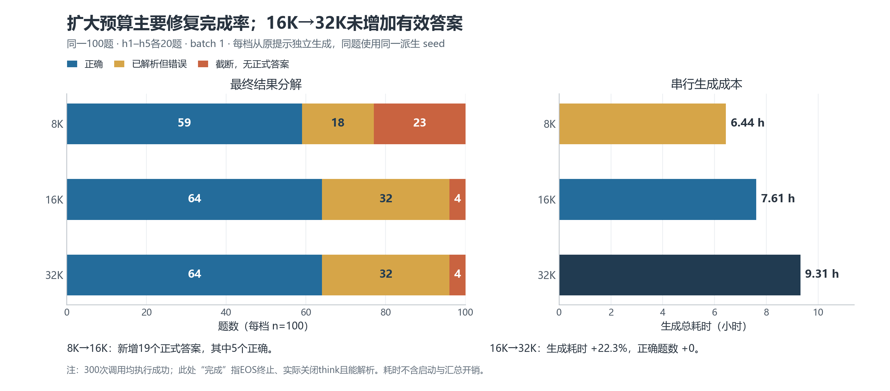
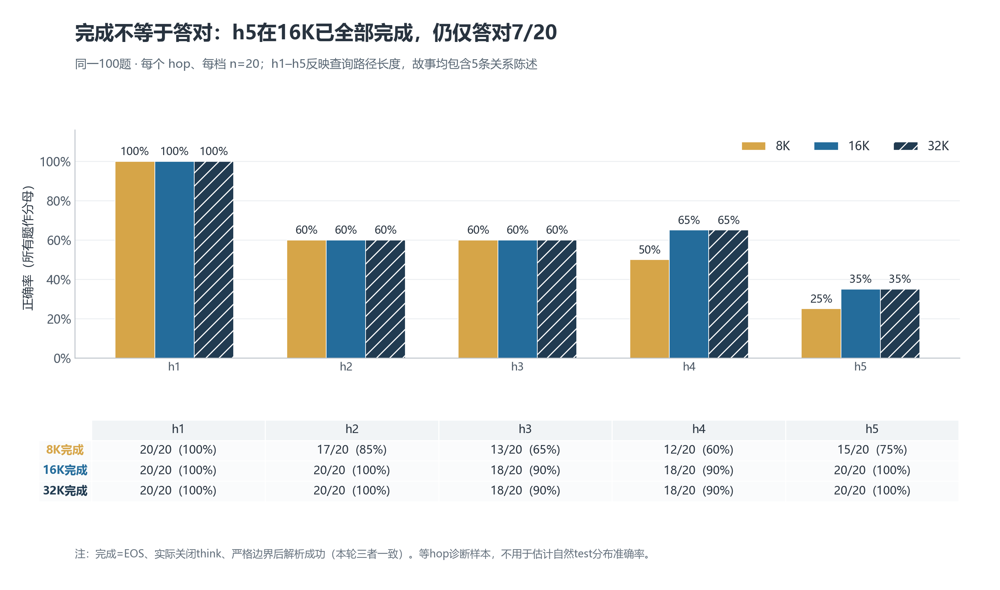
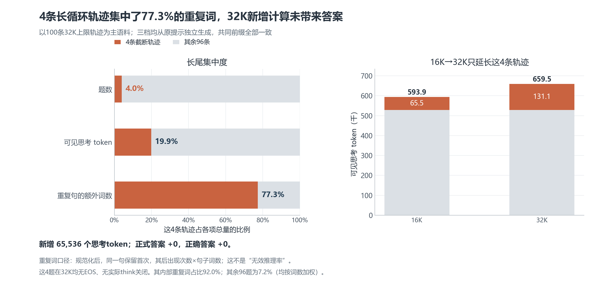
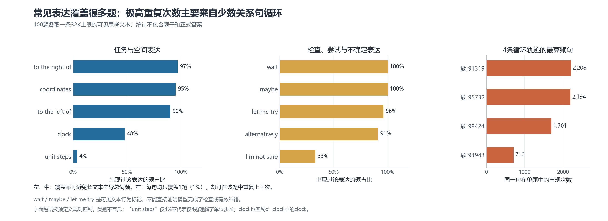

# 预算与轨迹图：图注、口径与审计

独立核对 1312 项，全部通过。图表数据源及SHA-256见 `budget_figure_validation.json`。

## 预算、结果与生成成本

同一100题在8K/16K/32K下分别得到59/64/64个正确答案；截断23/4/4题。生成耗时分别为6.44/7.61/9.31小时。8K到16K释放19个正式答案（其中5个正确），16K到32K没有新增正式答案。

误读风险：这是等hop、单seed的预算诊断；不要与旧2K batch8实验作严格因果配对，也不能据此宣称16K为总体最优预算。

## 按hop区分完成率与正确性

每个hop每档20题。16K与32K的正确题数均为20/12/12/13/7；完成题数均为20/20/18/18/20。h5全部完成却只答对7题，说明扩大预算未消除组合或读出错误。

误读风险：h5样本仅20题；hop与相关边数量、干扰边数量共变，不是独立控制的纯复杂度实验。

## 长尾计算与重复集中

4条32K截断轨迹占题数4%、可见思考token19.9%、重复句额外词数77.3%。16K到32K新增65,536个思考token全部来自这4题，未增加正式答案或正确答案。

误读风险：重复率是规范化后完全相同句子的词数加权描述，不等同语义无效率；可见文本也不等同隐藏神经机制。

## 高频表达的广度与集中度

在100条独立题目轨迹中，wait、maybe覆盖全部题，coordinates覆盖95题；右侧4个具体关系句各只出现于1题，却各重复710–2,208次。

误读风险：短语分类只是展示分组，不互斥；高覆盖的检查措辞不证明有效检查，低unit steps字面覆盖不证明未理解单位步长。
