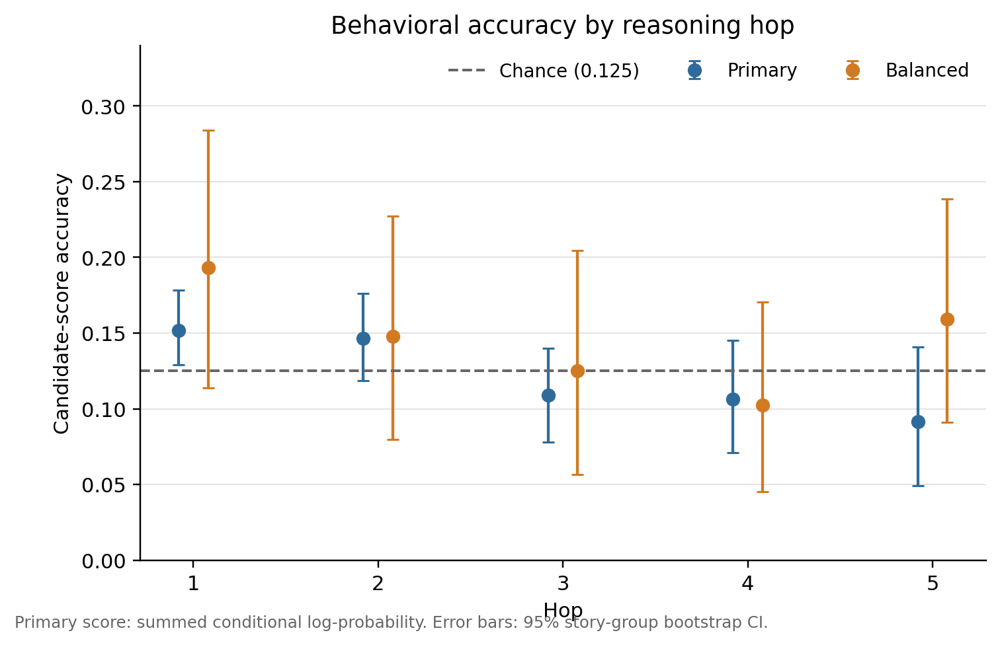
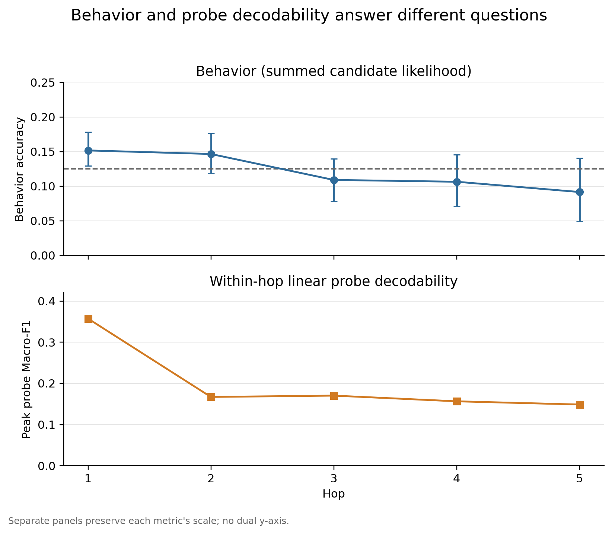
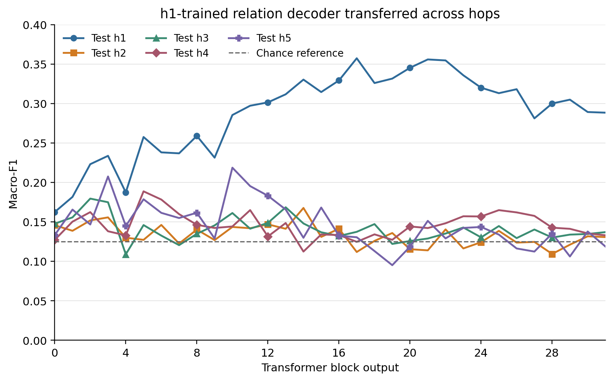
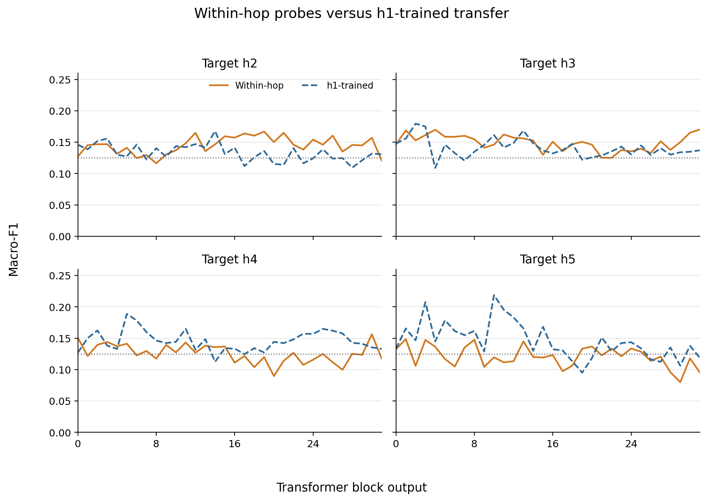
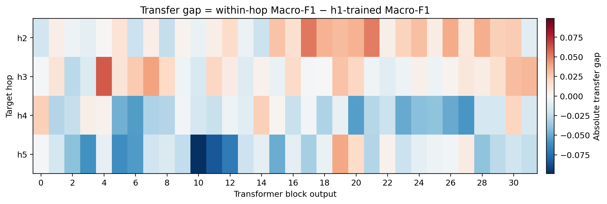
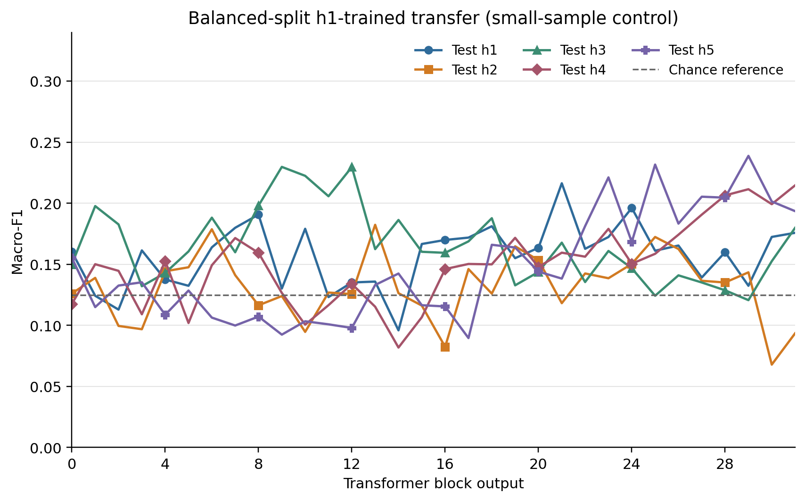

# Stage B1.5–B1.6 Behavioral Baseline + Cross-hop Transfer Probe

## Technical summary

**Overall status: PASS (B1.5 PASS; B1.6 PASS).** This stage used only the frozen Meta-Llama-3.1-8B Base pipeline. Candidate likelihood behavior is near chance for most hops under the preregistered summed conditional log-probability score, and decreases monotonically from h1 to h5. The h1-trained decoder transfers weakly but nontrivially to derived examples; however, derived within-hop probes are themselves weak, so similar transfer and within-hop values are evidence only for limited shared linearly accessible structure—not a shared symbolic reasoning code.

The evidence is most consistent with **Pattern A/D**: Base lacks clear, robust derived task ability under the primary scoring rule, while both behavioral performance and linear decodability are concentrated at h1. Length-normalized scoring changes several behavior values, confirming that answer-token length is an important sensitivity rather than a basis for changing the primary metric.

## Scope, frozen inputs, and Gate

- Model: `Meta-Llama-3.1-8B` Base only.
- Reused Stage B1 activations: 13,758 rows × 32 layers × 4,096 hidden dimensions, float16.
- No activation re-extraction for B1.6.
- Frozen Primary test counts by hop: 712, 505, 422, 282, 142.
- Frozen Balanced test: 88 rows per hop.
- Prompt: exact Stage B1 story/question wrapper, no chat template, few-shot, CoT, answer example, or gold answer.
- Input checksum Gate: PASS; all 32 activation shards, row order, split manifests, and frozen protocol hashes reverified.
- Independent validation: `/home/ai/projects/reasoning-geometry-pilot/artifacts/stage_b1_5_1_6/validation_summary.json`.

## Candidate likelihood method and audit

The primary behavior score is the sum of token-level conditional log-probabilities, `log P(candidate tokens | frozen prompt)`. Every candidate begins with the continuation-leading ASCII space. Explicit BOS was preserved; EOS/pad tokens were excluded. The 40-example audit exactly covered 5 hops × 8 relations and passed every leakage, conditional-position, candidate-count, and finite-score check.

| Relation | Candidate | Token IDs | Tokens |
|---|---:|---:|---:|
| ABOVE | ` above` | [3485] | 1 |
| BELOW | ` below` | [3770] | 1 |
| LEFT | ` left` | [2163] | 1 |
| RIGHT | ` right` | [1314] | 1 |
| UPPER_LEFT | ` upper-left` | [8582, 8109] | 2 |
| UPPER_RIGHT | ` upper-right` | [8582, 6840] | 2 |
| LOWER_LEFT | ` lower-left` | [4827, 8109] | 2 |
| LOWER_RIGHT | ` lower-right` | [4827, 6840] | 2 |

The cardinal candidates are one token and diagonal candidates are two. Therefore summed scoring structurally penalizes the longer candidates; mean log-probability per token is reported as a fixed sensitivity, not selected post hoc.

## Finding 1 — Behavioral baseline

### Primary, summed conditional log-probability

| Hop | n | Accuracy (95% story-group bootstrap CI) | Macro-F1 | Majority accuracy |
|---|---:|---:|---:|---:|
| h1 | 712 | 0.1517 [0.1292, 0.1784] | 0.0599 | 0.1390 |
| h2 | 505 | 0.1465 [0.1188, 0.1762] | 0.0637 | 0.1347 |
| h3 | 422 | 0.1090 [0.0782, 0.1398] | 0.0452 | 0.1540 |
| h4 | 282 | 0.1064 [0.0709, 0.1454] | 0.0468 | 0.1596 |
| h5 | 142 | 0.0915 [0.0493, 0.1408] | 0.0410 | 0.1901 |

Chance accuracy is 0.125. Primary accuracy is monotonically nonincreasing, but only h1's 95% CI lies narrowly above chance. h2 includes chance; h3–h5 do not establish above-chance ability. Macro-F1 is low at every hop. Consequently the data do not support a claim that Base has clear derived StepGame ability under the primary candidate scoring protocol.

### Balanced control

| Hop | n | Accuracy (95% CI) | Macro-F1 |
|---|---:|---:|---:|
| h1 | 88 | 0.1932 [0.1136, 0.2841] | 0.0944 |
| h2 | 88 | 0.1477 [0.0795, 0.2273] | 0.0787 |
| h3 | 88 | 0.1250 [0.0568, 0.2045] | 0.0450 |
| h4 | 88 | 0.1023 [0.0455, 0.1705] | 0.0444 |
| h5 | 88 | 0.1591 [0.0909, 0.2386] | 0.0670 |

Balanced estimates are noisy because each hop contains only 88 test rows. They do not show a monotonic hop trend and do not overturn the Primary conclusion.

### Token-length sensitivity

| Hop | Sum accuracy | Mean-token accuracy | Sum Macro-F1 | Mean-token Macro-F1 |
|---|---:|---:|---:|---:|
| h1 | 0.1517 | 0.1728 | 0.0599 | 0.1293 |
| h2 | 0.1465 | 0.1426 | 0.0637 | 0.0929 |
| h3 | 0.1090 | 0.1635 | 0.0452 | 0.1049 |
| h4 | 0.1064 | 0.1312 | 0.0468 | 0.0655 |
| h5 | 0.0915 | 0.1620 | 0.0410 | 0.0831 |

Length normalization increases several derived-hop estimates (for example h3 and h5 accuracy), demonstrating material answer-form sensitivity. Because candidate strings do not have equal token length, any future Base–Tulu comparison must freeze and report both scoring rules identically.

## Finding 2 — Behavior versus probe

| Hop | Behavior accuracy | Behavior Macro-F1 | Within-hop peak Macro-F1 | Peak layer |
|---|---:|---:|---:|---:|
| h1 | 0.1517 | 0.0599 | 0.3573 | L17 |
| h2 | 0.1465 | 0.0637 | 0.1670 | L19 |
| h3 | 0.1090 | 0.0452 | 0.1702 | L31 |
| h4 | 0.1064 | 0.0468 | 0.1563 | L30 |
| h5 | 0.0915 | 0.0410 | 0.1485 | L1 |

Both views distinguish h1 from derived hops, but they measure different phenomena. Across only five hop points, accuracy and peak probe F1 have Spearman ρ=0.9000; this is descriptive only (n=5) and is not inferential evidence of a mechanistic correspondence.

## Finding 3 — h1 → derived cross-hop transfer

For every layer, the StandardScaler and multinomial decoder were fitted on Primary h1 train only. C was chosen on h1 validation Macro-F1 only, using the frozen nine-value grid and smaller-C exact-tie rule. All h1–h5 test evaluations occurred after selection.

| Target | Peak h1-transfer F1 | Within-hop peak | Transfer at within peak | Gap at within peak | Retention | Mean gap | Late L16–31 mean gap |
|---|---:|---:|---:|---:|---:|---:|---:|
| h2 | 0.1676 @ L14 | 0.1670 @ L19 | 0.1359 | 0.0311 | 0.8140 | 0.0118 | 0.0253 |
| h3 | 0.1795 @ L2 | 0.1702 @ L31 | 0.1370 | 0.0331 | 0.8053 | 0.0085 | 0.0092 |
| h4 | 0.1887 @ L5 | 0.1563 @ L30 | 0.1354 | 0.0209 | 0.8661 | -0.0202 | -0.0272 |
| h5 | 0.2187 @ L10 | 0.1485 @ L1 | 0.1656 | -0.0170 | 1.1147 | -0.0248 | -0.0098 |

The gap is `within-hop F1 − h1-transfer F1`. h2/h3 show small positive late-layer gaps; h4/h5 often have zero or negative gaps. This is compatible with some shared linearly accessible relation structure, but the absolute derived scores remain weak and peak selection across 32 layers is optimistic. Similar weak values cannot distinguish a genuinely shared representation from broadly noisy, distribution-linked linear signals.

## Finding 4 — Derived-pooled → explicit

| Test hop | Peak Macro-F1 | Layer |
|---|---:|---:|
| h1 | 0.2047 | L16 |
| h2 | 0.1605 | L12 |
| h3 | 0.1725 | L14 |
| h4 | 0.1816 | L6 |
| h5 | 0.1892 | L9 |

Derived-pooled → h1 peaks at 0.2047 (L16), well below the h1 within-hop peak of 0.3573 (L17). The directions are not symmetric, although the training sample sizes and source distributions also differ, so this is not a controlled mathematical symmetry test.

## Finding 5 — Balanced transfer control

| Test hop | Peak Macro-F1 | Layer |
|---|---:|---:|
| h1 | 0.2163 | L21 |
| h2 | 0.1823 | L13 |
| h3 | 0.2298 | L9 |
| h4 | 0.2146 | L31 |
| h5 | 0.2388 | L29 |

The Balanced curves are high-variance and have no stable h1-dominant profile. They support only the qualitative conclusion that transfer is weak/noisy and layer-dependent; they do not reproduce Primary peak ordering and must not replace the Primary analysis.

## Negative control and numerical robustness

- Random-label transfer (layers 0, 7, 15, 17, 23, 31): mean accuracy 0.1240, mean Macro-F1 0.1215.
- Matched normal-label tasks: mean accuracy 0.1704, mean Macro-F1 0.1653.
- Random accuracy is within 0.002 of the 0.125 chance level and degrades clearly relative to matched normal probes.
- 33 selected fits that reached `max_iter=400` were independently refit from scratch at the same frozen C with `max_iter=2000`.
- At 2,000 iterations, remaining warnings: 6; maximum absolute test Macro-F1 change versus the original fit: 0.0193; mean absolute change: 0.0014.
- Those 6 remaining tasks were escalated to 5,000 iterations at the same C. Remaining warnings: 0; maximum absolute test Macro-F1 change versus the 2,000-iteration fit: 0.0133; mean absolute change: 0.0024.
- The sensitivity does not alter C selection or use test data for selection.

## Interpretation boundaries

The results justify the cautious statement that explicit and derived instances contain **limited shared linearly accessible structure** at some layers. They do not justify saying the model grounds relations and then reasons with one symbolic code. Because derived behavior and derived within-hop decodability are weak, the experiment cannot separate absent representations from nonlinear, transient, differently located, or prompt-incompatible representations.

Additional limitations are candidate-token-length asymmetry, small Balanced cells, peak-over-32-layers optimism, non-independent examples within dataset construction despite story-group bootstrap, and observation at only the question-end state.

## Gate outcomes

- Stage B1.5: **PASS**.
- Stage B1.6: **PASS**.
- Six required figures: PASS, visually inspected.
- Recommendation: **YES, proceed to a separately authorized Base–Tulu comparison**, because the Base reference pipeline and controls are now frozen and validated. The next stage must apply identical prompts, candidate strings, both sum/mean scoring rules, splits, activations/readout, probes, and reporting. No comparison was run here.

## Next steps (not executed)

1. Obtain explicit human approval before loading or running any Tulu/SFT/DPO/RLVR model.
2. Freeze the Base–Tulu comparison plan, especially tokenization-compatible candidate scoring and paired uncertainty comparisons.
3. Treat changes in behavior, within-hop decodability, and cross-hop transfer as separate outcomes.

## Further questions

- Does instruction tuning improve derived behavior without increasing question-end linear decodability?
- Does it increase cross-hop geometry sharing, or only alter answer-token priors?
- Are relation signals stronger at entity tokens or intermediate reasoning positions than at question end?
