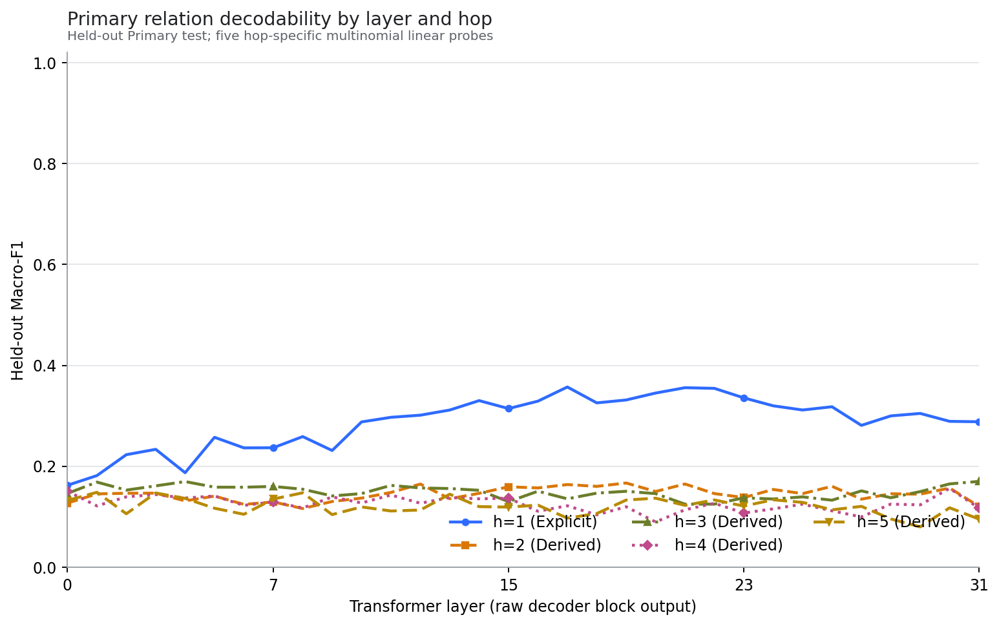
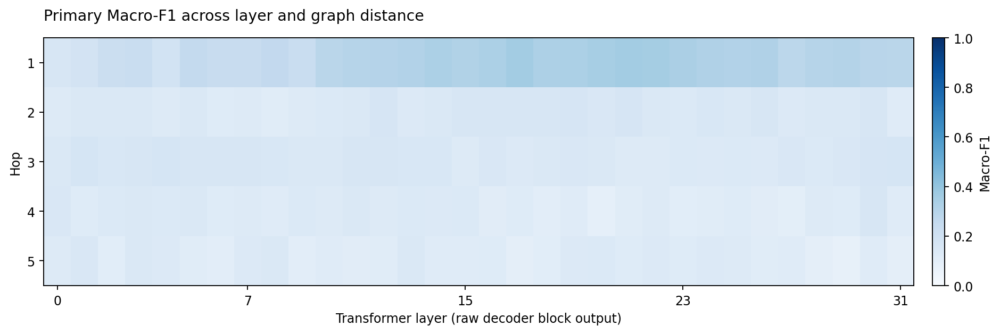
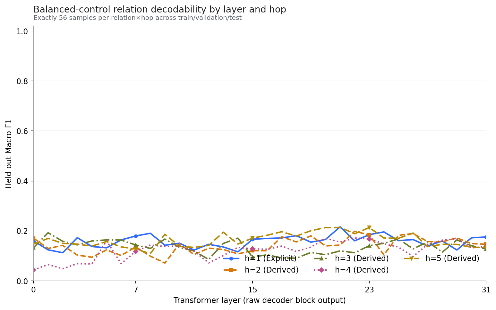
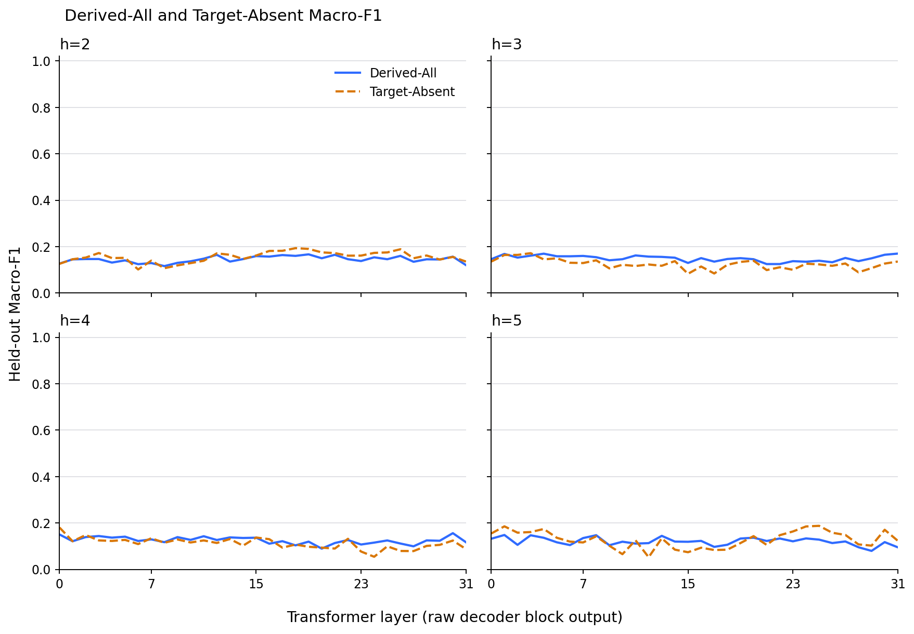
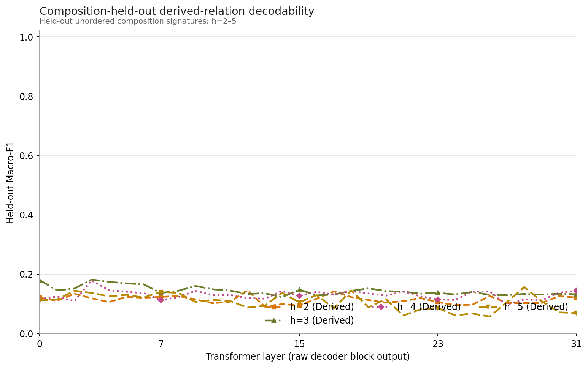
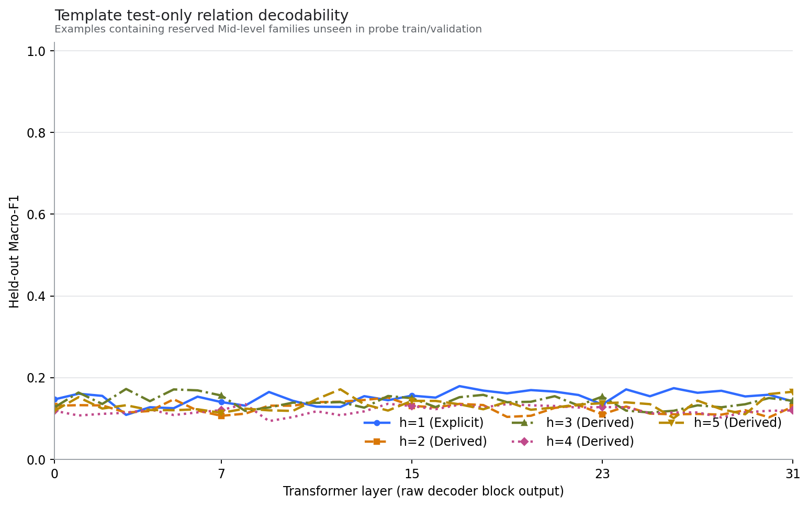

# Stage B1: Llama-3.1-8B Base Explicit / Derived Relation Probing

Status: **PASS**  
Scope: **Meta-Llama-3.1-8B Base only; no Tulu, SFT, DPO, RLVR, fine-tuning, steering, patching, or ablation was run.**

## Executive result

All 38 fail-closed post-run checks passed. The clearest result is that the explicit one-hop relation is substantially more linearly decodable than the derived relations: Primary h=1 peaks at Macro-F1 **0.3573** at layer 17, whereas h=2–5 peak between **0.1485 and 0.1702**. The four derived curves do not show a monotonic increase in onset depth with graph distance. This supports a Pattern-B-style reading—no evidence for the simple model “larger hop count becomes decodable systematically later”—while preserving the important distinction that h=1 is stronger.

These are correlational linear-readout results. They do not identify a reasoning layer, establish symbolic computation, or provide a causal mechanism.

## 1. Frozen scope and model

- Model: `Meta-Llama-3.1-8B Base` from `/home/ai/projects/reasoning-geometry-pilot/models/Meta-Llama-3.1-8B`.
- Model commit: `24ce1d3ac24d46a14b16dcb666c4fdd9147b87ea`; tokenizer commit: `c52792af35fe806a76530f3028f037d1af4e3490`.
- Parameters: 8,030,261,248; 32 decoder blocks; hidden size 4096; weights loaded as BF16.
- GPU: NVIDIA GeForce RTX 3090 (23.68 GiB).
- Frozen B0 Primary, Balanced, Composition-held-out, Target-Absent, and Template Test-only manifests were re-hashed after the experiment and remained unchanged.
- Union: 13,758 unique rows. The 32 float16 activation matrices plus row IDs occupy 3.36 GiB.

## 2. Prompt, tokenization, and activation definition

The frozen raw prompt was:

```text
Story:
<each original story sentence on its own line>

Question:
<original question>
```

No answer, chat wrapper, demonstrations, or chain-of-thought text was added. Tokenization used `add_special_tokens=False`, an explicit BOS, EOS as pad, and right padding. Readout was the final non-special token belonging to the question; all 120 audited examples selected the terminal `?`. The audit covered all 40 dataset×split cells and all 13,758 rows were checked for truncation safety (length 49–115, model limit 131072).

Activations are the raw output of each decoder block before the final RMSNorm, taken at that readout token. Sanity checks established 32 matrices of shape `[batch, 4096]`, layer 0/15 agreement with the matching Hugging Face hidden-state tuples, and final-layer raw-vs-normalized indexing consistency. Saved files have shape `[13758, 4096]`, dtype float16, exact row-ID order, and zero NaN/Inf. Sanity forward peak memory was 17.38 GiB allocated / 17.94 GiB reserved; extraction used batch size 32.

The formal 10-sample × 5-layer same-batch replay had minimum cosine 1.0000006, mean MAE 0.0, and maximum absolute error 0.0. A retained non-gate batch-size-1 diagnostic reached minimum cosine 0.999355; this is consistent with BF16 batch-shape numerical variation and is not a row-alignment failure. The fast tokenizer returned zero-length terminal offset mappings, so offset mapping was retained as a diagnostic only; exact token-ID decoding and the question-boundary/readout invariants were the gate criteria.

## 3. Probe protocol

Each layer and hop used a separate multinomial logistic regression. `StandardScaler` was fit on train only. Candidate C values were `[0.0001, 0.001, 0.01, 0.1, 1.0, 10.0, 100.0, 1000.0, 10000.0]`; validation Macro-F1 selected C, with smaller C winning exact ties, and test was accessed only after selection. Primary, Composition-held-out, and Template used balanced training weights; the exactly balanced control used no class weighting. No validation or test oversampling was performed.

The initial frozen solver was `lbfgs`, `max_iter=400`, `tol=1e-4`. Forty-one selected normal-label fits emitted convergence warnings. A fixed-C numerical audit refit exactly those models with `max_iter=2000` without reselecting C: all 41 converged, mean absolute test Macro-F1 change was 0.000972, maximum 0.011602. Two of five random-label warning refits still warned, but their maximum absolute test Macro-F1 change was 0.003641. The frozen 400-iteration values remain the reported primary results; the audit shows the main interpretation is not driven by those warnings.

## 4. Primary results

| Hop | Type | Peak layer | Peak Macro-F1 | 95% story-group CI | Majority Macro-F1 | L50 | L90 |
|---|---|---|---|---|---|---|---|
| 1 | Explicit | 17 | 0.3573 | [0.3234, 0.3904] | 0.0305 | 2 | 14 |
| 2 | Derived | 19 | 0.1670 | [0.1357, 0.1981] | 0.0297 | 0 | 15 |
| 3 | Derived | 31 | 0.1702 | [0.1311, 0.2055] | 0.0334 | 0 | 1 |
| 4 | Derived | 30 | 0.1563 | [0.1159, 0.1988] | 0.0344 | 0 | not reached |
| 5 | Derived | 1 | 0.1485 | [0.0847, 0.2118] | 0.0399 | 0 | not reached |

L50/L90 use the pre-frozen normalized gain from majority-class Macro-F1 to the hop-specific peak. L90 additionally requires the next two available layers to remain at least 85% of normalized peak; therefore h=4 and h=5 do not reach stable L90. The h=3 L90 at layer 1 and h=5 peak at layer 1 demonstrate why these summaries must not be interpreted as a monotonic reasoning timeline.



The explicit curve rises from 0.1625 at layer 0 to a broad mid/late-layer region around 0.30–0.36. Derived curves remain clustered near 0.10–0.17 without systematic hop ordering.



## 5. Balanced control

| Hop | Peak layer | Peak Macro-F1 | Difference from Primary peak |
|---|---|---|---|
| 1 | 21 | 0.2163 | -0.1409 |
| 2 | 22 | 0.1987 | 0.0318 |
| 3 | 1 | 0.1928 | 0.0226 |
| 4 | 22 | 0.1719 | 0.0156 |
| 5 | 21 | 0.2139 | 0.0653 |



Balancing materially reduces the h=1 peak (0.2163 versus 0.3573) and removes its broad high late-layer plateau. The derived curves remain low and irregular. Thus the Primary h=1 magnitude is partly sensitive to data volume/distribution, while neither dataset supports monotonic h=2→h=5 onset ordering.

## 6. Target-Absent evaluation

The Primary probe was reused without retraining. Values below compare Target-Absent with Derived-All at each hop's Primary peak layer; the final column gives the Target-Absent curve's own peak.

| Hop | Primary peak layer | Derived-All F1 | Target-Absent F1 | Target−All | Target-Absent own peak |
|---|---|---|---|---|---|
| 2 | 19 | 0.1670 | 0.1904 | 0.0235 | L18 / 0.1936 |
| 3 | 31 | 0.1702 | 0.1360 | -0.0342 | L3 / 0.1720 |
| 4 | 30 | 0.1563 | 0.1246 | -0.0318 | L0 / 0.1807 |
| 5 | 1 | 0.1485 | 0.1857 | 0.0372 | L25 / 0.1879 |



There is no uniform collapse under Target-Absent: the difference changes sign by hop and remains modest in scale. The result therefore does not support the claim that Primary derived decoding is mainly explained by an explicitly present target-relation sentence.

## 7. Composition-held-out

| Hop | Peak layer | Peak Macro-F1 | Difference from Primary peak |
|---|---|---|---|
| 2 | 12 | 0.1453 | -0.0216 |
| 3 | 3 | 0.1818 | 0.0116 |
| 4 | 3 | 0.1787 | 0.0224 |
| 5 | 28 | 0.1565 | 0.0079 |



Composition-held-out performance remains low. Relative to the separate IID peak it is lower for h=2, slightly higher for h=3–5, so there is no consistent composition-generalization penalty. Because these are different frozen test sets and peak layers, the differences are descriptive, not paired causal effects.

## 8. Template Test-only

| Hop | Peak layer | Peak Macro-F1 | Difference from Primary peak |
|---|---|---|---|
| 1 | 17 | 0.1794 | -0.1779 |
| 2 | 14 | 0.1514 | -0.0156 |
| 3 | 3 | 0.1724 | 0.0022 |
| 4 | 14 | 0.1361 | -0.0202 |
| 5 | 12 | 0.1716 | 0.0231 |



The explicit h=1 peak falls from 0.3573 IID to 0.1794 on reserved templates, whereas derived peak differences are small and mixed. This is evidence that the strong explicit-relation readout is sensitive to unseen surface templates; it is not evidence that all derived information is template invariant, since their absolute performance is already weak.

## 9. Controls and uncertainty

Primary majority-class baselines:

| Hop | Majority relation | n test | Accuracy | Macro-F1 |
|---|---|---|---|---|
| 1 | BELOW | 712 | 0.1390 | 0.0305 |
| 2 | RIGHT | 505 | 0.1347 | 0.0297 |
| 3 | LOWER_RIGHT | 422 | 0.1540 | 0.0334 |
| 4 | UPPER_LEFT | 282 | 0.1596 | 0.0344 |
| 5 | LOWER_LEFT | 142 | 0.1901 | 0.0399 |

Randomizing train labels at layers 0, 7, 15, 23, 31 for hops 1, 3, 5 produced mean accuracy **0.1285** and mean Macro-F1 **0.1247**. The matched normal-label mean Macro-F1 was **0.1790**, a mean degradation of **0.0543**. The random-label accuracy is close to the eight-class theoretical chance value 0.125. Primary peak uncertainty uses 1,000 resamples at the `story_group_id` level, not independent row resampling.

## 10. Gate audit

The independent post-run validator passed all 38 checks: split hashes, prompt/token readout, raw 32-layer definition, all-file finite-value scan, row alignment, result cardinalities, train-only scaling, validation-only C selection and tie rule, complete controls, checkpoint/figure presence, and absence of post-trained checkpoints. The formal machine-readable result is `validation_pre_report.json`.

## 11. Supported and unsupported conclusions

Supported:

- Explicit h=1 relation information is more strongly linearly decodable than h=2–5 derived information under this frozen Base-model protocol.
- No monotonic hop-distance ordering is visible among h=2–5; a simple “more hops means later decodability” account is unsupported.
- The strong explicit curve is attenuated by both exact balancing and reserved-template evaluation.
- Target-Absent and Composition-held-out controls do not show a uniform large degradation.
- Random-label controls are near chance and clearly worse than matched normal-label probes.

Not supported:

- No layer can be called a symbolic reasoning, grounding, or causal computation layer.
- Linear decodability does not show that the model uses the decoded relation to answer.
- Peak layers, L50, or L90 do not identify the step at which a reasoning operation occurs.
- Differences between frozen test sets should not be treated as paired causal effects.
- These Base-model findings cannot be generalized to Tulu or another post-trained checkpoint before running the separately gated comparison.

## 12. Decision

Stage B1 status is **PASS**. Proceeding to a separately approved Tulu stage is methodologically reasonable because the Base pipeline, integrity checks, controls, and fail-closed validation all pass. The motivation should be a preregistered Base-vs-post-training comparison, not an attempt to force hop ordering. This run stops here and has not loaded any post-trained checkpoint.
