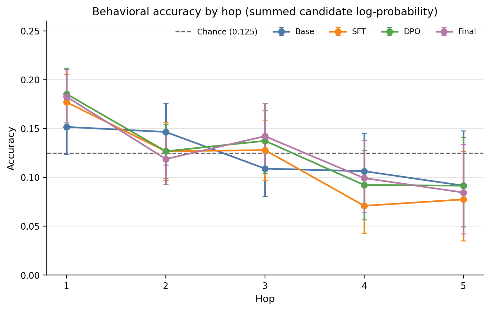
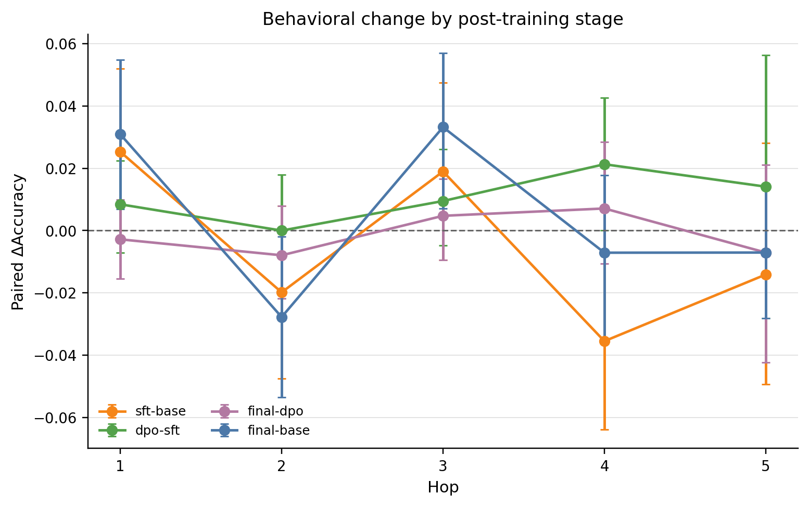
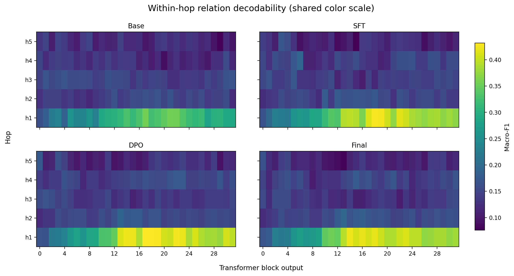
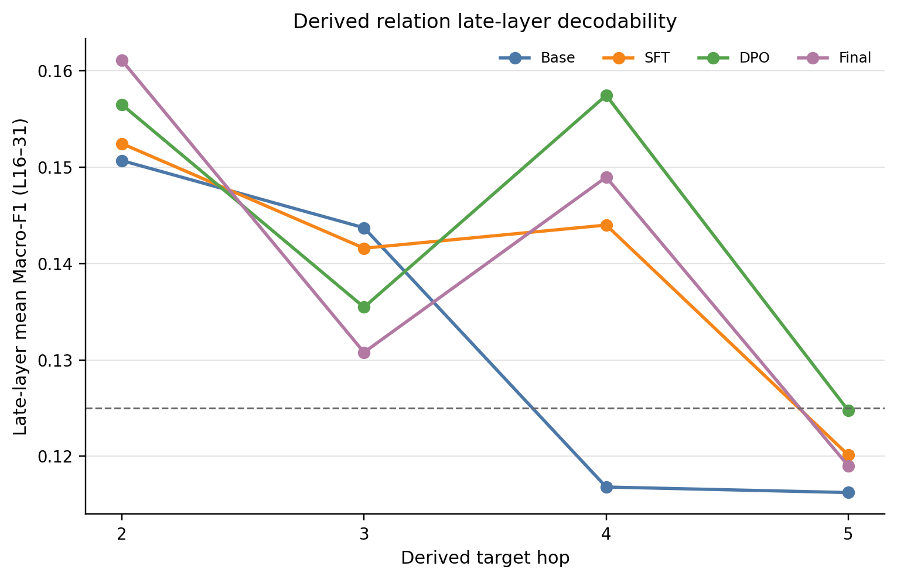
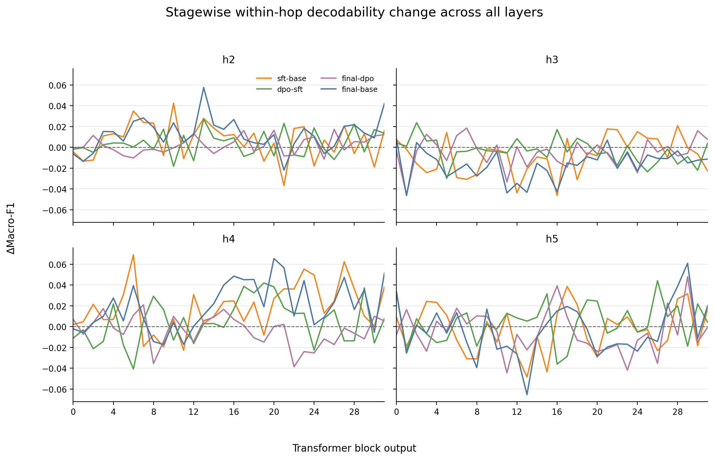
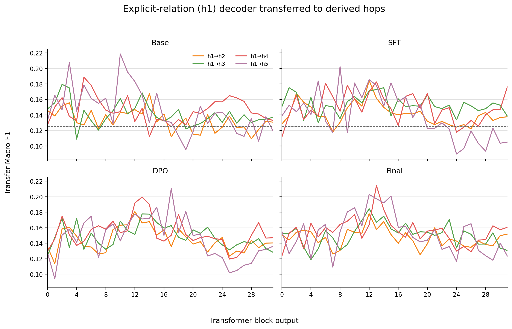
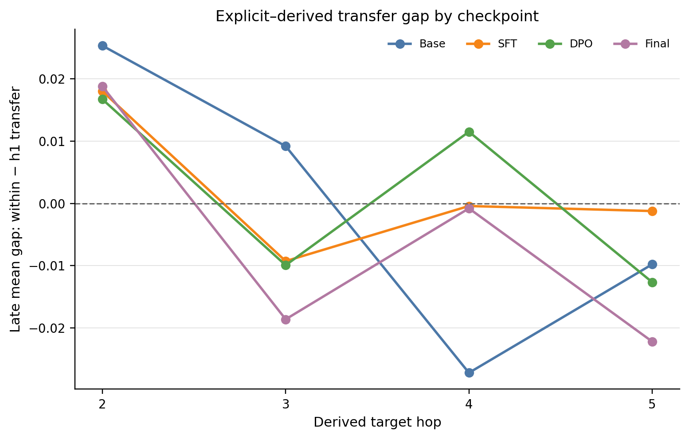
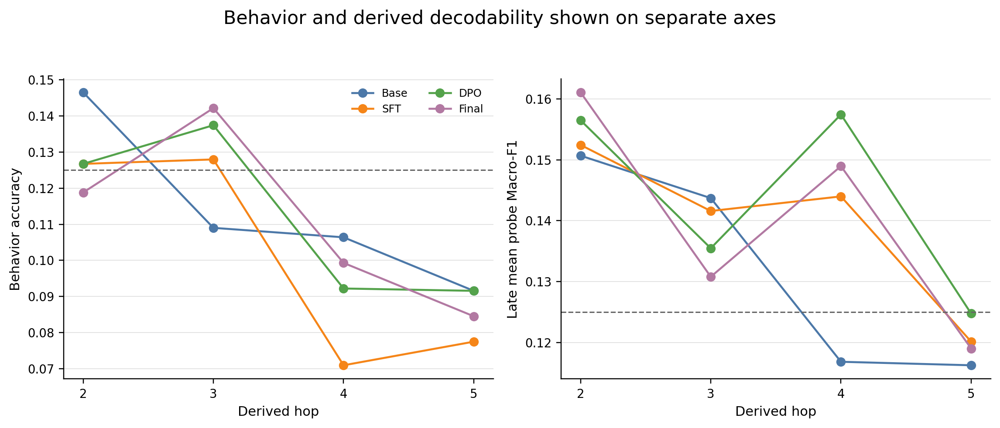
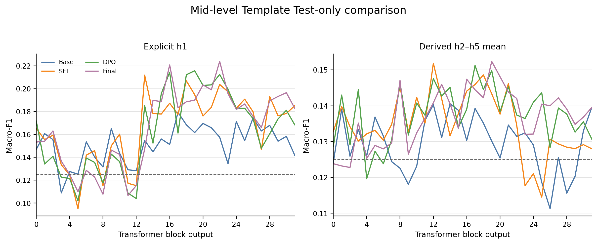
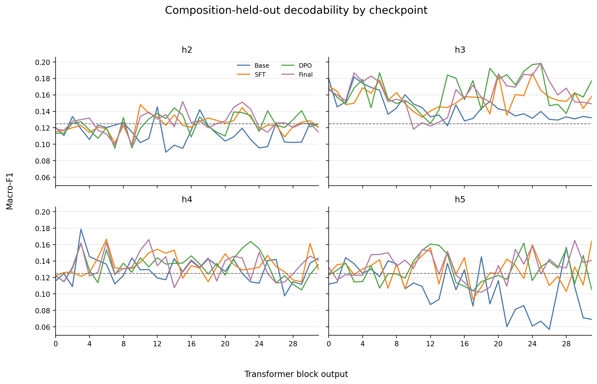

# Stage B2 图像解读指南

本页按“图展示什么—看到什么—不能怎样解释”说明 B2 的 10 张正式图。四个 checkpoint 分别是 Base、SFT、DPO 和 Final/RLVR；主要统计范围是预注册的晚层 L16–31，而不是事后选择的单个峰值层。

## 图 1：各 hop 的行为正确率

该图比较四个 checkpoint 在冻结 Primary 样本上的候选答案条件似然准确率。共同特征是 h1 高于多数派生 hop，且没有 Base→SFT→DPO→Final 的单调上升。Derived mean 为 Base 0.1134、SFT 0.1008、DPO 0.1120、Final 0.1112，因此后训练没有形成稳定的多步行为提升。

## 图 2：相邻训练阶段的行为变化

该图使用同一 story group 的配对 bootstrap 比较阶段差值。Base→SFT 的 derived 平均变化最大，但方向为 -0.0126；SFT→DPO 大致恢复该下降。误差区间跨越 0 的 hop 不应描述为可靠提升或下降。

## 图 3：32 层 × 5 hop 的 within-hop 可解码性

四张热图使用相同色标，展示每个 checkpoint 的完整层—hop 结构。最稳定的变化集中在 h1：晚层均值从 Base 0.3218 提高到 SFT 0.3907、DPO 0.4045、Final 0.3948。h2–h5 较弱且方向不一致，所以不能把 h1 增强推广为整体多步推理表征增强。

## 图 4：派生 hop 的晚层均值

该图把 L16–31 的 Macro-F1 先在层上平均，再按 h2–h5 展示。四阶段 derived 总均值为 0.1319、0.1395、0.1435、0.1400，变化幅度很小；各 hop 的 paired 95% CI 均未提供一致提升证据。DPO 的数值最高不等于 DPO 已建立更强推理机制。

## 图 5：逐层阶段差值曲线

该图保留所有层的阶段差值，用于判断变化是广泛分布还是由少数峰值驱动。曲线在 hop、层和阶段之间存在正负混合，说明不存在简单的单向训练轨迹。解释应优先看预注册晚层平均与配对区间，而不是挑选最大的单层差值。

## 图 6：h1 训练 probe 向 h2–h5 的迁移

该图测试显式一步关系上训练的线性分类器能否直接迁移到派生关系。晚层 derived transfer mean 从 Base 0.1325 增至 Final 0.1457，但绝对值仍弱，且连续阶段变化分散。它最多支持有限的共享线性可访问结构，不能证明共享符号关系代码。

## 图 7：within-hop 与 h1-transfer 的差值

TransferGap 定义为 within-hop Macro-F1 减去 h1-transfer Macro-F1。接近零表示两者表现接近，但当两者都接近随机水平时，接近零并不代表强共享。图中不同 hop 和 checkpoint 的符号混合，没有显示随后训练一致缩小的 gap。

## 图 8：行为与线性可解码性并列

两个面板有意分开绘制，因为行为准确率与 probe Macro-F1 不是同一量纲。h1 的线性可解码性在后训练后明显提高，但行为正确率没有对应的单调改善。这种分离说明“隐藏状态中可线性读取”不能替代“模型生成时实际使用”。

## 图 9：未见模板 Test-only 控制

该控制只在 probe 的训练和验证阶段保留未见的 Mid-level 模板家族。h1 晚层均值由 Base 0.1609 增至 Final 0.1923；derived 均值由 0.1282 增至 0.1411，但结论仍为 MIXED。它检验的是指定模板家族，不代表所有推理路径或语言表面形式都未见。

## 图 10：Composition-heldout 控制

该图评价冻结的未见无序 composition signatures。Derived late mean 从 Base 0.1175 到 SFT 0.1357、DPO 0.1389、Final 0.1398，但 h2–h5 并非一致改善。结果说明部分结构外推数值有所变化，仍不足以支持普遍的组合推理增强。

## 总体解释

B2 最稳健的结果是后训练与 h1 显式关系的晚层线性可解码性增强相关。派生关系的行为、within-hop 解码和跨 hop 迁移均呈弱而混合的变化，因此不能声称 Final/RLVR 创造了符号推理机制、某一层是“推理层”，或 probe 改善导致行为改善。
