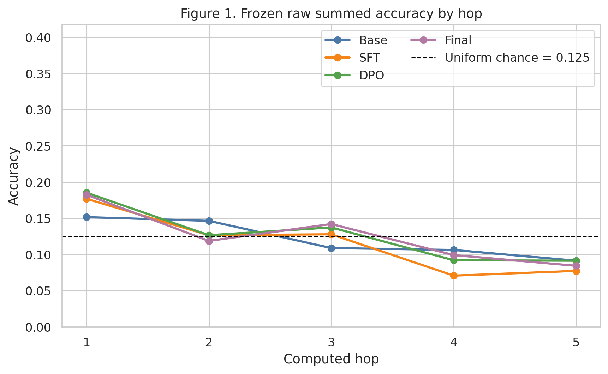
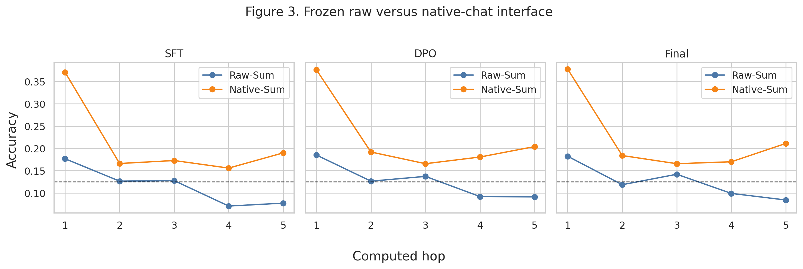
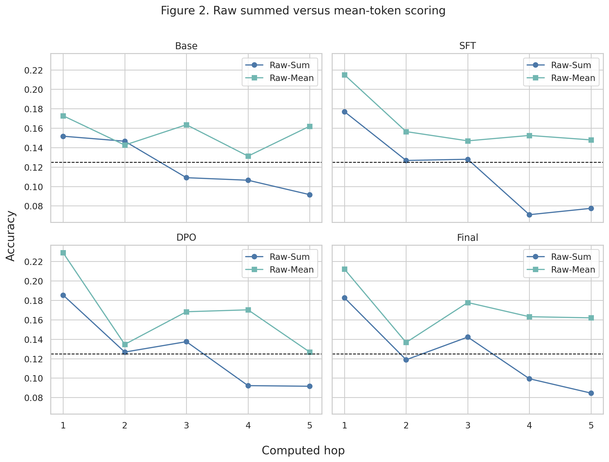
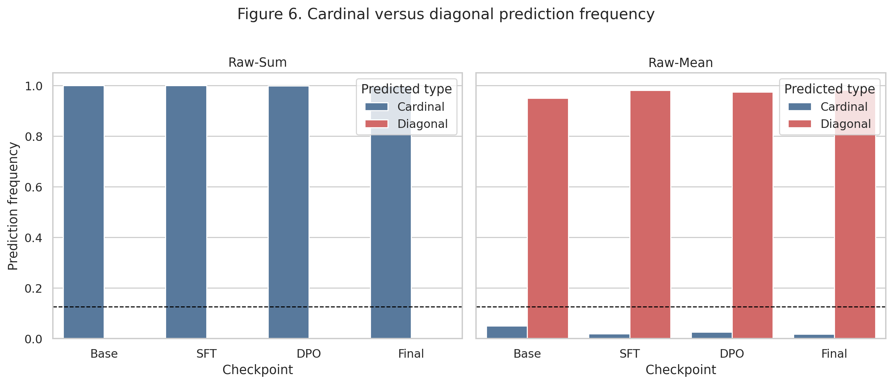
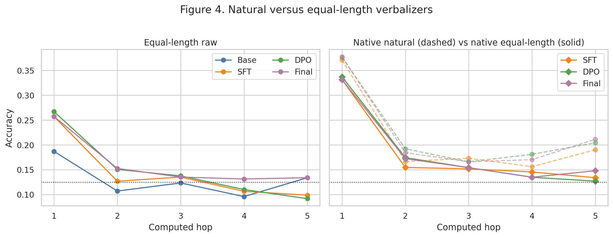
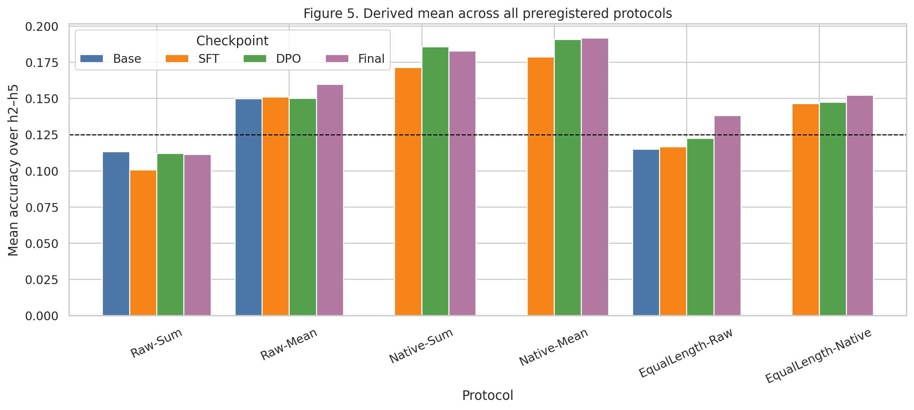
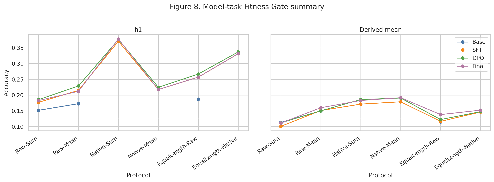
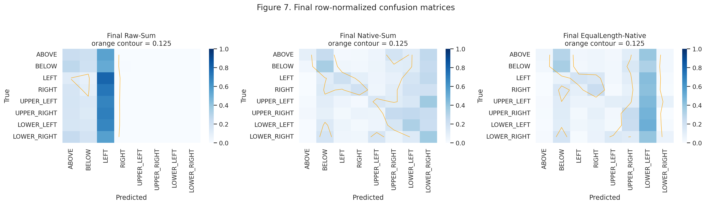

# Stage B2.1 Model-task Fitness Gate

## 1. Research question

本阶段不研究 hidden-state mechanism，也不训练或重跑 probe。核心问题是：冻结 B2 中 h2–h5 较低的八分类行为准确率，究竟主要来自模型的多步空间推理能力不足，还是来自 raw prompt、post-training chat interface 不匹配以及自然 verbalizer 的 token 长度不对称。所有结论均限定于 zero-shot、constrained-choice、teacher-forced candidate likelihood。

## 2. Frozen reference

- 冻结 Primary test 共 **2063** 行；h1–h5 分别为 712/505/422/282/142，row-ID SHA-256 为 `dbc5bf84903b9d177c7f02f32e4e6226082c61be7498e466b7e3f8e0c84ee950`。
- 四个 checkpoint 为 Base、SFT、DPO、Final；审计确认均为 32 层、hidden size 4096。Tulu revision 是 **ModelScope `.msc` local revision**，不是 Hugging Face commit。
- Raw prompt 精确保持 `Story:
...

Question:
...`，`add_special_tokens=False` 后显式加入 BOS；不含 system、chat wrapper、CoT、few-shot 或答案格式说明。
- 自然候选固定为 above/below/left/right 及四个 hyphenated diagonal；原 score 为候选 token log-probability 求和。
- 新阶段写入独立 `artifacts/stage_b2_1/`。审计前保护快照覆盖 2098 个旧文件。

方法依据：StepGame 用于多跳文本空间关系推理；Llama 3.1 与 Tülu 3 的接口差异提示 post-trained checkpoint 应额外在其原生对话模板下做 task-fitness 诊断。统计不以测试集调参；95% CI 用 `story_group_id` 为单位、2,000 次配对 bootstrap，固定 seed=20260910。

## 3. Experiment A — Frozen Raw Reproduction

Gate A 为 **PASS**。四模型每个 hop 的正确样本整数与冻结 B2 完全相同；JSON/CSV 浮点回读产生的最大表示差约 1e-16，但有理数 accuracy 与 row-level argmax 未改变。候选分数直接复用旧 artifact，并记录来源 SHA-256，避免不必要的 GPU 重算。

| model | protocol | hop | n_test | accuracy | accuracy_ci95_low | accuracy_ci95_high | macro_f1 | macro_f1_ci95_low | macro_f1_ci95_high | balanced_accuracy | majority_accuracy | uniform_chance |
|---|---|---|---|---|---|---|---|---|---|---|---|---|
| base | Raw-Sum | 1.0000 | 712.0000 | 0.1517 | 0.1264 | 0.1784 | 0.0599 | 0.0494 | 0.0708 | 0.1495 | 0.1390 | 0.1250 |
| base | Raw-Sum | 2.0000 | 505.0000 | 0.1465 | 0.1168 | 0.1802 | 0.0637 | 0.0489 | 0.0811 | 0.1465 | 0.1347 | 0.1250 |
| base | Raw-Sum | 3.0000 | 422.0000 | 0.1090 | 0.0782 | 0.1398 | 0.0452 | 0.0319 | 0.0583 | 0.1411 | 0.1540 | 0.1250 |
| base | Raw-Sum | 4.0000 | 282.0000 | 0.1064 | 0.0709 | 0.1454 | 0.0468 | 0.0310 | 0.0628 | 0.1370 | 0.1596 | 0.1250 |
| base | Raw-Sum | 5.0000 | 142.0000 | 0.0915 | 0.0493 | 0.1479 | 0.0410 | 0.0180 | 0.0669 | 0.1449 | 0.1901 | 0.1250 |
| sft | Raw-Sum | 1.0000 | 712.0000 | 0.1770 | 0.1489 | 0.2051 | 0.0990 | 0.0824 | 0.1150 | 0.1708 | 0.1390 | 0.1250 |
| sft | Raw-Sum | 2.0000 | 505.0000 | 0.1267 | 0.0970 | 0.1545 | 0.0668 | 0.0517 | 0.0814 | 0.1284 | 0.1347 | 0.1250 |
| sft | Raw-Sum | 3.0000 | 422.0000 | 0.1280 | 0.0972 | 0.1611 | 0.0743 | 0.0569 | 0.0917 | 0.1614 | 0.1540 | 0.1250 |
| sft | Raw-Sum | 4.0000 | 282.0000 | 0.0709 | 0.0426 | 0.1028 | 0.0383 | 0.0224 | 0.0555 | 0.0920 | 0.1596 | 0.1250 |
| sft | Raw-Sum | 5.0000 | 142.0000 | 0.0775 | 0.0352 | 0.1268 | 0.0368 | 0.0179 | 0.0568 | 0.1212 | 0.1901 | 0.1250 |
| dpo | Raw-Sum | 1.0000 | 712.0000 | 0.1854 | 0.1573 | 0.2149 | 0.1010 | 0.0854 | 0.1173 | 0.1796 | 0.1390 | 0.1250 |
| dpo | Raw-Sum | 2.0000 | 505.0000 | 0.1267 | 0.0970 | 0.1564 | 0.0663 | 0.0514 | 0.0821 | 0.1281 | 0.1347 | 0.1250 |
| dpo | Raw-Sum | 3.0000 | 422.0000 | 0.1374 | 0.1066 | 0.1706 | 0.0797 | 0.0604 | 0.0991 | 0.1745 | 0.1540 | 0.1250 |
| dpo | Raw-Sum | 4.0000 | 282.0000 | 0.0922 | 0.0603 | 0.1277 | 0.0482 | 0.0302 | 0.0673 | 0.1192 | 0.1596 | 0.1250 |
| dpo | Raw-Sum | 5.0000 | 142.0000 | 0.0915 | 0.0493 | 0.1408 | 0.0434 | 0.0216 | 0.0651 | 0.1430 | 0.1901 | 0.1250 |
| final | Raw-Sum | 1.0000 | 712.0000 | 0.1826 | 0.1545 | 0.2107 | 0.0952 | 0.0798 | 0.1111 | 0.1770 | 0.1390 | 0.1250 |
| final | Raw-Sum | 2.0000 | 505.0000 | 0.1188 | 0.0911 | 0.1485 | 0.0562 | 0.0425 | 0.0711 | 0.1200 | 0.1347 | 0.1250 |
| final | Raw-Sum | 3.0000 | 422.0000 | 0.1422 | 0.1114 | 0.1754 | 0.0841 | 0.0640 | 0.1037 | 0.1817 | 0.1540 | 0.1250 |
| final | Raw-Sum | 4.0000 | 282.0000 | 0.0993 | 0.0674 | 0.1348 | 0.0471 | 0.0277 | 0.0670 | 0.1271 | 0.1596 | 0.1250 |
| final | Raw-Sum | 5.0000 | 142.0000 | 0.0845 | 0.0423 | 0.1338 | 0.0380 | 0.0174 | 0.0604 | 0.1335 | 0.1901 | 0.1250 |

图 1 显示冻结 Raw-Sum 的完整基线，而不是选择最佳 checkpoint 作标题。h1 本身仅略高于 0.125；h2–h5 随 hop 增加总体下降，且 post-training checkpoint 未形成一致的单调优势。这一图只描述 frozen common interface 下的行为，不能单独推出模型绝对不会推理。

## 4. Experiment B — Native Chat Template

SFT/DPO/Final 均使用各 tokenizer 实际 `chat_template` 和 `apply_chat_template(..., add_generation_prompt=True)`；没有手写模板。模板文本是否完全一致：**True**。每 checkpoint 完成 3 deterministic rows × 5 hops × 8 candidates = 120 项边界审计；candidate 不写入 prompt，continuation 边界与独立 tokenization 一致。

| model | protocol | hop | n_test | accuracy | accuracy_ci95_low | accuracy_ci95_high | macro_f1 | macro_f1_ci95_low | macro_f1_ci95_high | balanced_accuracy | majority_accuracy | uniform_chance |
|---|---|---|---|---|---|---|---|---|---|---|---|---|
| sft | Native-Sum | 1.0000 | 712.0000 | 0.3708 | 0.3343 | 0.4045 | 0.3746 | 0.3363 | 0.4078 | 0.3678 | 0.1390 | 0.1250 |
| sft | Native-Sum | 2.0000 | 505.0000 | 0.1663 | 0.1347 | 0.1980 | 0.1380 | 0.1094 | 0.1666 | 0.1698 | 0.1347 | 0.1250 |
| sft | Native-Sum | 3.0000 | 422.0000 | 0.1730 | 0.1374 | 0.2085 | 0.1449 | 0.1102 | 0.1782 | 0.1594 | 0.1540 | 0.1250 |
| sft | Native-Sum | 4.0000 | 282.0000 | 0.1560 | 0.1135 | 0.1986 | 0.0984 | 0.0704 | 0.1274 | 0.1366 | 0.1596 | 0.1250 |
| sft | Native-Sum | 5.0000 | 142.0000 | 0.1901 | 0.1268 | 0.2535 | 0.1088 | 0.0697 | 0.1504 | 0.1417 | 0.1901 | 0.1250 |
| sft | Native-Mean | 1.0000 | 712.0000 | 0.2177 | 0.1868 | 0.2500 | 0.1537 | 0.1335 | 0.1740 | 0.2236 | 0.1390 | 0.1250 |
| sft | Native-Mean | 2.0000 | 505.0000 | 0.1723 | 0.1406 | 0.2040 | 0.1095 | 0.0879 | 0.1306 | 0.1756 | 0.1347 | 0.1250 |
| sft | Native-Mean | 3.0000 | 422.0000 | 0.1754 | 0.1398 | 0.2133 | 0.1000 | 0.0789 | 0.1214 | 0.1446 | 0.1540 | 0.1250 |
| sft | Native-Mean | 4.0000 | 282.0000 | 0.1702 | 0.1277 | 0.2128 | 0.0877 | 0.0649 | 0.1103 | 0.1408 | 0.1596 | 0.1250 |
| sft | Native-Mean | 5.0000 | 142.0000 | 0.1972 | 0.1338 | 0.2676 | 0.0906 | 0.0599 | 0.1216 | 0.1383 | 0.1901 | 0.1250 |
| dpo | Native-Sum | 1.0000 | 712.0000 | 0.3764 | 0.3427 | 0.4116 | 0.3795 | 0.3445 | 0.4150 | 0.3746 | 0.1390 | 0.1250 |
| dpo | Native-Sum | 2.0000 | 505.0000 | 0.1921 | 0.1604 | 0.2257 | 0.1640 | 0.1338 | 0.1939 | 0.1961 | 0.1347 | 0.1250 |
| dpo | Native-Sum | 3.0000 | 422.0000 | 0.1659 | 0.1327 | 0.2014 | 0.1364 | 0.1043 | 0.1683 | 0.1512 | 0.1540 | 0.1250 |
| dpo | Native-Sum | 4.0000 | 282.0000 | 0.1809 | 0.1383 | 0.2270 | 0.1233 | 0.0888 | 0.1576 | 0.1580 | 0.1596 | 0.1250 |
| dpo | Native-Sum | 5.0000 | 142.0000 | 0.2042 | 0.1338 | 0.2746 | 0.1078 | 0.0690 | 0.1489 | 0.1489 | 0.1901 | 0.1250 |
| dpo | Native-Mean | 1.0000 | 712.0000 | 0.2247 | 0.1952 | 0.2556 | 0.1556 | 0.1362 | 0.1745 | 0.2307 | 0.1390 | 0.1250 |
| dpo | Native-Mean | 2.0000 | 505.0000 | 0.1802 | 0.1465 | 0.2139 | 0.1162 | 0.0936 | 0.1389 | 0.1837 | 0.1347 | 0.1250 |
| dpo | Native-Mean | 3.0000 | 422.0000 | 0.1659 | 0.1327 | 0.2014 | 0.0947 | 0.0742 | 0.1158 | 0.1368 | 0.1540 | 0.1250 |
| dpo | Native-Mean | 4.0000 | 282.0000 | 0.1915 | 0.1454 | 0.2411 | 0.1008 | 0.0743 | 0.1275 | 0.1585 | 0.1596 | 0.1250 |
| dpo | Native-Mean | 5.0000 | 142.0000 | 0.2254 | 0.1549 | 0.2958 | 0.1019 | 0.0707 | 0.1348 | 0.1591 | 0.1901 | 0.1250 |
| final | Native-Sum | 1.0000 | 712.0000 | 0.3778 | 0.3455 | 0.4129 | 0.3776 | 0.3431 | 0.4112 | 0.3755 | 0.1390 | 0.1250 |
| final | Native-Sum | 2.0000 | 505.0000 | 0.1842 | 0.1525 | 0.2198 | 0.1618 | 0.1310 | 0.1938 | 0.1869 | 0.1347 | 0.1250 |
| final | Native-Sum | 3.0000 | 422.0000 | 0.1659 | 0.1327 | 0.2038 | 0.1374 | 0.1070 | 0.1698 | 0.1513 | 0.1540 | 0.1250 |
| final | Native-Sum | 4.0000 | 282.0000 | 0.1702 | 0.1277 | 0.2199 | 0.1226 | 0.0893 | 0.1569 | 0.1510 | 0.1596 | 0.1250 |
| final | Native-Sum | 5.0000 | 142.0000 | 0.2113 | 0.1479 | 0.2817 | 0.1255 | 0.0828 | 0.1670 | 0.1610 | 0.1901 | 0.1250 |
| final | Native-Mean | 1.0000 | 712.0000 | 0.2177 | 0.1882 | 0.2486 | 0.1501 | 0.1307 | 0.1691 | 0.2236 | 0.1390 | 0.1250 |
| final | Native-Mean | 2.0000 | 505.0000 | 0.1842 | 0.1525 | 0.2178 | 0.1202 | 0.0989 | 0.1415 | 0.1864 | 0.1347 | 0.1250 |
| final | Native-Mean | 3.0000 | 422.0000 | 0.1730 | 0.1374 | 0.2085 | 0.0995 | 0.0787 | 0.1195 | 0.1428 | 0.1540 | 0.1250 |
| final | Native-Mean | 4.0000 | 282.0000 | 0.1915 | 0.1454 | 0.2376 | 0.1099 | 0.0815 | 0.1362 | 0.1577 | 0.1596 | 0.1250 |
| final | Native-Mean | 5.0000 | 142.0000 | 0.2183 | 0.1549 | 0.2887 | 0.1018 | 0.0703 | 0.1327 | 0.1539 | 0.1901 | 0.1250 |

图 3 将同一冻结样本、同一自然候选的 Raw-Sum 与 Native-Sum 并列。差异回答的是“接口是否改变任务表现”，不是“chat template 改善 hidden representation”。若某 hop 上升而其他 hop 不稳定，结论记为 MIXED，不用单一最佳点替代全量结果。

## 5. Experiment C1 — Sum vs Mean-token

| model | protocol | hop | n_test | accuracy | accuracy_ci95_low | accuracy_ci95_high | macro_f1 | macro_f1_ci95_low | macro_f1_ci95_high | balanced_accuracy | majority_accuracy | uniform_chance |
|---|---|---|---|---|---|---|---|---|---|---|---|---|
| base | Raw-Sum | 1.0000 | 712.0000 | 0.1517 | 0.1264 | 0.1784 | 0.0599 | 0.0494 | 0.0708 | 0.1495 | 0.1390 | 0.1250 |
| base | Raw-Sum | 2.0000 | 505.0000 | 0.1465 | 0.1168 | 0.1802 | 0.0637 | 0.0489 | 0.0811 | 0.1465 | 0.1347 | 0.1250 |
| base | Raw-Sum | 3.0000 | 422.0000 | 0.1090 | 0.0782 | 0.1398 | 0.0452 | 0.0319 | 0.0583 | 0.1411 | 0.1540 | 0.1250 |
| base | Raw-Sum | 4.0000 | 282.0000 | 0.1064 | 0.0709 | 0.1454 | 0.0468 | 0.0310 | 0.0628 | 0.1370 | 0.1596 | 0.1250 |
| base | Raw-Sum | 5.0000 | 142.0000 | 0.0915 | 0.0493 | 0.1479 | 0.0410 | 0.0180 | 0.0669 | 0.1449 | 0.1901 | 0.1250 |
| base | Raw-Mean | 1.0000 | 712.0000 | 0.1728 | 0.1460 | 0.2008 | 0.1293 | 0.1057 | 0.1524 | 0.1788 | 0.1390 | 0.1250 |
| base | Raw-Mean | 2.0000 | 505.0000 | 0.1426 | 0.1129 | 0.1723 | 0.0929 | 0.0712 | 0.1151 | 0.1427 | 0.1347 | 0.1250 |
| base | Raw-Mean | 3.0000 | 422.0000 | 0.1635 | 0.1280 | 0.1967 | 0.1049 | 0.0766 | 0.1332 | 0.1397 | 0.1540 | 0.1250 |
| base | Raw-Mean | 4.0000 | 282.0000 | 0.1312 | 0.0922 | 0.1702 | 0.0655 | 0.0415 | 0.0897 | 0.1061 | 0.1596 | 0.1250 |
| base | Raw-Mean | 5.0000 | 142.0000 | 0.1620 | 0.1056 | 0.2254 | 0.0831 | 0.0515 | 0.1161 | 0.1295 | 0.1901 | 0.1250 |
| sft | Raw-Sum | 1.0000 | 712.0000 | 0.1770 | 0.1489 | 0.2051 | 0.0990 | 0.0824 | 0.1150 | 0.1708 | 0.1390 | 0.1250 |
| sft | Raw-Sum | 2.0000 | 505.0000 | 0.1267 | 0.0970 | 0.1545 | 0.0668 | 0.0517 | 0.0814 | 0.1284 | 0.1347 | 0.1250 |
| sft | Raw-Sum | 3.0000 | 422.0000 | 0.1280 | 0.0972 | 0.1611 | 0.0743 | 0.0569 | 0.0917 | 0.1614 | 0.1540 | 0.1250 |
| sft | Raw-Sum | 4.0000 | 282.0000 | 0.0709 | 0.0426 | 0.1028 | 0.0383 | 0.0224 | 0.0555 | 0.0920 | 0.1596 | 0.1250 |
| sft | Raw-Sum | 5.0000 | 142.0000 | 0.0775 | 0.0352 | 0.1268 | 0.0368 | 0.0179 | 0.0568 | 0.1212 | 0.1901 | 0.1250 |
| sft | Raw-Mean | 1.0000 | 712.0000 | 0.2149 | 0.1868 | 0.2444 | 0.1683 | 0.1412 | 0.1960 | 0.2197 | 0.1390 | 0.1250 |
| sft | Raw-Mean | 2.0000 | 505.0000 | 0.1564 | 0.1267 | 0.1881 | 0.0957 | 0.0745 | 0.1166 | 0.1527 | 0.1347 | 0.1250 |
| sft | Raw-Mean | 3.0000 | 422.0000 | 0.1469 | 0.1137 | 0.1801 | 0.0774 | 0.0588 | 0.0955 | 0.1216 | 0.1540 | 0.1250 |
| sft | Raw-Mean | 4.0000 | 282.0000 | 0.1525 | 0.1135 | 0.1916 | 0.0849 | 0.0610 | 0.1094 | 0.1219 | 0.1596 | 0.1250 |
| sft | Raw-Mean | 5.0000 | 142.0000 | 0.1479 | 0.0915 | 0.2113 | 0.0771 | 0.0470 | 0.1116 | 0.1087 | 0.1901 | 0.1250 |
| dpo | Raw-Sum | 1.0000 | 712.0000 | 0.1854 | 0.1573 | 0.2149 | 0.1010 | 0.0854 | 0.1173 | 0.1796 | 0.1390 | 0.1250 |
| dpo | Raw-Sum | 2.0000 | 505.0000 | 0.1267 | 0.0970 | 0.1564 | 0.0663 | 0.0514 | 0.0821 | 0.1281 | 0.1347 | 0.1250 |
| dpo | Raw-Sum | 3.0000 | 422.0000 | 0.1374 | 0.1066 | 0.1706 | 0.0797 | 0.0604 | 0.0991 | 0.1745 | 0.1540 | 0.1250 |
| dpo | Raw-Sum | 4.0000 | 282.0000 | 0.0922 | 0.0603 | 0.1277 | 0.0482 | 0.0302 | 0.0673 | 0.1192 | 0.1596 | 0.1250 |
| dpo | Raw-Sum | 5.0000 | 142.0000 | 0.0915 | 0.0493 | 0.1408 | 0.0434 | 0.0216 | 0.0651 | 0.1430 | 0.1901 | 0.1250 |
| dpo | Raw-Mean | 1.0000 | 712.0000 | 0.2289 | 0.1994 | 0.2612 | 0.1872 | 0.1603 | 0.2138 | 0.2339 | 0.1390 | 0.1250 |
| dpo | Raw-Mean | 2.0000 | 505.0000 | 0.1347 | 0.1050 | 0.1663 | 0.0898 | 0.0698 | 0.1107 | 0.1342 | 0.1347 | 0.1250 |
| dpo | Raw-Mean | 3.0000 | 422.0000 | 0.1682 | 0.1351 | 0.2038 | 0.1003 | 0.0795 | 0.1220 | 0.1388 | 0.1540 | 0.1250 |
| dpo | Raw-Mean | 4.0000 | 282.0000 | 0.1702 | 0.1277 | 0.2163 | 0.1083 | 0.0792 | 0.1364 | 0.1379 | 0.1596 | 0.1250 |
| dpo | Raw-Mean | 5.0000 | 142.0000 | 0.1268 | 0.0773 | 0.1831 | 0.0764 | 0.0426 | 0.1095 | 0.0941 | 0.1901 | 0.1250 |
| final | Raw-Sum | 1.0000 | 712.0000 | 0.1826 | 0.1545 | 0.2107 | 0.0952 | 0.0798 | 0.1111 | 0.1770 | 0.1390 | 0.1250 |
| final | Raw-Sum | 2.0000 | 505.0000 | 0.1188 | 0.0911 | 0.1485 | 0.0562 | 0.0425 | 0.0711 | 0.1200 | 0.1347 | 0.1250 |
| final | Raw-Sum | 3.0000 | 422.0000 | 0.1422 | 0.1114 | 0.1754 | 0.0841 | 0.0640 | 0.1037 | 0.1817 | 0.1540 | 0.1250 |
| final | Raw-Sum | 4.0000 | 282.0000 | 0.0993 | 0.0674 | 0.1348 | 0.0471 | 0.0277 | 0.0670 | 0.1271 | 0.1596 | 0.1250 |
| final | Raw-Sum | 5.0000 | 142.0000 | 0.0845 | 0.0423 | 0.1338 | 0.0380 | 0.0174 | 0.0604 | 0.1335 | 0.1901 | 0.1250 |
| final | Raw-Mean | 1.0000 | 712.0000 | 0.2121 | 0.1812 | 0.2430 | 0.1678 | 0.1409 | 0.1933 | 0.2175 | 0.1390 | 0.1250 |
| final | Raw-Mean | 2.0000 | 505.0000 | 0.1366 | 0.1089 | 0.1683 | 0.0907 | 0.0716 | 0.1106 | 0.1361 | 0.1347 | 0.1250 |
| final | Raw-Mean | 3.0000 | 422.0000 | 0.1777 | 0.1422 | 0.2133 | 0.1068 | 0.0848 | 0.1275 | 0.1466 | 0.1540 | 0.1250 |
| final | Raw-Mean | 4.0000 | 282.0000 | 0.1631 | 0.1241 | 0.2057 | 0.1049 | 0.0783 | 0.1305 | 0.1326 | 0.1596 | 0.1250 |
| final | Raw-Mean | 5.0000 | 142.0000 | 0.1620 | 0.1056 | 0.2254 | 0.0914 | 0.0565 | 0.1260 | 0.1191 | 0.1901 | 0.1250 |

自然候选中 cardinal 通常为 1 token、diagonal 为 2 token。Raw-Mean 只把同一候选的 log-probability 除以 token 数，不引入长度惩罚 α、温度或校准。图 2 显示 hop 级准确率变化；图 6 检查预测落在 cardinal/diagonal 集合的频率，避免仅凭 aggregate accuracy 判断 token-length bias。精确的 true-class 分组 accuracy、gold-vs-best-other margin 与预测类型频率见 `scoring_sensitivity/cardinal_diagonal_metrics.csv`。

## 6. Experiment C2 — Equal-length Verbalizer

标签选择 Gate 为 **PASS**；固定映射是 `{"ABOVE": "A", "BELOW": "B", "LEFT": "C", "RIGHT": "D", "UPPER_LEFT": "E", "UPPER_RIGHT": "F", "LOWER_LEFT": "G", "LOWER_RIGHT": "H"}`，选择算法为 `preferred_A_to_H_all_boundaries_single_token`。候选选择只读取 tokenizer，不访问模型概率或 gold-conditioned performance。C2-Raw 与 C2-Native 都显式展示 relation→label mapping，因此属于 measurement-control / task-fitness diagnostic，不能替代 Experiment A。

| model | protocol | hop | n_test | accuracy | accuracy_ci95_low | accuracy_ci95_high | macro_f1 | macro_f1_ci95_low | macro_f1_ci95_high | balanced_accuracy | majority_accuracy | uniform_chance |
|---|---|---|---|---|---|---|---|---|---|---|---|---|
| base | EqualLength-Raw | 1.0000 | 712.0000 | 0.1868 | 0.1587 | 0.2163 | 0.1618 | 0.1350 | 0.1890 | 0.1851 | 0.1390 | 0.1250 |
| base | EqualLength-Raw | 2.0000 | 505.0000 | 0.1069 | 0.0812 | 0.1347 | 0.0886 | 0.0657 | 0.1131 | 0.1052 | 0.1347 | 0.1250 |
| base | EqualLength-Raw | 3.0000 | 422.0000 | 0.1232 | 0.0947 | 0.1564 | 0.1074 | 0.0797 | 0.1375 | 0.1487 | 0.1540 | 0.1250 |
| base | EqualLength-Raw | 4.0000 | 282.0000 | 0.0957 | 0.0638 | 0.1312 | 0.0870 | 0.0551 | 0.1186 | 0.1144 | 0.1596 | 0.1250 |
| base | EqualLength-Raw | 5.0000 | 142.0000 | 0.1338 | 0.0845 | 0.1972 | 0.1280 | 0.0720 | 0.1849 | 0.1801 | 0.1901 | 0.1250 |
| sft | EqualLength-Raw | 1.0000 | 712.0000 | 0.2570 | 0.2247 | 0.2893 | 0.2350 | 0.2040 | 0.2660 | 0.2548 | 0.1390 | 0.1250 |
| sft | EqualLength-Raw | 2.0000 | 505.0000 | 0.1267 | 0.0990 | 0.1564 | 0.1225 | 0.0947 | 0.1520 | 0.1261 | 0.1347 | 0.1250 |
| sft | EqualLength-Raw | 3.0000 | 422.0000 | 0.1351 | 0.1019 | 0.1706 | 0.1268 | 0.0949 | 0.1580 | 0.1535 | 0.1540 | 0.1250 |
| sft | EqualLength-Raw | 4.0000 | 282.0000 | 0.1064 | 0.0745 | 0.1418 | 0.0996 | 0.0679 | 0.1318 | 0.1198 | 0.1596 | 0.1250 |
| sft | EqualLength-Raw | 5.0000 | 142.0000 | 0.0986 | 0.0563 | 0.1479 | 0.0851 | 0.0451 | 0.1270 | 0.1094 | 0.1901 | 0.1250 |
| sft | EqualLength-Native | 1.0000 | 712.0000 | 0.3315 | 0.2978 | 0.3666 | 0.3069 | 0.2735 | 0.3376 | 0.3259 | 0.1390 | 0.1250 |
| sft | EqualLength-Native | 2.0000 | 505.0000 | 0.1545 | 0.1248 | 0.1861 | 0.1201 | 0.0938 | 0.1462 | 0.1544 | 0.1347 | 0.1250 |
| sft | EqualLength-Native | 3.0000 | 422.0000 | 0.1517 | 0.1161 | 0.1848 | 0.1100 | 0.0820 | 0.1382 | 0.1473 | 0.1540 | 0.1250 |
| sft | EqualLength-Native | 4.0000 | 282.0000 | 0.1454 | 0.1098 | 0.1879 | 0.1024 | 0.0711 | 0.1377 | 0.1413 | 0.1596 | 0.1250 |
| sft | EqualLength-Native | 5.0000 | 142.0000 | 0.1338 | 0.0775 | 0.1901 | 0.0805 | 0.0399 | 0.1216 | 0.1089 | 0.1901 | 0.1250 |
| dpo | EqualLength-Raw | 1.0000 | 712.0000 | 0.2669 | 0.2346 | 0.3006 | 0.2568 | 0.2241 | 0.2880 | 0.2660 | 0.1390 | 0.1250 |
| dpo | EqualLength-Raw | 2.0000 | 505.0000 | 0.1505 | 0.1188 | 0.1822 | 0.1399 | 0.1090 | 0.1721 | 0.1487 | 0.1347 | 0.1250 |
| dpo | EqualLength-Raw | 3.0000 | 422.0000 | 0.1374 | 0.1066 | 0.1707 | 0.1310 | 0.0998 | 0.1633 | 0.1508 | 0.1540 | 0.1250 |
| dpo | EqualLength-Raw | 4.0000 | 282.0000 | 0.1099 | 0.0745 | 0.1489 | 0.1036 | 0.0682 | 0.1394 | 0.1186 | 0.1596 | 0.1250 |
| dpo | EqualLength-Raw | 5.0000 | 142.0000 | 0.0915 | 0.0493 | 0.1408 | 0.0770 | 0.0380 | 0.1159 | 0.0854 | 0.1901 | 0.1250 |
| dpo | EqualLength-Native | 1.0000 | 712.0000 | 0.3371 | 0.3020 | 0.3722 | 0.3211 | 0.2849 | 0.3549 | 0.3324 | 0.1390 | 0.1250 |
| dpo | EqualLength-Native | 2.0000 | 505.0000 | 0.1743 | 0.1426 | 0.2099 | 0.1361 | 0.1080 | 0.1635 | 0.1731 | 0.1347 | 0.1250 |
| dpo | EqualLength-Native | 3.0000 | 422.0000 | 0.1540 | 0.1209 | 0.1896 | 0.1236 | 0.0945 | 0.1524 | 0.1507 | 0.1540 | 0.1250 |
| dpo | EqualLength-Native | 4.0000 | 282.0000 | 0.1348 | 0.0957 | 0.1738 | 0.0920 | 0.0612 | 0.1210 | 0.1287 | 0.1596 | 0.1250 |
| dpo | EqualLength-Native | 5.0000 | 142.0000 | 0.1268 | 0.0775 | 0.1831 | 0.0684 | 0.0371 | 0.1046 | 0.0936 | 0.1901 | 0.1250 |
| final | EqualLength-Raw | 1.0000 | 712.0000 | 0.2570 | 0.2247 | 0.2879 | 0.2463 | 0.2138 | 0.2759 | 0.2568 | 0.1390 | 0.1250 |
| final | EqualLength-Raw | 2.0000 | 505.0000 | 0.1525 | 0.1228 | 0.1842 | 0.1390 | 0.1104 | 0.1692 | 0.1502 | 0.1347 | 0.1250 |
| final | EqualLength-Raw | 3.0000 | 422.0000 | 0.1351 | 0.1043 | 0.1682 | 0.1186 | 0.0883 | 0.1471 | 0.1400 | 0.1540 | 0.1250 |
| final | EqualLength-Raw | 4.0000 | 282.0000 | 0.1312 | 0.0922 | 0.1738 | 0.1173 | 0.0791 | 0.1560 | 0.1288 | 0.1596 | 0.1250 |
| final | EqualLength-Raw | 5.0000 | 142.0000 | 0.1338 | 0.0775 | 0.1972 | 0.1125 | 0.0632 | 0.1633 | 0.1150 | 0.1901 | 0.1250 |
| final | EqualLength-Native | 1.0000 | 712.0000 | 0.3315 | 0.2978 | 0.3666 | 0.3176 | 0.2834 | 0.3521 | 0.3280 | 0.1390 | 0.1250 |
| final | EqualLength-Native | 2.0000 | 505.0000 | 0.1723 | 0.1386 | 0.2059 | 0.1314 | 0.1018 | 0.1584 | 0.1695 | 0.1347 | 0.1250 |
| final | EqualLength-Native | 3.0000 | 422.0000 | 0.1540 | 0.1209 | 0.1896 | 0.1200 | 0.0914 | 0.1508 | 0.1478 | 0.1540 | 0.1250 |
| final | EqualLength-Native | 4.0000 | 282.0000 | 0.1348 | 0.0957 | 0.1773 | 0.0918 | 0.0615 | 0.1229 | 0.1197 | 0.1596 | 0.1250 |
| final | EqualLength-Native | 5.0000 | 142.0000 | 0.1479 | 0.0915 | 0.2113 | 0.0803 | 0.0452 | 0.1171 | 0.1079 | 0.1901 | 0.1250 |

图 4 左侧完整展示四模型 EqualLength-Raw，右侧将 Tulu native natural（虚线）与 native equal-length（实线）并列。等长 verbalizer 同时改变 token 对称性并增加 mapping 指令；因此性能变化不能被单因果解释为 token 长度效应。

## 7. Paired statistical comparisons

比较 A–E 均使用相同 row，并在 story-group 层配对重采样。下表为 Final accuracy；完整四模型、各 hop、Macro-F1 与 derived mean 在 `statistics/paired_bootstrap.csv`。

| comparison_code | protocol_a | protocol_b | hop | point_difference_b_minus_a | ci95_low | ci95_high | ci_excludes_zero |
|---|---|---|---|---|---|---|---|
| A | Raw-Sum | Raw-Mean | 1 | 0.0295 | -0.0140 | 0.0730 | False |
| A | Raw-Sum | Raw-Mean | 2 | 0.0178 | -0.0238 | 0.0614 | False |
| A | Raw-Sum | Raw-Mean | 3 | 0.0355 | -0.0214 | 0.0877 | False |
| A | Raw-Sum | Raw-Mean | 4 | 0.0638 | 0.0035 | 0.1241 | True |
| A | Raw-Sum | Raw-Mean | 5 | 0.0775 | 0.0000 | 0.1549 | False |
| A | Raw-Sum | Raw-Mean | derived_mean | 0.0487 | 0.0194 | 0.0782 | True |
| B | Raw-Sum | EqualLength-Raw | 1 | 0.0744 | 0.0365 | 0.1138 | True |
| B | Raw-Sum | EqualLength-Raw | 2 | 0.0337 | -0.0099 | 0.0772 | False |
| B | Raw-Sum | EqualLength-Raw | 3 | -0.0071 | -0.0545 | 0.0379 | False |
| B | Raw-Sum | EqualLength-Raw | 4 | 0.0319 | -0.0213 | 0.0816 | False |
| B | Raw-Sum | EqualLength-Raw | 5 | 0.0493 | -0.0211 | 0.1197 | False |
| B | Raw-Sum | EqualLength-Raw | derived_mean | 0.0269 | 0.0000 | 0.0532 | True |
| C | Raw-Sum | Native-Sum | 1 | 0.1952 | 0.1545 | 0.2360 | True |
| C | Raw-Sum | Native-Sum | 2 | 0.0653 | 0.0218 | 0.1109 | True |
| C | Raw-Sum | Native-Sum | 3 | 0.0237 | -0.0237 | 0.0711 | False |
| C | Raw-Sum | Native-Sum | 4 | 0.0709 | 0.0142 | 0.1242 | True |
| C | Raw-Sum | Native-Sum | 5 | 0.1268 | 0.0423 | 0.2113 | True |
| C | Raw-Sum | Native-Sum | derived_mean | 0.0717 | 0.0396 | 0.1035 | True |
| D | Native-Sum | Native-Mean | 1 | -0.1601 | -0.1966 | -0.1236 | True |
| D | Native-Sum | Native-Mean | 2 | 0.0000 | -0.0257 | 0.0257 | False |
| D | Native-Sum | Native-Mean | 3 | 0.0071 | -0.0166 | 0.0308 | False |
| D | Native-Sum | Native-Mean | 4 | 0.0213 | -0.0106 | 0.0532 | False |
| D | Native-Sum | Native-Mean | 5 | 0.0070 | -0.0282 | 0.0423 | False |
| D | Native-Sum | Native-Mean | derived_mean | 0.0089 | -0.0056 | 0.0238 | False |
| E | Native-Sum | EqualLength-Native | 1 | -0.0463 | -0.0758 | -0.0169 | True |
| E | Native-Sum | EqualLength-Native | 2 | -0.0119 | -0.0455 | 0.0218 | False |
| E | Native-Sum | EqualLength-Native | 3 | -0.0118 | -0.0475 | 0.0237 | False |
| E | Native-Sum | EqualLength-Native | 4 | -0.0355 | -0.0816 | 0.0071 | False |
| E | Native-Sum | EqualLength-Native | 5 | -0.0634 | -0.1338 | 0.0141 | False |
| E | Native-Sum | EqualLength-Native | derived_mean | -0.0306 | -0.0558 | -0.0061 | True |

Derived mean 是 h2、h3、h4、h5 四个 hop accuracy 的等权算术平均，不用样本量加权，且不替代各 hop。图 5 的空位代表 Base 不适用 Native，不填 0。

## 8. Model-task fitness decision

A. 当前 raw behavior 是否被成功复现？ **YES**。证据：Gate A=PASS，四模型×五 hop 正确数完全一致。

B. native chat 是否明显改善 post-trained 模型 behavior？ **YES**。依据 Final Native-Sum − Raw-Sum derived mean 的配对 95% CI，而不是挑选单一 hop。

C. candidate token length 是否明显影响 behavior？ **YES**。联合参考 Raw-Mean − Raw-Sum、cardinal/diagonal 预测频率和 EqualLength-Raw 对照。

D. equal-length verbalizer 是否明显提高 derived performance？ **MIXED**。分别审视 EqualLength-Raw − Raw-Sum 与 EqualLength-Native − Native-Sum。

E. 在最公平的 task-fitness protocol 下，Final 的 h2–h5 是否稳定高于 chance？ **NO**。判定要求 EqualLength-Native 的 h2–h5 每个 bootstrap 95% CI 下界均高于 0.125。

F. 当前 Llama/Tulu 是否适合作为“successful multi-hop reasoning mechanism”的主要研究对象？ **NO**。若仅部分 hop 高于 chance 或绝对性能仍弱，适合作 weak-reasoning control，但不宜自动当作成功推理机制的唯一主对象。

## 9. Consequence for Stage B research

**方案 B**：保留当前 Llama/Tülu 作为 weak-reasoning control，并新增一个在同一冻结 StepGame task-fitness protocol 下行为能力明确更强的模型；不要自动进入因果实验。

## 10. Interpretation boundaries

- chat template 提高 ≠ hidden representation improved；prompt token sequence 已改变。
- equal-length verbalizer 提高 ≠ reasoning mechanism changed；mapping 指令与 measurement interface 同时改变。
- probe F1 ≠ model behavioral accuracy。
- raw behavior low ≠ 模型在所有接口下绝对不能推理。
- 本报告不把 native 结果与原 B2 hidden states 混合解释为训练阶段因果效应。

## 11. Core summary table

| Model | Protocol | h1 | h2 | h3 | h4 | h5 | Derived mean |
|---|---|---|---|---|---|---|---|
| Base | Raw-Sum | 0.1517 | 0.1465 | 0.1090 | 0.1064 | 0.0915 | 0.1134 |
| Base | Raw-Mean | 0.1728 | 0.1426 | 0.1635 | 0.1312 | 0.1620 | 0.1498 |
| Base | EqualLength-Raw | 0.1868 | 0.1069 | 0.1232 | 0.0957 | 0.1338 | 0.1149 |
| SFT | Raw-Sum | 0.1770 | 0.1267 | 0.1280 | 0.0709 | 0.0775 | 0.1008 |
| SFT | Raw-Mean | 0.2149 | 0.1564 | 0.1469 | 0.1525 | 0.1479 | 0.1509 |
| SFT | Native-Sum | 0.3708 | 0.1663 | 0.1730 | 0.1560 | 0.1901 | 0.1714 |
| SFT | Native-Mean | 0.2177 | 0.1723 | 0.1754 | 0.1702 | 0.1972 | 0.1788 |
| SFT | EqualLength-Raw | 0.2570 | 0.1267 | 0.1351 | 0.1064 | 0.0986 | 0.1167 |
| SFT | EqualLength-Native | 0.3315 | 0.1545 | 0.1517 | 0.1454 | 0.1338 | 0.1463 |
| DPO | Raw-Sum | 0.1854 | 0.1267 | 0.1374 | 0.0922 | 0.0915 | 0.1120 |
| DPO | Raw-Mean | 0.2289 | 0.1347 | 0.1682 | 0.1702 | 0.1268 | 0.1500 |
| DPO | Native-Sum | 0.3764 | 0.1921 | 0.1659 | 0.1809 | 0.2042 | 0.1858 |
| DPO | Native-Mean | 0.2247 | 0.1802 | 0.1659 | 0.1915 | 0.2254 | 0.1907 |
| DPO | EqualLength-Raw | 0.2669 | 0.1505 | 0.1374 | 0.1099 | 0.0915 | 0.1224 |
| DPO | EqualLength-Native | 0.3371 | 0.1743 | 0.1540 | 0.1348 | 0.1268 | 0.1474 |
| Final | Raw-Sum | 0.1826 | 0.1188 | 0.1422 | 0.0993 | 0.0845 | 0.1112 |
| Final | Raw-Mean | 0.2121 | 0.1366 | 0.1777 | 0.1631 | 0.1620 | 0.1599 |
| Final | Native-Sum | 0.3778 | 0.1842 | 0.1659 | 0.1702 | 0.2113 | 0.1829 |
| Final | Native-Mean | 0.2177 | 0.1842 | 0.1730 | 0.1915 | 0.2183 | 0.1917 |
| Final | EqualLength-Raw | 0.2570 | 0.1525 | 0.1351 | 0.1312 | 0.1338 | 0.1381 |
| Final | EqualLength-Native | 0.3315 | 0.1723 | 0.1540 | 0.1348 | 0.1479 | 0.1522 |

## 12. Confusion analysis

图 7 对 Final 的 Raw-Sum、Native-Sum 和 EqualLength-Native 做行归一化。橙色等值线标记单元格概率 0.125。对角线反映 class recall，整列偏亮表示预测塌缩/偏好；因此它能区分“总体低但分散”与“集中猜少数 verbalizer”的两类失败。

## 13. Reproducibility, limitations, and references

运行环境版本、模型路径、revision、BOS/EOS、vocab、模板 SHA-256、prompt/token 边界、旧 artifact SHA-256 和 protocol SHA-256 均在 `audit/`。限制包括：只有一个 frozen StepGame split；conditional likelihood 不等同自由生成；C2 mapping 本身提供额外任务说明；native 与 raw token sequence 不同；bootstrap CI 量化抽样不确定性而非模型/数据分布外泛化。

参考文献：

1. Shi, Z. et al. (2022). *StepGame: A New Benchmark for Robust Multi-Hop Spatial Reasoning in Texts*. AAAI.
2. Dubey, A. et al. (2024). *The Llama 3 Herd of Models*. arXiv:2407.21783.
3. Lambert, N. et al. (2024). *Tülu 3: Pushing Frontiers in Open Language Model Post-Training*. arXiv:2411.15124.
4. Efron, B., & Tibshirani, R. J. (1993). *An Introduction to the Bootstrap*. Chapman & Hall/CRC.
