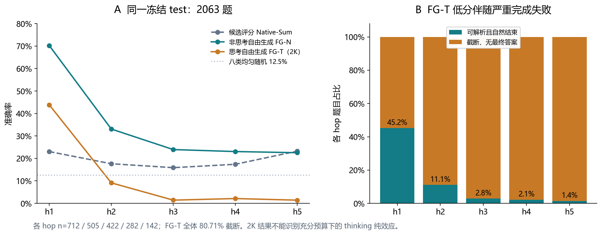
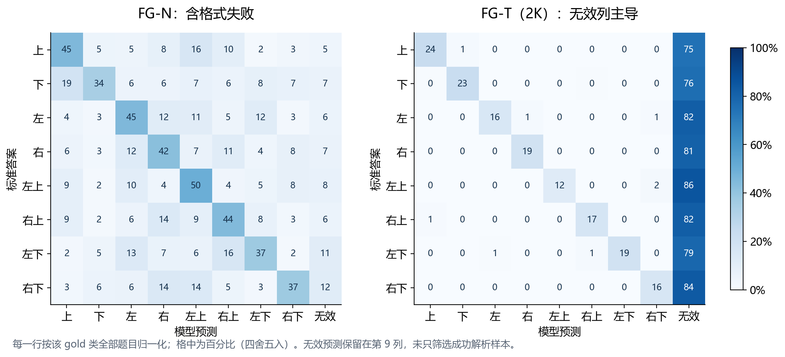
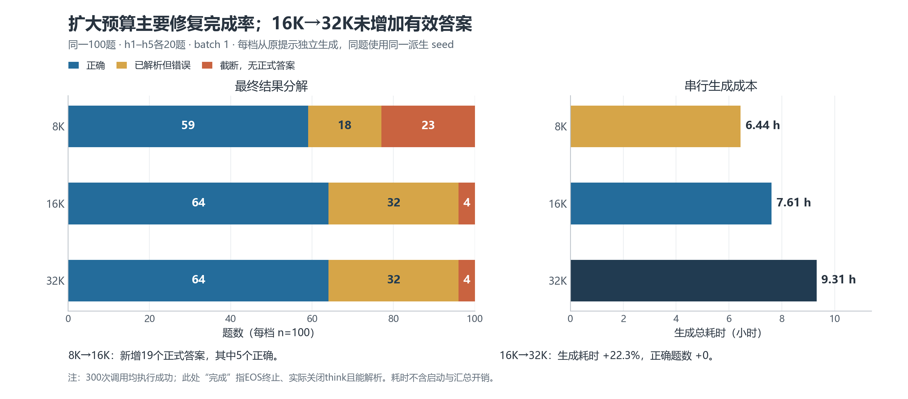
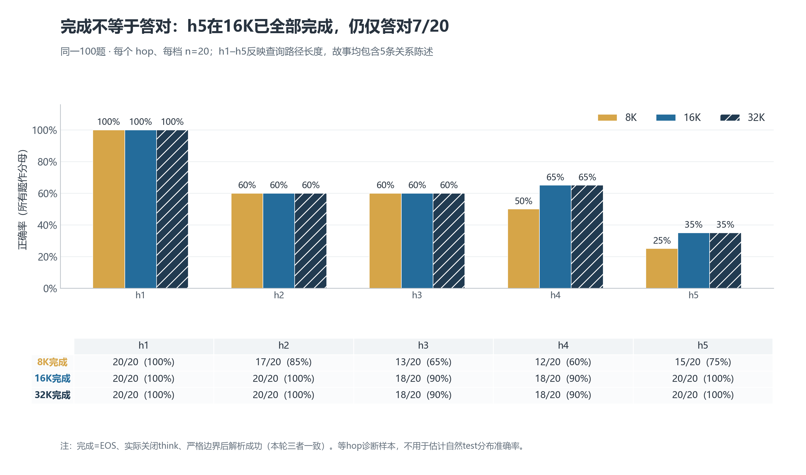
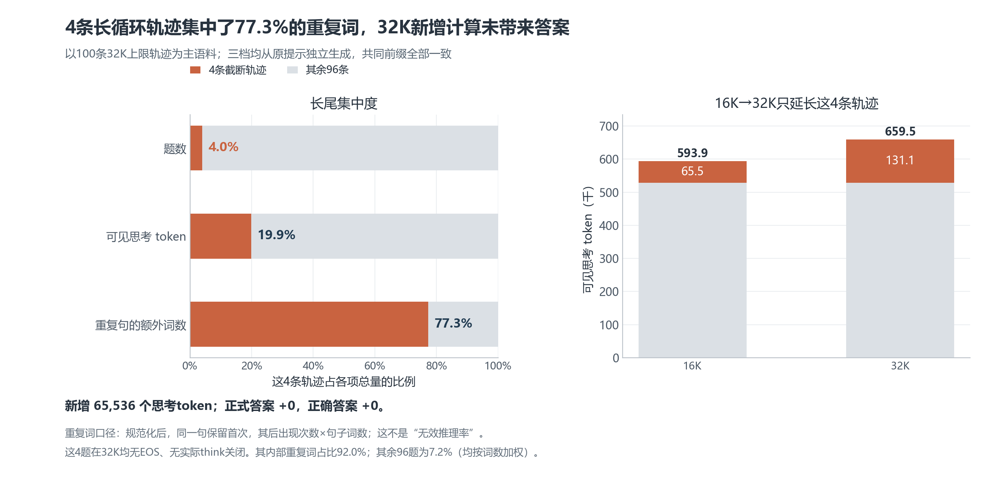
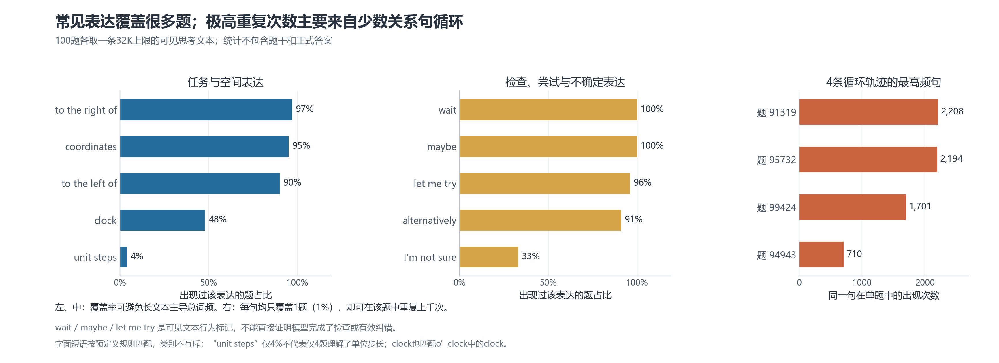
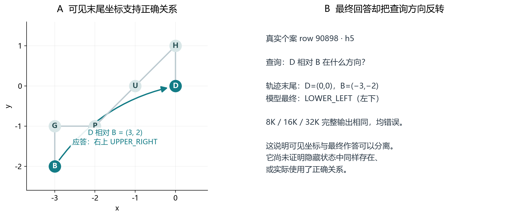
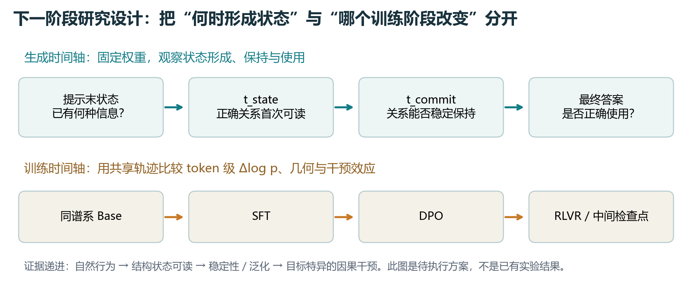

# StepGame 阶段综合报告：评测完成问题已定位，研究重点转向关系状态与答案使用

**范围：Stage B2.2—B2.3，含 10 题与 100 题思考预算校准、可见轨迹分析及前序 B0—B2 背景。证据截至 2026-10-15。** 本文结合本地冻结实验、独立审计和你提供的网页讨论整理；网页讨论主要针对早期 2K 实验，其“先补预算”建议已由后续实验部分落实。

## 1. 本阶段最重要的成果

- **确认了评测协议会显著改变可观察行为。** 在同一 2063 题冻结测试集上，Qwen3-8B 非思考自由生成的 h2—h5 等权准确率为 **25.65%**，候选评分为 **18.53%**，提高 **7.12 个百分点**，配对 95% 区间为 **[3.85, 10.55] 个百分点**。有统计差异，但未满足完整预设准入条件。
- **找到了原 2K 思考实验的关键解释限制。** 2063 题中 **1665 题（80.71%）**在最终答案前被截断。固定 2K 配置的低分是真实结果；它尚未有效检验“充分预算下，开启思考是否改善空间推理”。
- **完成了真正独立运行的 100 题三预算校准。** 8K／16K／32K 分别可解析 **77／96／96** 题、正确 **59／64／64** 题；16K→32K 没有新增有效答案，额外花费约 **1 小时 42 分钟**。这支持把 16K 作为当前任务下一轮确认实验的候选预算。
- **将剩余问题细化为可检验的研究对象。** 可见轨迹中出现查询方向反转、单位位移约定不一致、局部关系反复复述与目标关系论证不足。下一步应分别研究“关系状态是否正确形成”和“最终答案是否正确使用该状态”，再研究后训练如何改变二者。

100 题是每 hop 20 题的诊断样本；64/100 不是自然 2063 题分布的总体能力估计。现阶段也尚未完成生成轨迹隐藏状态提取、token 级 Δlog p 或因果激活干预。

## 2. 回到总研究问题：本阶段做了什么、为什么需要做

总问题仍是：**后训练如何改变推理中的正确性信号、关系状态和轨迹选择？这些变化是否被模型实际用于产生正确答案？** 同谱系 Base／SFT／DPO／RLVR 比较是训练阶段问题；同一个 Qwen3-8B 的思考开关和输出预算比较是推理时计算问题，两者需要分别设计。

前序 B1／B2 已观察到：Tülu 谱系在 StepGame 上的显式关系读出较强，派生关系及多步行为较弱；后训练最稳定的改善集中在 h1 晚层线性读出，没有得到普遍、单调的多步行为增强证据。因此需要先校准行为评测，再决定何种任务、模型和状态值得投入机制分析。数学／代码的可验证推理仍可保留为原项目主线，StepGame 作为结构更清楚的空间关系分支。

| 阶段任务 | 已完成工作与成果 | 研究意义 |
|---|---|---|
| 前置数据与表征基础 | B0 语义解析、computed hop、分组划分；B1／B2 question-end 逐层探针、跨 hop 迁移与四阶段比较 | 提供冻结数据、关系标签和弱行为背景；可读性不等于实际使用 |
| B2.1—B2.2 接口审查 | 比较原始／原生模板、sum／mean、自然／等长候选；Qwen3-8B 与 Tülu Final 的候选评分 | 识别模板、候选长度与答案接口依赖 |
| B2.3 自由生成 | 两模式各 2063 次全量生成；250 题 pilot 的三 seed 检查与匹配解码敏感性 | 建立自由生成行为基线和完成失败诊断 |
| B2.3 复核 | 原始生成重算、配对 bootstrap、终止与 think 边界复核、含 INVALID 的错误分析 | 保留数值与原始门控记录，修正科学解释 |
| 10 题预算试验 | h1—h5 各 2 题，8K／16K／32K 共 30 次真实独立生成 | 小规模发现 16K 可恢复完成，不能据此宣布普遍最优 |
| 100 题预算试验 | 排除旧 10 题，各 hop 20 题，三预算共 300 次；身份、原始 token、解析、成本与遥测审计 | 扩大预算校准；确认剩余 4 条满 32K 循环 |
| 可见轨迹分析 | 读取原始文本、8 个诊断个案片段审阅、100 条唯一 32K 轨迹的高频和精确重复分析 | 为状态／答案分离、过程验证与后续干预提供样本 |

本阶段的贡献首先是**建立了可信的测量和研究对象选择依据**，尚不能写成“已经发现后训练的内部推理机制”。

B2.2 中，Qwen3-8B 与 Tülu Final 的 Native-Sum 多步准确率分别为 18.53%／18.29%，差 +0.24 个百分点，95% 区间 [−2.50,+2.96]；仅换成 Qwen 并未在该评分接口下确认更强行为，这也是继续开展 B2.3 的原因。

## 3. 数据复杂度、样本数与 h1—h5 到底表示什么

官方 CompleteVersion/clean 共 210,000 条；本项目主实验从“五句关系故事”池中筛出 13,758 条，采用自定义冻结划分 **train／validation／test = 9630／2065／2063**。这些不是随意抽取的“约 2000 题”。划分 seed 为 20260823；分层与分组用于控制关系、hop 及等价故事泄漏。它与官方原 train／val／test 划分不同，不能直接把本项目指标当作官方基准分数。

| computed hop | Train | Validation | Test |
|---|---:|---:|---:|
| h1 | 3330 | 714 | 712 |
| h2 | 2348 | 503 | 505 |
| h3 | 1971 | 422 | 422 |
| h4 | 1316 | 283 | 282 |
| h5 | 665 | 143 | 142 |
| 合计 | 9630 | 2065 | 2063 |

**h 是独立解析的查询实体间最短路径长度，使用 BFS 计算；不是直接采用文件名 qaK，也不是故事句数。** 当前主队列每题均有 5 条关系、6 个实体；h1 到 h5 改变的是查询路径，同时相关边与干扰边数量也变化，不能把所有难度变化只归因于组合步数。h1 还可能要求关系反向、措辞识别和查询读出，不能称为“纯 grounding”；h2—h5 也保留这些成分。

例如真实 h5 题 90898：H 在 D 上方，U 在 H 左下，G 在 B 上方，G 在 P 的 9 点钟方向，P 在 U 左下。问 **D 相对 B** 的方向。路径 B→G→P→U→H→D 的单位位移为 上、右、右上、右上、下，总和 (3,2)，答案为右上。附图 7 展示其可见轨迹与最终答案的分离。

八个标签是上／下／左／右及四个对角方向，排除 overlap；均匀随机猜测为 12.5%。标签来自生成器的单位网格位移约定，自然语言“左／右”的任意距离解释可能无法唯一确定同一答案，这是后续提示对照必须检验的语义因素。

Train 用于拟合线性探针；validation 用于选择正则化参数；test 用于冻结后的评价。这里没有用这 9630 条继续训练 Qwen 权重。预算 100 题由 test 排除旧 10 题后抽取，seed=20261014；它不是额外独立来源的训练集。Seed 固定伪随机过程，控制可复现性；它不保证不同 batch、软件或硬件下逐 token 一致。

## 4. 候选评分、自由生成与思考模式：三件经常混淆的事

**候选似然评分（candidate-likelihood scoring）**由研究者提供八个候选，对候选 token 做 teacher forcing：S(y)=Σ log p(y_t | x,y_<t)，取最高分。候选词可能是多个 token；sum 对长度敏感，mean 和等长候选是敏感性检查，不是自动无偏的真值。B2.2 的 Native-Sum 使用非思考原生接口，避免把答案候选放到预期的思考起始位置评分。

**自由生成（free generation）**让模型逐 token 自行生成；已生成内容进入后续上下文，计算路径可以随内容变化。它与“给定答案让模型打分”测量不同。两者还存在提示、格式和接口差异，不能把全部提升归因为内部推理增强。

B2.2 的接口与候选敏感性结果如下，均为 Qwen3-8B 的 h2—h5 等 hop 准确率。原生模板提高了自然候选的表现，但没有得到对评分方法／候选表述稳定的强行为。

| 候选评分条件 | 多步准确率 |
|---|---:|
| 原始模板 Raw-Sum | 10.61% |
| 原始模板 Raw-Mean | 16.60% |
| 原生模板 Native-Sum | 18.53% |
| 原生模板 Native-Mean | 19.87% |
| 等长候选 EqualLength-Raw | 11.44% |
| 等长候选 EqualLength-Native | 10.06% |

等长候选改变了答案措辞，因此既是 token 长度敏感性对照，也混入表述因素；不能把它当作只改变长度的完美干预。

**思考／非思考模式使用同一份已后训练的 Qwen/Qwen3-8B 权重。** 非思考仍执行完整 Transformer 计算；思考模式增加可见中间 token 及其带来的序列计算机会。当前比较没有重现 Base→SFT→DPO→RLVR 的训练过程。[Qwen 官方模型卡](https://huggingface.co/Qwen/Qwen3-8B)支持在单一模型内切换模式，并给出相应采样建议。

EOS 是模型输出的结束 token，不是外部正确性验证器；模型可以很快结束并答错。max_new_tokens 是人工设定的**总新增输出上限，包含思考与最终答案**，2048 不是模型固有上下文极限。提高上限不会迫使已经 EOS 的错误答案继续修改。

## 5. 全量 2063 题：自由生成提高行为表现，2K 思考模式严重截断

图 1 左侧比较同一冻结测试队列的准确率；右侧把 FG-T 的可解析完成与截断分开。八类均匀随机线只是参考基线，不替代类别分布、区间与门槛。

| h2—h5 等 hop 指标 | B2.2 Native-Sum | FG-N 非思考 | FG-T 思考，2K |
|---|---:|---:|---:|
| 准确率 | 18.53% | 25.65% | 3.52% |
| Macro-F1 | 12.36% | 25.65% | 6.17% |
| 平衡准确率 | 15.74% | 25.13% | 3.40% |
| 最终答案解析率 | 100%：封闭候选 | 92.48% | 4.37% |

**FG-N 的一步／多步差距清楚存在：h1—h5 分别为 70.22%、33.07%、23.93%、23.05%、22.54%。** 它改善了候选评分下的表现，但多步准确率、F1 和解析率仍未达到 strong gate。预设强门槛为 derived accuracy≥0.35、Macro-F1≥0.30、balanced accuracy≥0.30、parse≥0.98；统计显著也不能代替这些准入要求。FG-N−候选评分为 +7.12 个百分点，其区间排除 0，但提升点估计尚未达到预设 +10 个百分点要求，完整判定仍为 UNCERTAIN。

完整 strong gate 还要求无预测塌缩、各多步 hop 高于多数类基线、至少五类 recall≥5%，不能只满足表中若干均值就宣布通过。

FG-T−FG-N 为 −22.13 个百分点，95% 区间 [−24.87,−19.51]。在 250 题匹配解码子集的 200 条多步题上，两模式为 29.5% 和 3.5%，说明不同 temperature／top-p 不足以解释全部差异；共同的 2K 上限依然使思考输出严重截断。

FG-T 中 1665 题同时达到输出上限、没有 EOS、没有可解析最终答案；其余 398 题结束且可解析，其中 372 正确。**不能用 372/398 的完成者条件正确率代表总体能力**：完成者是强选择后的子集。

图 2 从两种模式的全部原始输出重建，8 个 gold 行、9 个预测列；FG-N 无效 158/2063，FG-T 无效 1665/2063。只画成功解析的 8×8 矩阵会隐藏关键完成失败。格内为每个 gold 类的行百分比。

旧文件中的形式门控保留历史原值：候选评分低估行为 UNCERTAIN、thinking benefit NO、task fitness WEAK、strong target UNCERTAIN。**更新后的科学解释是：NO 只描述原 2K 固定配置的端到端结果；充分预算的 thinking 纯效应在该实验中未被有效检验。** 不能据此直接淘汰 Qwen3-8B，也不能声称“思考让推理能力下降”。

## 6. 从 10 题到 100 题：预算校准已经给出了什么答案

先完成的 10 题试验中，8K 可解析 8、正确 6；16K／32K 均可解析 10、正确 7，后两档全部完整 token 相同。它只提供继续扩大校准的依据。随后固定 100 个新题，每 hop 20 题；每题分别从原提示独立运行 8192、16384、32768 上限，总计 **300 次真实生成**，不是裁剪一条 32K 轨迹。

| 输出上限 | 正确 | 已解析但错误 | 截断无正式答案 | 平均输出 token | 100 题生成耗时 | 平均每题 | 峰值 allocated |
|---|---:|---:|---:|---:|---|---|---:|
| 8K | 59 | 18 | 23 | 5165.28 | 6小时26分31秒 | 3.87分钟 | 16.54 GiB |
| 16K | 64 | 32 | 4 | 5947.53 | 7小时36分49秒 | 4.57分钟 | 17.79 GiB |
| 32K | 64 | 32 | 4 | 6602.89 | 9小时18分48秒 | 5.59分钟 | 20.29 GiB |

分母各为 100，三类互斥且合计 100。300 次调用全部执行完成；其中 31 次达到上限，故“执行完成”不等于“模型自然结束”。总进程运行 **23小时29分57秒**，纯生成 **23小时22分08秒**，无 OOM 或异常。

8K→16K：原 23 个截断中，19 个交付最终答案，只有 5 个新增正确，14 个新增错误；4 个继续截断。77 个已结束输出逐 token 不变。16K→32K：96 个完整输出完全相同；4 个独立长输出共享原前缀，延伸到 32768 后仍截断。三组预算配对共 300 个重叠 token 前缀均一致，但这项一致性是测得结果，不代表实验用复制代替了生成。

图 4 每个 hop 分母仅为 20。16K／32K 的正确数分别是 h1 20、h2 12、h3 12、h4 13、h5 7；h3 和 h4 各剩 2 个截断。h5 全部结束却只有 7/20 正确，说明剩余错误不能主要用“还缺 token”解释。h2—h5 合计 44/80 正确；每 hop 样本小，不据此宣布稳定的难度排序。

本轮解析率 96% 达到了有用的预算校准水平，但尚未通过原 strong gate 的 98% 解析要求。100 题等 hop、关系覆盖 39/40（h3 ABOVE 为 0）、单生成 seed，而且用于选择预算，**不能替代选预算后的独立能力确认**。与旧 2K 实验的 batch／RNG 不同，也不能把 3.52%→64% 写成严格配对的 thinking 净效应。

## 7. 高频内容说明了什么：反复检查与少数循环要区分

分析以 **100 条唯一的 32K 档可见思考文本**为主语料，排除题目和最终回答；不把三档共享前缀当作 300 条独立文本。常见内容包括复述关系、分配坐标、解释钟点方向、尝试不同距离、反复检查查询方向。wait／maybe 的出现本身不代表错误或无效思考。

32K 主语料中，思考 token 约 65.95 万；按英文词与数字规则计词约 50.73 万，二者不是同一个单位。精确重复句的额外词数占全部思考词 **25.10%**，但去掉 4 条截断轨迹后其余 96 条为 **7.22%**。这 4 条只占题目 4%、思考 token 的 **19.88%**，却贡献重复词的 **77.29%**；其内部重复占比约 **91.95%**。16K→32K 增加的 65,536 个输出 token 全部来自这 4 条，且无新增有效答案。

例如 maybe 2797 次／100 题，wait 2601 次／100 题，let me try 816 次／96 题，coordinates 726 次／95 题，alternatively 906 次／91 题。高覆盖率说明这些表达常见，不能说明它们对正确性有因果作用。unit steps 精确短语只出现在 4 题，也不能反推其余题均未理解单位位移。

极端重复则有更明确的文本证据：91319 的一句局部关系出现 2208 次，95732 的一句出现 2194 次；这些高总频次分别集中在单条轨迹。重复指标保留实体与坐标，只统计规范化后的完全相同句子，属于描述性指标，**不是过程无效率，也没有完成语义等价聚类**。

## 8. 重点个案：关系状态、最终答案和过程有效性需要分别标注

90898 的可见末尾坐标 D=(0,0)、B=(−3,−2) 支持 D 在 B 右上方，最终却回答左下。这个真实反例表明：**可见关系计算与答案读出可以分离**。但它还不是“隐藏状态已含正确关系且没有被使用”的机制证明；需要检查对应 token 隐藏状态并做干预。

| 个案 | 最终结果 | 经审阅片段支持的判断 |
|---|---|---|
| 90898，h5 | 错误 | 末尾坐标局部一致；最终查询方向反转 |
| 94828，h5 | 错误 | 引入自由距离，未按数据集单位位移完成横向抵消；末尾依赖猜测 |
| 86290，h4 | 正确 | 末尾借助目标关系假设作答；不能自动标为已验证有效推理 |
| 95279，h4 | 正确 | 所检查末尾坐标算例支持 RIGHT；此前探索并未逐步全部验证 |
| 91319／94943／95732／99424 | 截断 | 满 32K 仍未关闭 think，大量重复局部关系 |

目前是 8 个诊断个案的代表性片段审阅，尚未完成 100 条全轨迹的系统过程标注。后续至少分开记录：最终正确性、局部边翻译正确性、组合状态正确性、查询方向、过程是否支持答案、终止状态。

## 9. 能否从轨迹判断“什么时候产生思考能力”与后训练改变

可以研究可操作的“何时出现并使用正确状态”，但要分清两个时间轴。

**生成时间轴**：固定权重在一道题上从提示末状态到最终答案。可标注首次正确、与查询相关的非平凡组合关系或坐标状态 t_state、稳定保持 t_commit、最终查询读出 t_query，并另记单条局部边的识别时刻；这些是任务状态的形成或能力调动，不是生成过程中权重学会了新能力。首次在文字中出现正确关系也不等于内部首次有该信息，所以需要提示末状态和更早位置作为对照。

**训练时间轴**：同谱系 Base／SFT／DPO／RLVR，最好有训练中间检查点。只有阶段末模型时，最多定位改变发生在哪个训练区间；不能确定第几步“能力诞生”。当前 Qwen 模式／预算实验不能回答后训练因果归因，Tülu 四阶段虽已有表征背景，但 StepGame 行为偏弱，直接全量扩展成本高且解释困难。

在共享、已独立验证的轨迹 z 上，计算 Δlog p_t=log p_post(z_t|x,z_<t)−log p_pre(z_t|x,z_<t)，分别检查关键组合、纠错、查询反向、最终答案和 EOS。还需要长度／风格相近的错误轨迹作对照；高条件概率只说明模型倾向于接受给定路径，不保证自主生成时能找到该路径。

几何分析应同时研究关系向量／坐标状态与最终正确性信号，控制位置、token 类型、长度及跨模型坐标对齐。线性可解码只证明信息可读；跨模型原始 PCA 方向不能直接当作同一个语义方向。

八分类任务尤其不适合用普通 pass@k 宣称 Base“原本就会”：独立均匀猜 32 次至少一次正确的概率已达 **98.61%**。应加入过程验证、实体重命名、查询反向和反事实关系改动的一致性检验；有限次未成功也不能证明能力绝对不存在。

## 10. 文献进展：同时检验“轨迹选择改善”和“组合能力改变”

以下是截至 2026-10-15 核验的相关原始研究，支持研究设计而非替代我们的实验。部分为预印本；任务、模型和评测协议各异。

| 研究 | 与我们有关的证据 | 对本项目的启发与边界 |
|---|---|---|
| [Lanham 等，2023：Measuring Faithfulness in Chain-of-Thought Reasoning](https://arxiv.org/abs/2307.13702) | 用思考链干预研究答案对可见过程的依赖，忠实性随任务与模型变化 | 不能直接把可见文字当隐藏因果机制；需做可检验干预 |
| [Yue 等，2025：Does RL Really Incentivize Reasoning Capacity…](https://arxiv.org/abs/2504.13837) | 在其测试设置中，RL 后成功率与大 k 覆盖的变化支持已有路径重分配解释 | “重加权”是待检验假设；StepGame 普通 pass@k 有小标签空间猜中问题 |
| [Wen 等，2025：RLVR Implicitly Incentivizes Correct Reasoning…](https://arxiv.org/abs/2506.14245) | 将过程正确纳入 CoT-Pass@K，并追踪训练检查点 | 区分最终答对与过程正确；不能由个别任务外推所有后训练机制 |
| [Kong 等，2026：From Reasoning Traces to Reusable Modules](https://arxiv.org/abs/2606.18089) | 在受控组合任务研究中间推理模块与新组合泛化 | 不预设 RL 只能重排已有完整答案；检查新关系组合能否稳定复用 |
| [Shen 等，2026：Understanding Reasoning from Pretraining to Post-Training](https://arxiv.org/abs/2607.16097) | 从预训练到后训练研究任务难度与能力变化，主要使用受控棋类并做数学验证 | 提醒我们按基础能力和难度分层；“原先几乎没有”不等于概率严格为零 |
| [Bhupatiraju 与 Nyaupane，2026-09：Are Stated Reasoning Steps Causally Load-Bearing?](https://arxiv.org/abs/2609.27038) | 在合成查找任务中以激活反事实修补检验已陈述中间步骤的作用 | 借鉴目标答案可预测、随机位置及无关 donor 等对照；其结果尚非 StepGame 验证 |

这些研究并未形成“RL 一定只重加权”或“一定创造新推理能力”的普遍结论。本项目更适合提出：**后训练如何改变正确关系状态的形成、保持与使用？改变主要来自轨迹选择、状态组合，还是答案读出？** 让竞争解释对应不同可观测预测。

## 11. 已确认、尚未确认与主要局限

| 已确认的阶段结果 | 仍不能据此推出 |
|---|---|
| 答案接口显著影响 StepGame 可观察行为 | 自由生成提升全部来自内部组合机制增强 |
| 原 2K 思考输出严重截断 | thinking 本身损害推理；或只要加长就会解决 |
| 当前 100 题上 16K→32K 没有有效增益 | 16K 对所有模型、数据和 seed 都最优 |
| 可见末尾状态与最终答案存在不一致个案 | 已定位隐藏状态中的正确关系及其因果使用失败 |
| 4 条长尾贡献了大部分精确重复 | 所有长思考都无效；常见检查短语导致错误 |
| 既有探针可读出部分关系信息 | 模型内部已经形成并使用图结构或统一符号算法 |

主要局限包括：单模型和单生成 seed 的预算校准；100 题小样本且非自然分布；提示与数据集单位网格语义可能不一致；hop 与干扰边数共变；旧 2K 与新预算的 batch／RNG 不同；完成者选择偏差；过程有效性仅审阅部分个案；可见文本不是隐藏神经状态；前序 prompt-end 探针没有覆盖生成中的状态变化；训练阶段比较尚无充分行为基础与因果控制。

如果要支持 **graph-like relational representation**，至少应从同一内部状态恢复多个实体对／关系矩阵，检验实体重命名与句序置换下的结构稳定性，并做边特异反事实干预：改变 B→C 后，依赖它的 A→C 按规则变化，无关 D→E 尽量保持。单个派生答案可解码、h1 强于多步或某晚层出现信号，都不足以证明图结构。

## 12. 下一阶段：先做能区分解释的小实验

以下均为**建议方案，尚未执行**，不需要先重复现有 300 次长生成。

1. **冻结候选预算，确认行为与语义因素。** 以 16K 为候选，在未参与本轮预算选择的确认样本上评估完成、解析与各 hop 正确性；条件尽量匹配。另设原提示与明确单位网格／查询方向提示的对照，作为新条件保存，检验错误来自约定理解还是组合。不能按测试正确率反复调提示后仍称独立确认。
2. **建立 20—30 题的状态—答案诊断集。** 从既有正确、组合错、查询反向和循环个案中按预先规定类别选取；保留原轨迹，标注 4—6 个语义里程碑。诊断选样只用于解释，不能估计总体发生率。过程标注应与自动单位位移验证结合，并盲于最终答案复核。
3. **先验证能否读出，再验证是否使用。** 选少量层与位置做 teacher-forced 重放，读取关系状态和最终正确性；采用独立故事／模板划分、随机标签及浅层基线。随后做有预期目标答案的文本／激活干预，并加入等长无关修改、释义、随机位置等对照。普通“改了文本答案就变”可能只是破坏或重新计算，尚不充分。
4. **再推进同谱系后训练比较。** 先核实 Base／SFT／DPO／RLVR 的真实谱系和可用中间检查点；在共享已验证轨迹上比较关键 token 的 Δlog p、状态保持与目标特异干预效果，同时保留自主生成行为测试。若 StepGame 能力仍不足，则把它保留为弱能力对照，在数学／代码可验证任务继续主线。

推荐进入下一步的条件是：行为指标和完成指标在新确认样本上达到预先冻结标准，且至少有足够的有效过程样本支持状态分析。如果明确任务约定后仍不具备组合行为，应停止扩大同一弱模型的全层长轨迹采集，转向任务／模型比较；这与直接按早期 2K 低分淘汰模型不同。

## 13. 运行成本、batch 与升级服务器：此前讨论的统一口径

慢的主要规模来源是逐 token 自回归生成与长尾，不能只用显卡峰值 TFLOPS 推算时间。KV cache 避免完整重算历史，但每个新增 token 仍依次通过模型各层，长上下文的注意力与缓存开销也增加。本次 32K 档均值 5.59 分钟、中位数约 3.90 分钟；最长 39.15 分钟来自满 32K 个案，不能当作每题平均。

**batch 共享模型权重，每条序列有各自 KV cache。** 以当前 36 层、8 个 KV head、head_dim=128、BF16 为例，理论 KV 为每 token 144 KiB，32K 约每序列 4.5 GiB；权重约 15 GiB 是共享开销。所以 batch1 约 20 GiB、batch8 接近 51 GiB 再加其他开销的量级并不矛盾。后者是估算，不是本项目已实测 batch8 的满 32K 显存。

Batch 提高总吞吐，不等于单题延迟除以 batch。当前 24GB RTX3090 已实测完成 batch1、短输入下的满 32K 输出，峰值 allocated 20.29 GiB、全运行 reserved 23.30 GiB；不能外推到长提示或更大 batch。600 个调用前后快照也不足以精确定位持续性能瓶颈。

升级更应优先看可运行的 batch 和显存／带宽：48GB 可作起点，长期多轨迹与激活研究可考虑 80GB 级服务器；先租用同协议跑少量代表题做吞吐、延迟和显存基准，再决定采购。这里没有测得升级后的加速倍数，也没有证据保证某卡能把总时长缩短到指定小时。全层全 token 激活保存开销很大，32K×36×4096×BF16 约 9 GiB／轨迹，宜先选层选点。

## 14. 参数、复现与成果文件

| 项目 | 原 B2.3 全量 2K | 本轮 100 题预算 |
|---|---|---|
| 模型／精度 | Qwen/Qwen3-8B，同一冻结后训练权重；BF16、无量化 | 相同权重与提示；BF16、无量化 |
| 注意力与缓存 | SDPA、KV cache | SDPA、KV cache；eval／inference_mode |
| Batch size | 实际主运行 8，尾批 7；按实际 run manifest | 1 |
| 输出上限 | 2048 | 8192／16384／32768，独立运行 |
| 采样 | FG-N T=.7,p=.8；FG-T T=.6,p=.95；k=20,min_p=0 | 思考 T=.6,p=.95,k=20,min_p=0 |
| 生成 seed | 20260924；pilot另有25／26；实际为 batch RNG | 20260924；同题跨预算相同 row 派生 seed |
| 样本 | 2063题；pilot250题 | 排除旧10题，各hop20，抽样seed20261014 |
| 解析 | 冻结最终答案格式，INVALID计错；复核终止与边界 | 仅实际唯一 `</think>` token 后解析，缺失／歧义为INVALID |

本轮严格边界要求实际生成关闭 token 151668、有效打开状态、边界唯一且无歧义，关闭后不得重新打开；思考中出现“Final answer”不算正式答案。多个合法答案行按冻结实现取最后一个；本轮所有可解析输出只有一行合法最终答案。三预算 EOS／think关闭／解析数恰好一致，但它们是三个不同定义，不能预设其他实验也相同。

100题独立审计通过5075项检查，覆盖300个唯一shard、抽样与身份hash、token重解码、提示重建、EOS、严格边界、正确性、统计和配对前缀。全权重SHA在远端启动时重算，本地核对清单；本轮没有把整套模型重新下载到本地复算。高频分析另有321项验证；检查数表示复核覆盖，不表示模型正确率。

关键原始与派生产物：

- [全量 B2.3 指标](../../artifacts/stage_b2_3_qwen3_generation/statistics/full_metrics_by_hop.csv)、[配对区间](../../artifacts/stage_b2_3_qwen3_generation/statistics/paired_bootstrap.csv)、[原 2K 复核](../../artifacts/stage_b2_3_qwen3_generation/analysis_20261013/evidence_audit.md)。
- [100题完整总结](../../artifacts/stage_b2_3_budget100_20261014/8K_16K_32K_100题实验总结_20261015.md)、[逐题审计](../../artifacts/stage_b2_3_budget100_20261014/audit_completion_rows.csv)、[独立汇总](../../artifacts/stage_b2_3_budget100_20261014/audit_completion_metrics.csv)、[审计记录](../../artifacts/stage_b2_3_budget100_20261014/audit_completion.json)。
- [可见轨迹个案](../../artifacts/stage_b2_3_budget100_20261014/audit_cases.md)、[90898完整原始思考文本](../../artifacts/stage_b2_3_budget100_20261014/readable_traces/row_90898_budget_32768.md)、[高频分析](../../artifacts/stage_b2_3_budget100_20261014/analysis_high_frequency_20261015/思考轨迹高频内容_20261015.md)。
- 本报告所有重点图保存在 [图表目录](../../artifacts/stage_b2_3_synthesis_20261015/figures/)，PNG适合汇报，SVG适合无损编辑；图表输入和复核记录保存在 [图表数据](../../artifacts/stage_b2_3_synthesis_20261015/figure_data/)。本次整理不重新调用GPU，不改写原始输出，不恢复已停止的完成通知。

本报告将旧阶段的“评测资格审查”推进为更具体的研究入口：**先确认任务约定与组合行为，再研究正确关系状态何时形成、能否保持、如何转成答案；用共享轨迹与受控干预区分后训练对路径选择、组合和读出的改变。**
