# Stage B 研究报告：后训练增强显式关系读出，但未形成稳定的多步推理提升

更新日期：2026-09-02；完成范围：Stage B0、B1、B1.5、B1.6、B2；研究对象：StepGame 空间关系推理；Llama-3.1-8B Base、Tülu-3 SFT、DPO、Final

## 摘要

本研究以 StepGame 为任务环境，考察大型语言模型隐藏状态中的空间关系表示是否随推理步数和后训练阶段发生系统变化。研究先独立审计数据集与 hop 定义，冻结无泄漏的训练、验证和测试划分；随后在 32 层 question-end hidden state 上训练八分类线性探针，比较显式一步关系与二至五步派生关系；进一步通过候选答案条件似然、跨 hop 迁移和 Base→SFT→DPO→Final 对照，区分“隐藏状态中可线性读取的信息”“模型实际答案行为”与“跨任务共享线性结构”。

主要结论如下：

1. StepGame 文件中的 `qaK` 不是实际 query hop。独立图解析显示，仅 36,693/210,000（17.47%）样本满足二者相等；实验因此使用 BFS 最短路径定义 `computed_hop`。
2. Base 模型的显式 h1 关系明显比 h2–h5 派生关系更可线性解码：h1 峰值 Macro-F1 为 0.3573@L17，而派生 hop 峰值仅为 0.1485–0.1702；不存在“hop 越大，峰值层越晚”的单调顺序。
3. Base 的候选答案行为较弱。主评分下准确率从 h1 的 0.1517 降到 h5 的 0.0915，派生 hop 未建立稳健高于八分类随机水平 0.125 的能力。
4. h1 训练探针能够以较弱水平迁移到 h2–h5，但绝对分数低、层间波动大，不能据此推断模型使用统一符号关系代码。
5. 后训练最稳定的改变发生在 h1 显式关系：晚层 Macro-F1 从 Base 0.3218 提高至 SFT 0.3907、DPO 0.4045、Final 0.3948。派生 hop 的行为、within-hop 解码和 transfer 变化较小且方向不一致，未形成 Base→SFT→DPO→Final 的单调多步推理提升。

因此，本研究支持“后训练会改变 question-end hidden state 中显式关系的线性可读性”，但不支持“后训练建立了统一的多步符号推理机制”或“探针改善导致行为改善”。

## 1. 研究问题与分析框架

本研究围绕三个层次的问题展开：

- **表示存在性**：给定冻结隐藏状态，空间关系是否能被简单线性模型读取？
- **行为一致性**：模型自身在不训练探针的情况下，是否把正确关系赋予更高条件似然？
- **结构共享性**：只用 h1 显式关系训练的探针，能否迁移到 h2–h5 派生关系？后训练是否增强这种共享？

这三个问题必须分开解释。线性探针成功只说明信息在给定位置和表示中可线性访问，不证明生成模型实际使用该信息；行为正确也不证明内部存在特定线性几何；transfer 接近 within-hop 也可能发生在二者都接近随机水平时。

## 2. 方法来源与理论依据

### 2.1 线性探针

线性探针沿用 Alain 与 Bengio（2016）的诊断思想：冻结原模型，在中间表示上训练低容量分类器，以测量信息的线性可读性。探针不更新语言模型参数，因此测量的是既有表示，而不是通过微调写入的新能力。

### 2.2 空间表示研究背景

Gurnee 与 Tegmark（2024）展示了语言模型内部存在可线性读取的空间和时间特征。本项目将这一思想从世界坐标任务扩展到文本空间关系：不预测连续经纬度，而是预测八种离散方向关系，并进一步比较显式和多步派生关系。

### 2.3 StepGame

StepGame（Shi、Zhang 与 Lipani，2022）由文本化空间关系故事、查询实体对和方向标签组成，适合研究多 hop 组合推理。本项目固定使用官方仓库 commit `5e6aff1563a6d7f46ee1f1aeff98b94e68c29005`，并参考 Li、Hogg 与 Cohn（2024）对模板与空间推理评测的讨论。

### 2.4 模型与后训练阶段

Base 使用 Llama-3.1-8B。B2 比较同一架构谱系上的 Base、SFT、DPO 与 Final；Tülu 3 的公开技术报告将其后训练流程概括为监督微调、直接偏好优化及基于可验证奖励的强化学习阶段。所有正式结论使用保守名称 `Final`，不单凭本地目录名断言具体训练实现。

## 3. 数据审计与冻结步骤（Stage B0）

### 3.1 数据来源与记录粒度

官方 CompleteVersion/clean 实际包含 210,000 条记录：每个 K 的 train/valid/test 分别为 10,000/1,000/10,000，而非 README 文字可能暗示的更大规模。每条记录的分析粒度是一则 story–question–label 样本。

### 3.2 独立语义解析

对每条故事执行以下步骤：

1. 将句子匹配到官方模板源；
2. 把可辩护模板规范化为有向空间边；
3. 构建查询实体间的关系图；
4. 使用 BFS 最短路径计算 `computed_hop`；
5. 沿路径组合方向向量并与标签核对；
6. 标记模板错误、解析失败、重复故事和潜在泄漏组。

审计发现：

| 指标 | 结果 |
|---|---:|
| 总记录数 | 210,000 |
| `FULL_OK` 完整解析 | 190,237 |
| 可恢复 query path | 200,811 |
| `qaK = computed_hop` | 36,693（17.47%） |
| 精确重复组 | 806 |
| 重复 story 组 | 1,583 |

`qaK` 表示生成时链长，但生成器随后可能查询任意实体对，因此它不能直接作为实际推理距离。若强制 `qaK = computed_hop`，h1–h4 的关键单元会被错误清空。正式实验固定五句故事，并以独立 BFS 距离作为唯一 hop。

### 3.3 关系类别与排除规则

Primary 使用八个非重合方向：ABOVE、BELOW、LEFT、RIGHT、UPPER_LEFT、UPPER_RIGHT、LOWER_LEFT、LOWER_RIGHT。OVERLAP 没有显式边模板，主要由路径向量组合产生，因此不进入八分类 Primary。

排除或单独标记：

- 无完整语义路径的样本；
- 含错误或无法唯一解释模板的样本；
- 非五句故事；
- query relation 为 OVERLAP 的样本；
- 可能跨 split 泄漏的重复 story、逆向 query 或等价模板组。

### 3.4 冻结划分

| 划分 | Train | Validation | Test | 用途 |
|---|---:|---:|---:|---|
| Primary | 9,630 | 2,065 | 2,063 | 自然分布主分析 |
| Balanced | 1,360 | 440 | 440 | 每个 hop×relation 严格平衡 |
| Target-Absent | 2,814 | 605 | 604 | 目标方向未在故事中直接陈述 |
| Composition-heldout | 5,901 | 1,501 | 1,600 | 测试未见组合签名 |
| Template Test-only | 10,217 | 1,802 | 1,739 | 测试保留未见 Mid-level 模板组 |

Primary、Balanced、Target-Absent、Composition 和最终 Template Test-only 均通过冻结验证。早期 broad-family template-heldout 不具备完整 40 单元支持，正式状态为限制性诊断；B0.2c 采用 Mid-level Test-only 方案后覆盖 40/40 hop×relation 单元，最小 test cell 为 14，story 与 held-out-template 泄漏均为 0。

## 4. Base 模型逐层关系探针（Stage B1）

### 4.1 模型与读出位置

- 模型：Meta-Llama-3.1-8B Base；
- 层数与隐藏维度：32 层，hidden size 4096；
- 输入：冻结 story/question wrapper，无 chat template、few-shot、CoT 或答案示例；
- 读出：问题末尾 `?` token 对应的 residual hidden state；
- 标签：八种非重合关系。

### 4.2 探针训练协议

对每层、每个 hop 独立执行：

1. 只用训练集拟合 `StandardScaler`；
2. 训练多项逻辑回归线性分类器；
3. 在固定九值 C 网格上使用 validation Macro-F1 选择正则强度；
4. 精确并列时选择较小 C；
5. 测试集只在选择完成后评价；
6. 报告 accuracy、Macro-F1、峰值层、全层曲线与 late-layer summary；
7. 运行随机标签、Balanced、Target-Absent、Composition-heldout 与 Template Test-only 控制。

独立验证文件记录 38/38 项检查通过，包括 split hash、token readout、32 层定义、有限值、行序、训练集标准化、validation-only C 选择、控制实验和图表完整性。

### 4.3 Primary 结果

| Hop | Test n | 峰值 Macro-F1 | 峰值层 |
|---|---:|---:|---:|
| h1 | 712 | 0.3573 | L17 |
| h2 | 505 | 0.1670 | L19 |
| h3 | 422 | 0.1702 | L31 |
| h4 | 282 | 0.1563 | L30 |
| h5 | 142 | 0.1485 | L1 |

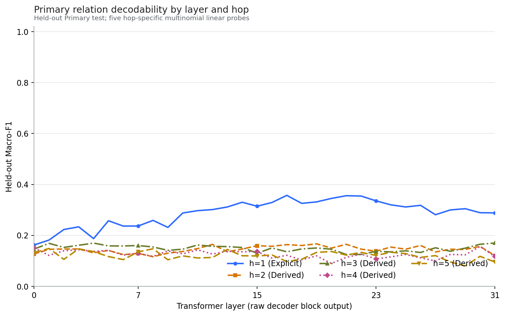

**图像分析。** h1 曲线在中后层形成明显高于派生 hop 的宽峰，说明显式一步关系在 question-end state 中更容易被线性读取。h2–h5 曲线整体靠近八分类随机水平附近，且峰值层顺序为 L19、L31、L30、L1，并不随 hop 单调后移。尤其 h5 的描述性峰值出现在 L1，直接反驳简单的“更多推理步对应更晚层”叙事。峰值是在 32 层中取最大值，具有选择乐观性，因此主解释同时依赖全层曲线与控制实验。

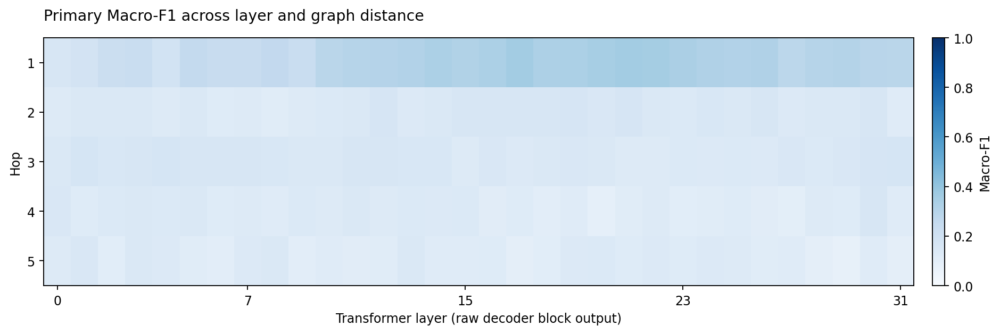

**热图分析。** h1 在较广的中后层区域保持较强信号，而派生 hop 只出现零散弱热点，没有清晰的对角线或逐 hop 后移带状结构。这更符合“显式关系强、派生关系弱且层位置不稳定”，而非逐层执行固定步数的可定位流水线。

### 4.4 控制实验

- Balanced 控制中 h1 峰值下降至 0.2163，说明 Primary 的部分优势受自然分布和样本量影响；
- Template Test-only 中 h1 峰值降至 0.1794，说明显式读出对表面模板具有敏感性；
- Target-Absent 与 Composition-heldout 未产生稳定的派生关系增强；
- 随机标签平均 accuracy 约为 0.1285、Macro-F1 约为 0.1247，接近八分类随机水平，表明正常探针结果不是训练流程必然制造的高分。

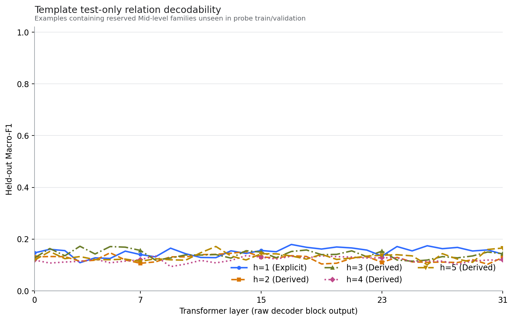

**图像分析。** 模板未见条件下各曲线整体下移，h1 优势明显缩小。它说明探针利用的不只是抽象关系，也包含与模板分布相关的线性信号；但测试模板只覆盖预先保留的 Mid-level 家族，不能外推为所有语言表达形式均未见。

## 5. 模型行为基线（Stage B1.5）

### 5.1 候选条件似然

每个样本固定八个候选答案。主分数为候选 token 的条件对数概率之和：

`score(c) = Σ_t log P(c_t | prompt, c_<t)`

候选均带前导空格；保留 BOS，排除 EOS/pad。四个基数方向为单 token，四个对角方向为双 token，因此另行报告每 token 平均 log-probability 作为固定敏感性分析，但不根据结果事后选择评分规则。

### 5.2 Primary 行为结果

| Hop | n | Accuracy（95% story-group bootstrap CI） | Macro-F1 | Majority accuracy |
|---|---:|---:|---:|---:|
| h1 | 712 | 0.1517 [0.1292, 0.1784] | 0.0599 | 0.1390 |
| h2 | 505 | 0.1465 [0.1188, 0.1762] | 0.0637 | 0.1347 |
| h3 | 422 | 0.1090 [0.0782, 0.1398] | 0.0452 | 0.1540 |
| h4 | 282 | 0.1064 [0.0709, 0.1454] | 0.0468 | 0.1596 |
| h5 | 142 | 0.0915 [0.0493, 0.1408] | 0.0410 | 0.1901 |

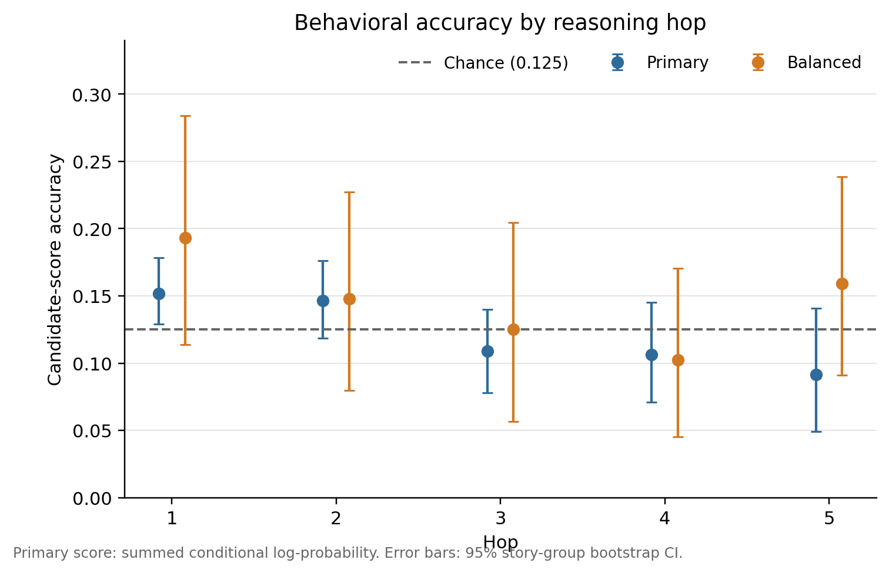

**图像分析。** 主评分准确率随 hop 总体下降。只有 h1 的区间下界略高于 0.125，h2 区间包含随机水平，h3–h5 不支持高于随机的能力。h5 的多数类基线反而高于模型准确率，说明自然标签分布与候选 token 偏好会显著影响结果。

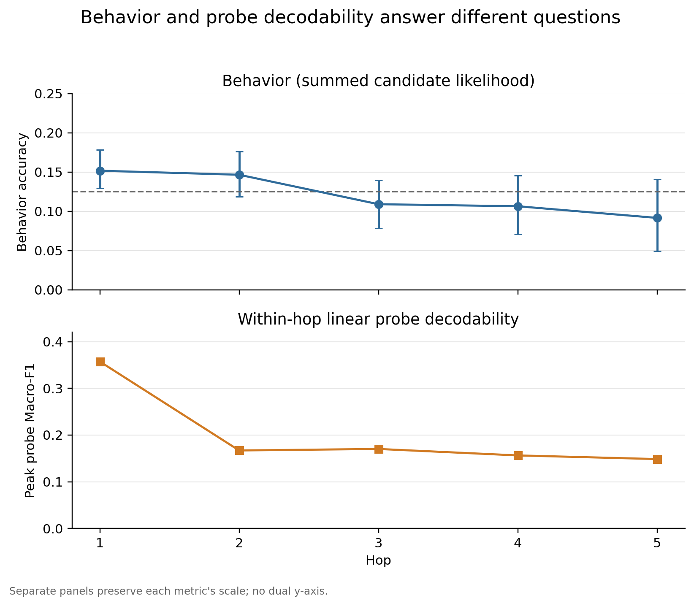

**对照分析。** 探针 Macro-F1 与行为 Macro-F1 在量纲和任务上不同：前者在冻结 hidden state 上重新训练分类器，后者直接读取语言模型候选概率。两者都区分 h1 与派生 hop，但探针可读性明显高于模型行为。这说明“状态中存在可读取信息”并不等于模型在答案分布中有效利用该信息。

## 6. 跨 hop 线性迁移（Stage B1.6）

### 6.1 迁移定义

每层只用 Primary h1 train 拟合 scaler 和分类器，C 只由 h1 validation 选择；随后不再拟合，直接在 h2–h5 test 上评价。定义：

`TransferGap = within-hop Macro-F1 − h1-trained transfer Macro-F1`

### 6.2 结果

| 目标 hop | h1-transfer 峰值 | within-hop 峰值 | L16–31 平均 gap |
|---|---:|---:|---:|
| h2 | 0.1676@L14 | 0.1670@L19 | 0.0253 |
| h3 | 0.1795@L2 | 0.1702@L31 | 0.0092 |
| h4 | 0.1887@L5 | 0.1563@L30 | -0.0272 |
| h5 | 0.2187@L10 | 0.1485@L1 | -0.0098 |

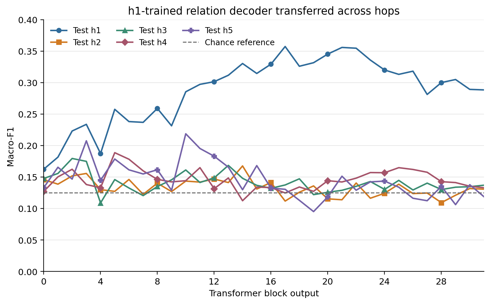

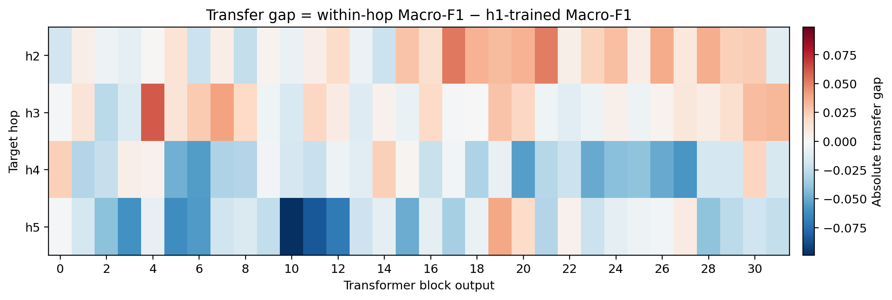

**图像分析。** h1 探针在派生 hop 上并非完全失效，说明显式和派生样本之间存在有限共享的线性可访问结构。但 gap 的符号在 hop 和层之间混合；h4/h5 的负 gap 主要反映两个弱系统之间的相对关系，并不意味着 h1 探针获得了强多步推理能力。因为 within-hop 派生分数本身也很低，接近零或负 gap 不能被解释为统一符号代码。

随机标签迁移的平均 accuracy 为 0.1240、Macro-F1 为 0.1215，符合随机预期。达到迭代上限的拟合经过 2,000 和 5,000 次迭代复核，最终警告清零，结论不依赖未收敛模型。

## 7. 后训练阶段比较（Stage B2）

### 7.1 可比性控制

四个 checkpoint 均为 32 层 Llama decoder、hidden size 4096。120 条冻结 raw prompt 覆盖 5 hop×8 relation，其 token IDs、BOS、序列长度、readout index 和末尾 `?` 在四个 checkpoint 上完全一致。模型谱系、冻结输入、activation integrity 和最终验证均为 PASS。

### 7.2 行为准确率

| Checkpoint | h1 | h2 | h3 | h4 | h5 | Derived mean |
|---|---:|---:|---:|---:|---:|---:|
| Base | 0.1517 | 0.1465 | 0.1090 | 0.1064 | 0.0915 | 0.1134 |
| SFT | 0.1770 | 0.1267 | 0.1280 | 0.0709 | 0.0775 | 0.1008 |
| DPO | 0.1854 | 0.1267 | 0.1374 | 0.0922 | 0.0915 | 0.1120 |
| Final | 0.1826 | 0.1188 | 0.1422 | 0.0993 | 0.0845 | 0.1112 |

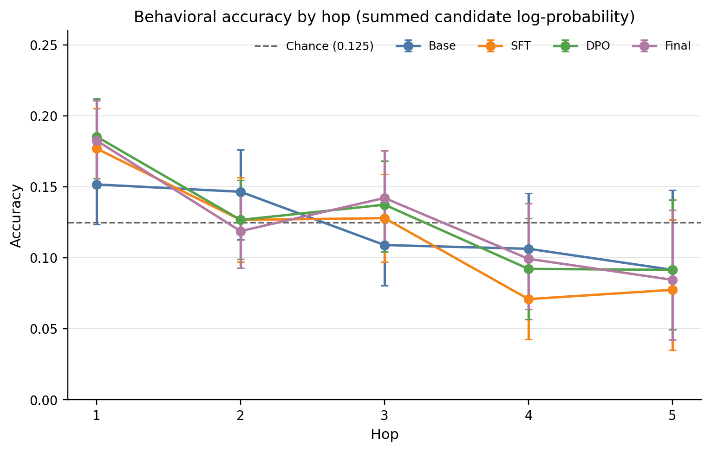

**图像分析。** h1 从 Base 到后训练 checkpoint 有描述性提高，但 derived mean 没有单调增加。绝对变化最大的连续阶段是 Base→SFT，方向却是 -0.0126；SFT→DPO 大致恢复该下降。配对区间不支持所有派生 hop 的统一提升，因此不能把 Final 描述为在 StepGame 多步行为上稳定优于 Base。

### 7.3 Within-hop 线性可解码性

L16–31 Macro-F1 平均值：

| Checkpoint | h1 | h2 | h3 | h4 | h5 | Derived mean |
|---|---:|---:|---:|---:|---:|---:|
| Base | 0.3218 | 0.1507 | 0.1437 | 0.1168 | 0.1162 | 0.1319 |
| SFT | 0.3907 | 0.1524 | 0.1416 | 0.1440 | 0.1201 | 0.1395 |
| DPO | 0.4045 | 0.1565 | 0.1355 | 0.1574 | 0.1247 | 0.1435 |
| Final | 0.3948 | 0.1611 | 0.1308 | 0.1490 | 0.1190 | 0.1400 |

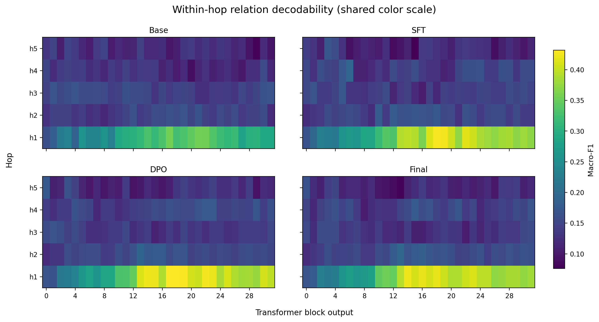

**图像分析。** h1 在 SFT 后出现最清楚的广泛晚层增强，Final−Base 的 h1 晚层差值也为正。派生 hop 的变化更小且方向不一致：h3 在 Final 中低于 Base，h2/h4 略升，h5 基本不变。四个派生 hop 的 late-summary paired 95% CI 均包含 0，故 derived mean 的小幅数值增加不能解释为稳定机制增强。

### 7.4 Explicit→derived 迁移

| Checkpoint | h1→h2 | h1→h3 | h1→h4 | h1→h5 | Derived mean |
|---|---:|---:|---:|---:|---:|
| Base | 0.1253 | 0.1345 | 0.1441 | 0.1260 | 0.1325 |
| SFT | 0.1344 | 0.1509 | 0.1444 | 0.1214 | 0.1378 |
| DPO | 0.1398 | 0.1454 | 0.1459 | 0.1374 | 0.1421 |
| Final | 0.1423 | 0.1494 | 0.1498 | 0.1412 | 0.1457 |

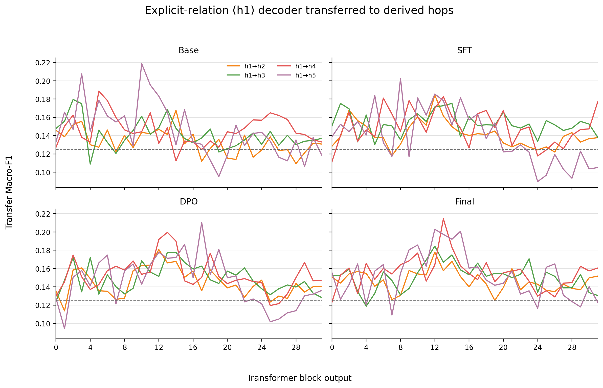

Final 相对 Base 的 derived transfer mean 增加约 0.0132，但 TransferGap 没有在各 hop 上统一缩小，且 within-hop 派生解码没有同步稳定增强。因此证据最多支持“后训练与弱共享线性结构的改变相关”，不能支持“共享符号几何已经建立”。

### 7.5 行为与可解码性的分离

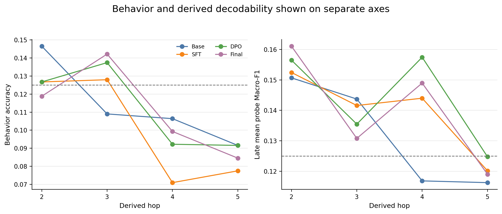

**图像分析。** 图的左右面板刻意采用不同尺度：行为准确率衡量模型答案，probe Macro-F1 衡量重新训练的线性读取器。后训练后 h1 probe 明显增强，但行为准确率仅小幅、非单调变化；派生 hop 在两类指标上都较弱。这种分离是反对因果过度解释的核心证据。

### 7.6 泛化控制

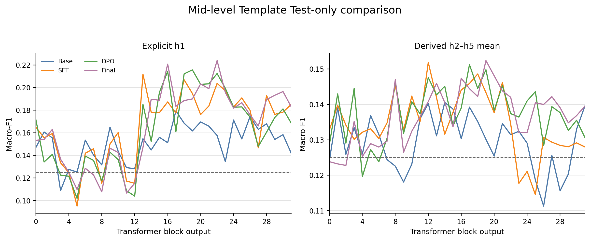

Template Test-only 的 h1 late mean 从 0.1609 增至 0.1923，derived mean 从 0.1282 增至 0.1411；但只适用于冻结的 Mid-level 模板家族，结论仍为 MIXED。

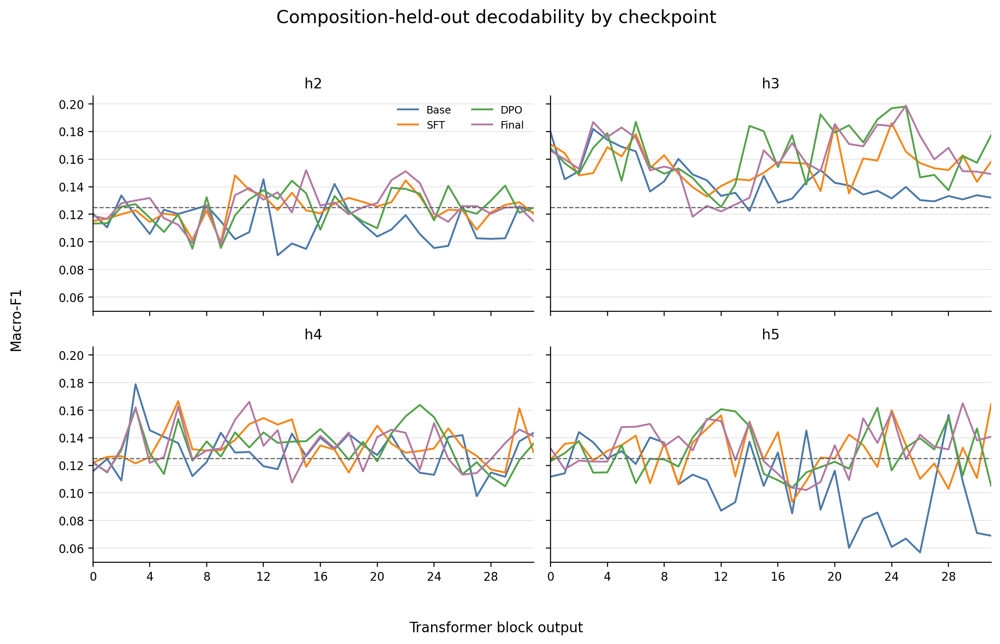

Composition-heldout 的 derived late mean 从 Base 0.1175 增至 Final 0.1398，但 h2–h5 并非一致提升。该结果说明部分未见组合上的线性读出数值发生变化，不足以支持普遍组合推理增强。

随机标签控制在四个 checkpoint 上均接近 0.125 chance，且 Macro-F1 比 matched normal-label probe 低超过 0.02，控制状态 PASS。

## 8. 综合分析

### 8.1 最稳健发现：显式关系读出增强

B1 显示 Base 已具有较强 h1 线性信号；B2 显示这一信号在 SFT 后进一步增强，并在 DPO、Final 中维持。该效应跨较宽晚层区域出现，不依赖单一峰值层，是当前最稳定的后训练相关变化。

### 8.2 派生关系没有形成统一训练轨迹

派生关系的三个指标给出一致的谨慎结论：

- 行为 derived mean 无单调提升；
- within-hop derived late mean 只有小幅混合变化；
- h1→derived transfer 有小幅数值上升，但 gap 与 hop 方向不一致。

如果后训练建立统一的多步符号机制，预期至少会看到派生行为、within-hop 和 transfer 在多数 hop 上方向一致地改善；当前证据不满足这一条件。

### 8.3 模板和分布敏感性不可忽略

Balanced 与 Template Test-only 会显著改变曲线幅度和排序，说明线性探针部分利用分布、模板和词汇线索。冻结无泄漏划分降低了直接泄漏风险，但不能把可线性读取性等同于抽象、因果或跨表达稳定的关系机制。

## 9. 结论

### 9.1 证据支持

- StepGame 的实际推理距离必须通过语义图独立计算，不能直接使用 `qaK`。
- Llama-3.1-8B Base 的 h1 显式关系在中后层具有明显线性可读性。
- h2–h5 派生关系较弱，且没有 hop 增加对应更晚层的单调规律。
- 模型行为弱于探针读出，尤其派生 hop 未建立稳健高于随机的行为能力。
- h1 与派生样本存在有限、较弱的共享线性结构。
- 后训练最稳定地增强 h1 显式关系的晚层线性读出，而不是稳定增强多步派生行为。

### 9.2 证据不支持

- 不支持把某层称为固定“推理层”；
- 不支持声称模型在统一符号空间中逐步组合关系；
- 不支持声称 Final/RLVR 已稳定提高 StepGame 多步行为；
- 不支持把 probe 改善解释为行为改善的原因；
- 不支持仅凭 transfer gap 接近零断言表示共享。

### 9.3 后续研究建议

在进入干预实验前，应优先人工复核 B2 配对区间和控制曲线，并把因果问题限定到当前最稳定的 h1 效应。可行方向包括：实体 token 与 question-end 的位置对照、层/方向干预、probe direction ablation、跨模板重述、以及在等 token 长度候选上的行为复核。任何新分析都应保持 B0 冻结 row IDs、split checksum 和 prompt 协议不变。

## 10. 局限性

- 线性探针无法检测非线性、瞬时或位于其他 token 位置的表示；
- question-end 只是一个读出位置，未覆盖生成过程中的全部状态；
- 32 层峰值存在多重比较和选择乐观性；
- Balanced test 每 hop 仅 88 条，区间较宽；
- 对角候选为双 token，主 summed score 对答案长度敏感；
- story-group bootstrap 处理重复故事结构，但不能消除数据生成机制中的全部依赖；
- Template Test-only 只保留指定模板家族，不代表任意新语言表达；
- 观察性 probe 与 checkpoint 比较不能单独建立因果机制。

## 11. 复现与验证材料

- B0 报告：`docs/stage-b/B0_*`
- B1 报告与验证：`docs/stage-b/B1_LLAMA31_BASE_RELATION_PROBE_REPORT.md`、`results/stage-b1/validation_pre_report.json`
- B1.5–B1.6：`docs/stage-b/B1_5_B1_6_BEHAVIOR_TRANSFER_REPORT.md`
- B2：`docs/stage-b/B2_BASE_TULU_STAGE_COMPARISON_REPORT.md`、`results/stage-b2/B2_final_validation.json`
- B2 逐图解释：`docs/stage-b/B2_FIGURE_GUIDE_ZH.md`
- 全仓库 SHA-256：`FILE_INVENTORY.csv`

## 参考文献

1. Alain, G., & Bengio, Y. (2016). *Understanding intermediate layers using linear classifier probes*. arXiv:1610.01644. https://arxiv.org/abs/1610.01644
2. Gurnee, W., & Tegmark, M. (2024). *Language Models Represent Space and Time*. ICLR 2024. https://proceedings.iclr.cc/paper_files/paper/2024/hash/0a6059857ae5c82ea9726ee9282a7145-Abstract-Conference.html
3. Shi, Z., Zhang, Q., & Lipani, A. (2022). *StepGame: A New Benchmark for Robust Multi-Hop Spatial Reasoning in Texts*. AAAI 36(10), 11321–11329. https://doi.org/10.1609/aaai.v36i10.21383
4. Li, F., Hogg, D. C., & Cohn, A. G. (2024). *Advancing Spatial Reasoning in Large Language Models: An In-Depth Evaluation and Enhancement Using the StepGame Benchmark*. arXiv:2401.03991. https://arxiv.org/abs/2401.03991
5. Grattafiori, A., et al. (2024). *The Llama 3 Herd of Models*. arXiv:2407.21783. https://arxiv.org/abs/2407.21783
6. Lambert, N., et al. (2024). *Tülu 3: Pushing Frontiers in Open Language Model Post-Training*. arXiv:2411.15124. https://arxiv.org/abs/2411.15124
