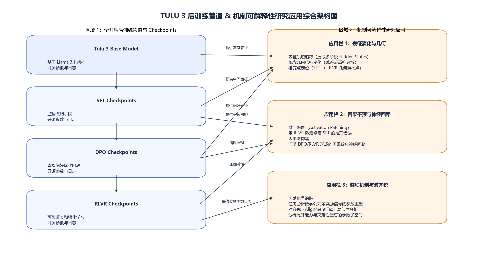

# MATH-500 pilot-20

本目录保存 Base、SFT、DPO 与 Final/RLVR 四阶段在同一组 20 道 MATH-500 题目上的行为层可行性实验，包括原始逐题审阅报告、人工复核 CSV、演示汇总表和 Tülu 架构说明图。

## 冻结设置

- 每阶段 20 道题、每题 1 次生成；
- greedy decoding，temperature = 0；
- max new tokens = 1024；
- 统一采用答案抽取后人工复核；
- 主要用途是验证模型加载、生成、答案抽取、人工复核和汇总流程能够端到端运行。

## 结果

| 阶段 | 人工复核后正确 | 准确率 |
|---|---:|---:|
| Base | 5/20 | 25% |
| SFT | 4/20 | 20% |
| DPO | 4/20 | 20% |
| Final/RLVR | 7/20 | 35% |

20 题样本不足以支持正式模型排名。Final/RLVR 相比 DPO 的 +15 个百分点只描述该 pilot 样本，不应外推为总体性能提升。

